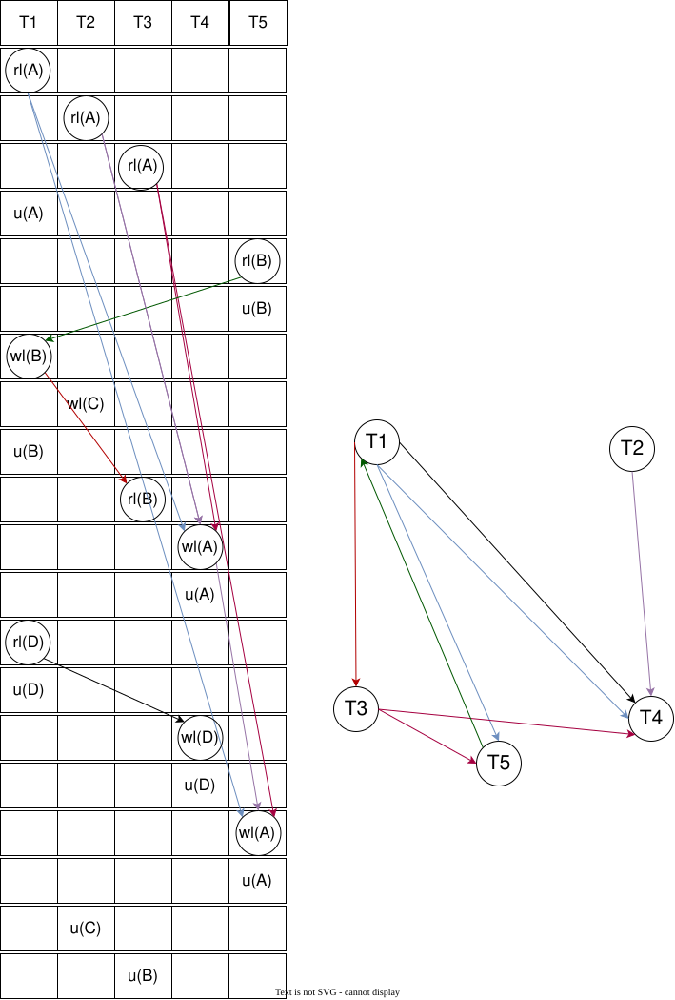

# Práctica concurrencia y recuperación

## Ejercicio 1.1

> Dada la siguiente historia (schedule) que es conflicto-serializable transformarla en una historia serial mediante una secuencia de intercambios no conflictivos de acciones adyacentes.

$H_1 = r_1(A);w_1(A);r_2(A);w_2(A);r_1(B);w_1(B);r_2(B);w_2(B)$

- Como es acíclico $\iff$ la historia es serializable.
- Obtengo un orden topológico del grafo para obtener un posible orden de las transacciones en una historial serial.
- La historia serial equivalente ejecuta primero todas las operaciones de $T_1$ y luego las de $T_2$.

$H_1 \equiv H_S = r_1(A);w_1(A);r_1(B);w_1(B);r_2(A);w_2(A);r_2(B);w_2(B)$

## Repaso teorico

### **Lectura entre transacciones**

Dadas dos transacciones $T_i$ y $T_j$ decimos que $T_i$ lee $X$ de $T_j$ si $T_i$ lee $X$ y $T_j$ fue la última transacción que escribió $X$ y no abortó antes de que $T_i$ lo leyera. i.e.

$$\begin{cases} w_j(X) < r_i(X) \iff T_j  ~escribió~antes~el~elemento~que~lee~T_i \\ a_j \nless r_i(X) \iff T_j~no~abortó \\ (Si~existe~ w_k(X) / w_j(X) \lt w_k(X) \lt r_i(X) \implies a_k \lt r_i(X)) \iff T_j ~es~la~última ~que~escribió~ X ~y~no~abortó \end{cases}$$

### Clasificación de las historias

**Definiciones:**

- *Historia recuperable* (**RC**): Si toda transacción $T_i$ que leyó de $T_j$ y commiteó, entonces $T_j$ commiteó antes. Es decir **solo commitea después de que todas de las que leyó lo hicieron**.
- *Historia avoid cascading abort* (**ACA**): Siempre que una transacción $T_i$ lee de $T_j$, $T_j$ commiteó antes de la lectura. Es decir **solo leo de las que ya commitearon**.
- *Historia strict* (**ST**): Una transacción **solo puede leer o escribir un item si la última que lo escribió ya commiteó o abortó**.

### Schedules rigurosos (**RG**)

Un *schedule* $S$ es riguroso $\iff$ es **ST** y al momento de cada escritura de un item todos sus lectores previos a ella (de otras transacciones) ya abortaron o commitearon.

**Propiedades**:
    - RG $\subset$ SR.
    - RG $\subset$ ST $\subset$ ACA $\subset$ RC.

### **Teorema de la recuperabilidad:**

ST $\subset$ ACA $\subset$ RC

### **Definición de serializabilidad (*SR*)**

Una historia es *serializable* si es conflicto equivalente a una historia serial.

### Anomalías

#### *Dirty reads*

Ocurre cuando se le permite a una transacción leer un item de que ha sido modificado por una transacción que aún no ha sido commiteada.

Patrón: $w_1(X);\dots;r_2(X);\dots;(c_1 or a_1)$ [1]

>[!IMPORTANT]
> **Consultar**: El hecho de leer de una que aún no ha sido commiteada es *dirty read*, aunque si ella aborte la que leyó también lo haga ¿sigue siendo *dirty read*?

#### *Lost updates*

Lost Update: Ocurre cuando una transacción $T_1$ lee un item y luego $T_2$ lo escribe (posiblemente basado en una lectura previa), luego $T_1$, basado en su valor leído actualiza el item y commitea. [1]

Patrón: $r_1(x);\dots;w_2(x);\dots;w_1(x);\dots;c_1$ (Lost Update) [1]

>[!IMPORTANT]
>**Consultar**: ¿Es la única forma en que puede ocurrir *lost update*?¿*dirty write* ($w_1(X);\dots;w_2(X)$) es considerado *lost update*? ¿En el patrón da igual si $T_2$ commiteó o no?

#### *Phantom reads*

Distintas lecturas de un item en una transacción dan resultados distintos porque entre lecturas fue modificado por otra transacción.

### Control de concurrencia

### Esquema lock binario

- $l_i(A)$: Transacción $i$ realiza *lock* sobre item $A$.
- $u_i(A)$: Transacción $i$ libera *lock* sobre item $A$.

#### Historias legales

- $T_i$ solo puede leer o escribir item $A$ si antes realizó *lock* sobre $A$ y aún no lo liberó.
- Si $T_i$ realiza *lock* sobre un elemento debe liberarlo posteriormente.
- Si $T_i$ desea obtener *lock* sobre elemento lockeado por otra $T_j$, debe esperar a que esta lo libere.

#### Grafo precedencia lock binario

- Un nodo por cada $T_i$ de $H$ historia legal.
- $T_i \xrightarrow{A} T_j$ si $T_i$ realiza $l_i(A)$ y luego $T_j$ realiza $l_j(A)$.

$H$ es **SR** $\iff$ grafo de precedencia no tiene ciclos.

Órdenes topológicos del grafo de precedencia dan orden de *historia serial equivalente*

>[!NOTE]
>¿Cómo obtener ordenes topológicos?: Buscás el nodo sin aristas de entrada, lo sacás con todas sus aristas salientes y lo ponés en una lista. Repetís el proceso hasta que no te queden nodos y lo tenés.

>[!IMPORTANT]
> **CONSULTAR**: Si hay ciclo no es serializable?

### Esquema lock ternario

Como las <ins>lecturas de un mismo item por parte de múltiples transacciones no generan conflictos</ins>, incorporamos mecanismo para permitirlas.

- $rl_i(A)$: Lock de lectura compartido.
- $wl_i(A)$: Lock de escritura exclusivo.

| $T_i$ solicita | $T_j$ tiene (rl) | $T_j$ tiene (wl) |
| :------------: | :--------------: | :--------------: |
| **rl**         | ✅ Se lo damos   | ❌ Denegado      |
| **wl**         | ❌ Denegado      | ❌ Denegado      |

*Solo permitimos varios locks de lectura $rl$ en simultáneo*.

#### Historias legales

**Requisitos de consistencia**:

- Todo $r_i(X)$ debe ser precedido por $rl_i(X)$ sin $u_i(X)$ intermedio. *No podés leer sin el lock de lectura sobre ese item*.
- Todo $w_i(X)$ debe ser precedido por $wl_i(X)$ sin $u_i(X)$ intermedio. *No podés escribir sin el lock de escritura sobre ese item*.
- Todos los locks deben ser seguidos por un unlock del mismo elemento. *En algún momento lo tenés que liberar*.

**Requisitos de legalidad**:

- Si $wl_i(X)$ aparece en una historia, entonces no puede haber luego un $wl_j(X)$ o $rl_j(X)$ para $j \neq i$ sin que haya primero un $u_i(X)$. *Si solicitaste lock de escritura sobre un item nadie lo puede leer ni escribir hasta que lo liberes*.

- Si $rl_i(X)$ aparece en una historia, entonces no puede haber luego un $wl_ij(X)$ para $j \neq i$ sin que haya primero un $u_i(X)$. *Si alguien tiene el lock de lectura sobre un item, no podés recibir el de escritura sobre el mismo hasta que esa lo libere*.

#### Grafo precedencia

- Nodo por cada $T_i$.
- Si $T_i$ hace un $rl_i(X)$ o $wl_i(X)$ y luego $T_j$, con $i \neq j$ hace un $wl_j(X)$ en $H$, ponés $T_i \xrightarrow T_j$. *Si pediste lock (lectura o escritura) sobre item y otra lo escribe después, entonces ponés arista*.
- Si $T_i$ hace un $wl_i(X)$ y luego $T_j$, con $i \neq j$ hace un $rl_j(X)$ en $H$, ponés $T_i \xrightarrow T_j$. *Si escribiste un item y otra lo quiere leer, ponés arista*.

>[!IMPORTANT]
> **CONSULTAR**: Si hay ciclo no es serializable?

#### *Lock upgrading/downgrading*

- **Upgrading lock**: Pasar de lock de lectura compartido a uno exclusivo de escritura.
- **Downgrading lock**: Pasar de lock de escritura exclusivo a uno de lectura compartido.

**Problema**: Solo concedemos la actualización si es la única transacción con ese lock sobre el item. En el caso *downgrading* sabemos que es el único que lo posee por ser exclusivo, pero en *upgrading* no, ya que varios pueden tener compartido el de lectura y ninguna puede hacer el *upgrading* hasta que las demás lo liberen.

#### *Update locking*

Para solucionar el problema del *deadlock por upgrading* agregamos el ***update lock***, $ul_i(X)$ que da privilegio de lectura pero no de escritura, con la ventaja de ser el único que puede solicitar *upgrading* a *write lock*.

| $T_i$ solicita | $T_j$ tiene (rl) | $T_j$ tiene (wl) | $T_j$ tiene (ul) |
| :------------: | :--------------: | :--------------: | :--------------: |
| **rl**         | ✅ Se lo damos   | ❌ Denegado      | ❌ Denegado      |
| **wl**         | ❌ Denegado      | ❌ Denegado      | ❌ Denegado      |
| **ul**         | ✅ Se lo damos   | ❌ Denegado      | ❌ Denegado      |

*Solo le concedemos el $ul(X)$ si nadie lo tiene y nadie tiene $wl(X)$*.

>[!NOTE]
> Una transacción con un *shared lock* pero sin un *update lock* no puede recibir un *write lock*, incluso aunque en general no prohibimos que una transacción tenga múltiples locks sobre un elemento, por ejemplo de lectura y escritura en simultáneo. [2](pag. 945)

- Si ya hay transacciones que tienen un *read lock* sobre el ítem y otra nos solicita un *upgrade lock* sobre el mismo ítem → se lo concedemos.
- Una vez concedimos a una transacción un *update lock* sobre un ítem, ya no concedemos más locks de ningún tipo sobre ese ítem a cualquier transacción que nos lo solicite hasta que el que tiene el *update lock* lo libere.
  - ¿Por qué? Porque la idea es que, aunque debamos denegarle el *upgrading* a escritura sobre el ítem a la transacción que tiene el *update lock* porque otras tienen un *read lock* sobre el mismo ítem, eventualmente estas terminarán y podremos permitir que el poseedor de *upgrade lock* promocione a *write lock* y pueda escribir. Si siguiéramos otorgando *read locks* a otras transacciones podríamos generar *starvation* sobre la transacción con el *update lock*.

>[!IMPORTANT]
> En el *update lock* pueden varios tener locks de lectura no upgradeables a lock de lectura y uno solo tener el upgradeable no? En dicho caso, los que tienen locks de lectura compartidos no upgradeables qué pasa cuando el que tiene el upgradeable quiere convertirlo en lock de escritura? lo liberan automaticamente o el upgradeable debe esperar a que lo hagan ellos manualmente? La matriz permite que si tenes uno de lectura y solicitan el de ul lo reciba por lo que acabarían conviviendo los de lectura con los ul?

>[!IMPORTANT]
> *Locking* por si solo no garantiza <ins>serializabilidad</ins>, se necesitan protocolos para posicionar lock y unlocks.

### Protocolos de *locking*

#### 2PL (*two phase locking*)

Transacción es 2PL $\iff$ todos los *locks* preceden a la primer operación de *unlock*.

El dos fases viene de: fase de adquisición de locks (*growing phase*) y fase de liberación (*shrinking phase*).

**Teorema serializabilidad con 2PL**
Si todas las transacciones son 2PL, entonces toda historia legal sobre ellas es **SR**, incluso Gen(2PL) $\subset$ OCSR.

#### C2PL (*conservative two phase locking*)

Transacción es C2PL $\iff$ adquiere todos los locks que necesitará al inicio, es decir antes de su primer escritura o lectura.

#### 2PLE o S2PL (*strict two phase locking*)

Transacción es 2PLE $\iff$ es 2PL y no libera ninguno de sus locks de escritura hasta después de realizar commit o abort.

2PLE garantiza que historia es **ST**.

>[!IMPORTANT]
> 2PLE garantiza que historia es **ST**: ¿significa que toda historia compuesta por transacciones 2PLE es ST?

>[!IMPORTANT]
> Necesariamente debe liberarlos después que los de lectura?

#### 2PLR o SS2PL (*rigurous two phase locking*)

Transacción es 2PLR $\iff$ es 2PL y no libera ninguno de sus locks de escritura o lectura hasta después del commit o abort.

### Deadlocks

*Estado en el cual cada miembro de un grupo de transacciones está esperando que algún otro miembro libere un lock*.

#### Detección de *deadlocks*: Wait-for graph

- Un nodo por cada transacción que tiene un *lock* o espera por uno.
- Una arista entre $T_i$ y $T_j$ si $T_i$ está esperando que $T_j$ libere un lock sobre un item que $T_i$ necesita bloquear. *Arrancás desde final de $H$ y ponés arista si hay un lock previo sobre mismo item*.

Ciclos $\iff$ hay deadlock.

#### Prevención de *deadlocks*

##### Timestamping

Cada transacción $T_i$ tiene un timestamp $TS(T_i)$ es un identificador único basado en orden en el que cada transacción comienza.

**Estrategias**:
Si $T_i$ quiere realizar un lock sobre un item y no puede porque $T_j$ ya tiene un lock previo sobre él, entonces:

- ***Wait-die***:
  - Si $T_i$ es más viejo que $T_j \xrightarrow T_i$ espera.
  - Si $T_i$ es más joven que $T_j \xrightarrow T_i$ aborta y reinicia más tarde con mismo timestamp.
- ***Wound-wait***:
  - Si $T_i$ es más viejo que $T_j \xrightarrow T_j$ aborta y reinicia más tarde con el mismo timestamp.
  - Si $T_i$ más joven que $T_j \xrightarrow T_i$ espera.

>[!NOTE]
> $TS(T_i) \lt TS(T_j) \iff$ $T_i$ es más viejo que $T_j$.

##### Otros esquemas

- Timeout.
- No waiting (NW).
- Cautious waiting (CW).

## Ejercicio 1.2

> Dadas las siguientes historias (schedules):

### (a) Indicar para cada una si es NoRC, RC, ACA o ST.

Dado que si es **RC** será tanto **ACA** como **ST** conviene primero chequear si es **RC**.

$H_1 = r_1(X);r_4(Y);w_1(X);w_4(X);r_3(X);c_1;w_4(Y);w_3(Y);w_4(Z);c_4;w_3(X);c_3$

- Es **RC** $\iff$ todos commitean luego de aquellos de los que leen.
  - Hay solo 3 lecturas. Primero analizo esas.
    - $r_1(X)$ y $r_4(X)$ no imponen restricciones.
    - $r_3(X)$ significa que $T_3$ lee de $T_4$, por lo que $c_4 \lt c_3$. Lo cual se cumple.
- Es **ACA** $\iff$ nadie lee de una que no haya sido commiteada.
  - No lo es ya que: $w_4(X);r_3(X)$. Por lo tanto no es **ACA** y tampoco podrá ser **ST** pues **ST** $\subset$ **ACA** $\subset$ **RC**.

$H_2=r_1(X);w_2(X);r_1(Y);w_1(X);w_1(Y);c_1;r_2(Z);w_2(Y); c_2$

- Es **RC** $\iff$ todos commitean luego de aquellos de los cuales leen.
  - Hay 3 lecturas. Primero analizo esas.
    - $r_1(X)$, $r_1(Y)$ y $r_2(Z)$ no imponen restricciones porque nadie escribió antes esos items en $H_2$.
  - Como nadie lee de nadie, es **RC** vacuamente ✔.

- Es **ACA** $\iff$ todos leen solo de commiteadas.
  - Como nadie lee de nadie, es **ACA** vacuamente también ✔.

- Es **ST** $\iff$ nadie lee ni escribe item si la última que lo escribió no commiteó o abortó. 
  - No vale, pues en $H_2$ tenemos $w_2(X);r_1(Y);w_1(X)$.
  - $\therefore$ no es **ST**.

$H_3=w_1(X);w_2(X);w_2(Y);c_2;w_1(Y);c_1;w_3(X);w_3(Y);c_3$

- Es **RC** $\iff$ todos commitean después de que lo hacen aquellas de las cuales leyeron.
  - Como no hay lecturas nadie lee de nadie y se cumple vacuamente ✔.
- Es **ACA** $\iff$ todos leen de transacciones ya commiteadas.
  - Como no hay lecturas nadie lee de nadie y se cumple vacuamente ✔.
- Es **ST** $\iff$ Nadie lee ni escribe un item hasta que la última que lo escribió haya hecho commit u abortado.
  - No se cumple, $w_1(X);w_2(X)$.
  - $\therefore$ no es **ST**.

$H_4=w_2(X);r_1(X);r_2(Z);r_1(Y);w_2(Y);w_1(Y);c_2;w_1(X);c_1$

- Es **RC** $\iff$ nadie commitea hasta que lo hacen todas aquellas de las cuales leyó.
  - $w_2(X);\dots;r_1(X)$ dice que $T_1$ lee de $T_2$, por lo tanto debería valer que $c_2 < c_1$ lo cual se cumple.
  - El resto de las lecturas son sobre items no escritos en $H_4$ por lo que no imponen restricciones.
  - $\therefore$ es **RC**.
- Es **ACA** $\iff$ nadie lee de alguien que no haya aún commiteado al momento de la lectura.
  - No cumple porque $w_2(X);r_1(X)$ indica que $T_1$ lee de $T_2$ sin que haya commiteado.
  - $\therefore$ No es **ACA** y por lo tanto tampoco es **ST**, pues ST $\subset$ ACA $\subset$ RC.

$H_5=r_1(X);r_4(Y);r_3(X);w_1(X);w_4(Y);w_3(X);c_1;w_3(Y); w_4(Z);c_3;w_4(X);c_4$

- Es **RC** $\iff$ nadie commitea antes que las transacciones de las cuales lee.
  - Nadie lee de nadie porque no tenemos escrituras previas de los items que son leídos en $H_5$. Por lo tanto es **RC** vacuamente.
- Es **ACA** $\iff$ todos leen solo de transacciones ya commiteadas al momento de la lectura.
  - También vale vacuamente porque nadie lee de nadie. Por lo tanto es **ACA**.
- Es **ST** $\iff$ nadie escribe y lee un item hasta que la última que lo escribió haya commiteado o abortado.
  - No se cumple pues en $w_1(X);w_4(Y);w_3(X)$ $T_3$ escribe $X$ y aún no había ni commiteado ni abortado $T_1$, por lo que es una transacción activa.
  - $\therefore$ No es **ST**.

### (b) Indicar cuáles podrían producir un *dirty read* o un *lost update*

**Dirty reads**:

- Si es **ACA** no habrán *dirty reads* porque solo permitimos leer de transacciones ya commiteadas.
- Como **ST** $\subset$ **ACA**, entonces *strict* tampoco las permite.
- Los que son solamente **RC** permiten leer de un item modificado por una transacción, siempre y cuando hagamos commit luego de ella. $\therefore$ No evitan *dirty reads*.
- Los que son **NoRC** también los permiten.
- $\therefore H_1$ y $H_4$ son las únicas que son solo **RC** y no hay ninguna **NoRC**. Así que son las únicas que permiten *dirty reads*.

**Lost updates** (CONSULTARLO):

- Si permito leer de una que aún no commiteó, entonces pueden ocurrir *lost updates* si se opera de forma *interleaved* con esa transacción. Por lo tanto si es **RC** y no **ACA** o si es **NoRC**, debo chequear eso.
- Si es **ACA** no habrán *lost updates*, ya que solo leo de transacciones que ya commitearon.
- En $H_1$ hay *lost update* en $w_1(X);w_4(X)$ y $r_4(Y);\dots;w_4(Y);w_3(Y)$.
- En $H_2$ hay *lost update* $r_1(X);w_2(X);r_1(Y);w_1(X)$ porque se pierde lo que haya escrito en $X$ $T_2$.
- En $H_3$ también porque en $w_1(X);w_2(X)$ se pisa el valor que escribió $T_1$.
- En $H_4$ también en $w_2(Y);w_1(Y)$ y en $w_2(X);\dots;w_1(X)$.
- En $H_5$ también en $w_1(X);w_4(Y);w_3(X);c_1;w_3(Y)$ tenés dos.

## Ejercicio 1.3

> Clasificar según recuperabilidad las siguientes historias:

$H_1=r_1(X);r_2(Z);r_1(Z);r_3(X);r_3(Y);w_1(X);c_1;w_3(Y);c_3;r_2(Y);w_2(Z);w_2(Y);c_2$

- Es **RC** $\iff$ todas las transacciones solo commitean después de aquellas de las cuales leen.
  - El único read que impone restricciones por ser sobre un item escrito por otra transacción de la historia es $r_2(Y)$, el cual lee de $T_3$ y commitea después que ella. $\therefore$ es **RC**.
- Es **ACA** $\iff$ solo tiene lecturas de transacciones ya commiteadas.
  - La única lectura que impone restricciones es $r_3(Y)$ que lee de $T_3$ pero comitteó justo antes. $\therefore$ es **ACA**.
- Es **ST** $\iff$ toda escritura o lectura sobre un item se hace luego de que la que lo escribió haya commiteado o abortado.
  - $r_2(Y)$ que lee de $T_3$ que había commiteado justo antes.
  - $w_2(Y)$ escribe el mismo item que antes había escrito $T_3$ con $w_3(Y)$, pero lo hace después del commit de $T_3$.
  - $\therefore$ es **ST**.
- Es *schedule riguroso RG* $\iff$ es **ST** y al momento de cada escritura de un item todos sus lectores (de otras transacciones) ya abortaron o commitearon.
  - No porque $T_3$ lee $X$ y no commiteó ni abortó al momento de que $T_1$ lo intenta escribir. $\therefore$ no es **RG**.

$H_2=r_1(X);r_2(Z);r_1(Z);r_3(X);r_3(Y);w_1(X);w_3(Y);r_2(Y);w_2(Z);w_2(Y);c_1;c_2;c_3$

- Es **RC** $\iff$ todas las transacciones commitean luego de aquellas de las cuales leen.
  - Por $w_3(Y);r_2(Y)$, $T_2$ lee de $T_3$, pero $c_3 > c_2$, por lo que $T_2$ lee de $T_3$ y commitea antes. $\therefore$ no es **RC**. Luego como RG $\subset$ ST $\subset$ ACA $\subset$ RC, no cae en ninguna de esas categorías y es **NoRC**.

$H_3=r_1(X);r_2(Z);r_3(X);r_1(Z);r_2(Y);r_3(Y);w_1(X);c_1;w_2(Z);w_3(Y);w_2(Y);c_3;c_2$

- Es **RC** $\iff$ todas las transacciones commitean después de aquellas de las cuales leen.
  - Nadie lee de nadie porque todas las lecturas están antes que todas las escrituras. $\therefore$ es **RC** y también **ACA**, ya que vacuamente todos solo leen de transacciones commiteadas.
- Es **ST** $\iff$ todas las lecturas o escrituras de un item se hacen ya cuando la transacciones que escribieron su último valor están commiteadas o abortadas.
  - No se cumple por $w_3(Y);w_2(Y)$. $\therefore$ no es **ST** ni **RG**, ya que **RG** $\subset$ **ST**.

## Ejercicio 1.4

> Dadas las siguientes transacciones:
> $T_1 = w_1(B);r_1(C);w_1(C);$
> $T_2 = r_2(D);r_2(B);w_2(C);$

### Dar una historia $H_1$ que no sea **RC**

- Para que no sea **RC** debemos permitir que una transacción lea de otra pero commitee antes que ella.
- Podríamos usar que $T_1$ lea de $T_2$ con $w_2(C);\dots;r_1(C);\dots;c_1;\dots;c_2$ o que $T_2$ lea de $T_1$ con $w_1(B);\dots;r_2(B);\dots;c_2;\dots;c_1$.

Opción 1:

$r_2(D);r_2(B);w_2(C);w_1(B);r_1(C);w_1(C);c_1;c_2$

Opción 2:

$w_1(B);r_1(C);w_1(C);r_2(D);r_2(B);w_2(C);c_2;c_1$.

### Dar una historia $H_2$ que sea **ACA** pero no **ST**

- Para que sea **ACA** pero no **ST** debo leer solo de ya commiteadas y no (leer o escribir items tales que la última transacción que la escribió ya commiteó o abortó).
- La única combinación posible es leer solo de ya commiteadas, pero escribir items tales que la última que lo escribió aún no commiteó ni abortó.
- ¿Cómo podría romper **ST** con escrituras? $w_2(C);(no~c_2);w_1(C)$.
- Planteo eso y voy rellenando huecos:

$H=r_2(D);r_2(B);w_2(C);w_1(B);w_1(C);c_2;r_1(C);c_1$

Alternativa:

$H=r_2(D);r_2(B);w_1(B);w_2(C);c_2;r_1(C);w_1(C);c_1$

### Dar una historia $H_3$ que sea **ST**

- $H=T_1;c_1:T_2;c_2$ cumple por ser serial.

## Ejercicio 2.1

> Dada las siguientes transacciones escritas como Read/Write:
>
> $T_1 = r_1(A);w_1(A);r_1(A);w_1(B) \\ T_2 = r_2(A);w_2(A);r_2(B);w_2(B)$
>
> **Nota:**  Si bien ambas parecen iguales en realidad pueden realizar operaciones diferentes sobre los ítems leídos.

### (a) Incorporar locks para que llevarlas a un modelo con locking binario

- Encerramos cada lectura $r_i(X)$ con $l_i(X);r_i(X);ul_i(X)$.
- Encerramos cada escritura $w_i(X)$ con $l_i(X);w_i(X);ul_i(X)$.

$T_1 = l_1(A);r_1(A);ul_1(A);l_1(A);w_1(A);ul_1(A);l_1(A);r_1(A);ul_1(A);l_1(B);w_1(B);ul_1(B). \\ T_2 = l_2(A);r_2(A);ul_2(A);l_2(A);w_2(A);ul_2(A);l_2(B);r_2(B);ul_2(B);l_2(B);w_2(B);ul_2(B)$.

### (b) Realizar una historia legal pero no serializable

- Para que sea no serializable quiero que su grafo de precedencia tenga un ciclo.
- En su grafo de precedencia tenemos arista de $T_i$ a $T_j$ si $T_i$ realiza $l_i(A)$ y luego $T_j$ realiza $l_j(A)$.
- Para la arista de $T_1 \xrightarrow{A} T_2$ ubico primero $r_1(A);w_1(A)$ y luego $r_2(A);w_2(A)$.
- Para la arista  $T_2 \xrightarrow{B} T_1$ ubico primero $r_2(B);w_2(B)$ y luego $r_1(B);w_1(B)$.

$H=l_1(A);r_1(A);w_1(A);ul_1(A);l_2(A);r_2(A);w_2(A);ul_2(A);l_2(B);r_2(B);w_2(B);ul_2(B);l_1(B);r_1(B);w_1(B);ul_1(B)$

$H$ es una historia legal, pero no serializable.

## Ejercicio 2.2

> Dadas las siguientes transacciones que deben ser ejecutadas en forma concurrente, indicar una historia legal en el cual se produzca un dirty read:
>
> $T_1 = l_1(A);A = A + 2;l_1(B);B = A + 5;u_1(B);u_1(A);l_1(C);C = 2 ∗ C;u_1(C) \\ T_2 = l_2(A);A = A + 1;l_2(E);E = A + 8;l_2(D);u_2(E);D = D/5; u_2(A);u_2(D)$

- **Dirty read** es si lees de una transacción que aún no commiteó.
- La unica variable que escriben ambos es $A$ y ambas inician con esa escritura, por lo que $T_1$ y $T_2$ nos quedan divididas por ella.

$T_1' =l_1(A);A = A + 2;l_1(B);B = A + 5;u_1(B);u_1(A);$
$T_1''=l_1(C);C = 2 ∗ C;u_1(C)$
$T_2' =l_2(A);A = A + 1;l_2(E);E = A + 8;l_2(D);u_2(E);D = D/5; u_2(A)$
$T_2''=u_2(D)$

Cualquier ejecución de $T_1';T_2'$ o $T_2';T_1'$ va a hacer que una utilice el valor modificado por la otra en lugar del original de $A$ que hubiera utilizado si no se ejecutaran concurrentemente.

Las siguientes serían algunas de la posibles:

$H=T_1';T_2';T_1'';T_2''$
$H=T_1';T_2';T_2'';T_1''$
$H=T_2';T_1';T_2'';T_1''$
$H=T_2';T_1';T_1'';T_2''$

## Ejercicio 2.3

> Considerando la siguiente historia con el modelo introductorio de LOCK/UNLOCK
>
> 

### (a) Determinar si es serializable

- Para chequear si es serializable armamos el grafo de precedencia acorde al modelo, en este caso es el de *lock binario* y vemos si tiene ciclos, en dicho caso será no serializable, caso contrario será serializable.
- Un nodo por cada transacción.
- Una arista $T_i \xrightarrow{X} T_j$ si $T_j$ tiene un lock sobre $X$ luego del de $T_i$.

Es acíclico $\therefore$ es serializable.

### (b) En caso afirmativo, proponer un *schedule* serial equivalente

Para obtener un *schedule* serial equivalente computo su orden topológico.

$H_S=T_1;T_4;T_2;T_3$ sería uno de los posibles.
$H_S=T_4;T_1;T_2;T_3$ sería otro.

## Ejercicio 2.4

> Dadas las transacciones del [ejercicio 2.1](#ejercicio-21) llevarlas a un modelo de *locking binario* tal que ambas sean 2PL.
>
> $T_1 = r_1(A);w_1(A);r_1(B);w_1(B) \\ T_2 = r_2(A);w_2(A);r_2(B);w_2(B)$

- Para que ambas sean **2PL** deben cumplir que adquieran todos sus locks antes del primer unlock.
- Versión 2PL de $T_1=l_1(A);r_1(A);w_1(A);l_1(B);r_1(B);w_1(B);ul_1(A);ul_1(B)$.
- Versión 2PL de $T_2=l_2(A);r_2(A);w_2(A);l_2(B);r_2(B);w_2(B);ul_2(A);ul_2(B)$.
- Ahora dado que ambas son **2PL**, toda historia legal sobre ellas es **SR**, por lo tanto serializable.

## Ejercicio 2.5

> Dadas las siguientes transacciones:
>
> $T_1=l_1(A);l_1(B);u_1(A);u_1(B); \\ T_2=l_2(B);l_2(A);u_2(B);u_2(A);$

### (a) Responder: ¿Cumplen las transacciones $T_1$ y $T_2$ con 2PL?

Sí, las transacciones $T_1$ y $T_2$ cumplen con 2PL porque adquieren todos sus locks antes de liberar el primer lock.

### (b) Realizar un entrelazado tal que se produzca un *deadlock*

- $l_1(A);l_2(B);$ ya te genera un *deadlock* porque $T_1$ tiene el lock sobre $A$ pero no puede continuar sin adquirir el lock sobre $B$ y al mismo tiempo $T_2$, que tiene el lock sobre $B$, no puede continuar sin adquirir el de $A$. Así que ninguno llega avanzar.
- Completamos el *schedule* para formar una historia, de las varias posibles.

$H=l_1(A);l_2(B);l_1(B);l_2(A);u_1(A);u_1(B);u_2(B);u_2(A)$

>[!NOTE]
> Notar que dadas transacciones 2PL, podemos tener una historia que no lo sea.

## Ejercicio 3.1

> Dadas las siguientes transacciones $T_1$ y $T_2: \\$
> $T_1=wl_1(A);A = A + 1;wl_1(B);B = A + B;u_1(A);u_1(B) \\ T_2=rl_2(A);wl_2(C);C = A + 1;wl_2(D);D = 1;u_2(A);u_2(D);u_2(C)$.

### (a) Construir un *schedule* legal serializable que no sea serial

- Estamos en *locking ternario*.
- Para construir un *schedule* legal serializable que no sea serial debemos encontrar un intercalamiento de $T_1$ y $T_2$ tal que su *grafo de precedencia* sea *acíclico*.
- En el *grafo de precedencia* del modelo *locking ternario* tenemos:
  - Un nodo por cada transacción.
  - Una arista de $T_i \xrightarrow{X} T_j$ piden lock sobre mismo item y al menos una de ellas es un *write lock*.
  - $T_1$ pide lock sobre $A$ y $B$.
  - $T_2$ pide lock sobre $A, C$ y $D$.
  - El único item que me genera una arista entre las transacciones es $A$. Pero como me genera una sola arista, ningún intercalamiento que sea un *schedule* legal me generará un ciclo, por lo que son serializables.
  - Propongo $H=wl_1(A);A = A + 1;wl_1(B);B = A + B;u_1(A);rl_2(A);wl_2(C);C = A + 1;wl_2(D);D = 1;u_2(A);u_2(D);u_2(C);u_1(B)$, que sería ejecutar $T_1$ hasta que libera el lock sobre $A$, luego ejecutar $T_2$ y finalmente liberar el lock de $T_1$ sobre $B$.

### (b) Responder: ¿Cumplen las transacciones $T_1$ y $T_2$ con 2PL?

- $T_1$ sí cumple con 2PL, pues adquiere todos sus locks antes de liberar el primero.
- $T_2$ también.

## Ejercicio 3.2

> Dadas las transacciones $T_1$ , $T_2$ , $T_3$ y $T_4$ con el siguiente entrelazado:
> 

### (a) Determinar si es serializable y, en caso afirmativo, proponer las correspondientes historias seriales equivalentes

- De nuevo, estamos en esquema *locking ternario*.
- Construimos el grafo de precedencia y vemos si es acícliclo, en dicho caso es una historia serializable (**SR**).
  - Ponemos un nodo por cada transacción.
  - Una arista de $T_i \xrightarrow{X} T_j$ si ambas lockean el mismo recurso y al menos una de ellas es un *write lock*, vemos la historia en orden ascendente temporalmente.

Es acíclico, por lo tanto la historia es serializable. Obtengo una historia serial equivalente a partir de un orden topológico del grafo:

- $T_2$ es el único sin aristas de entrada, lo saco y lo pongo primero en el orden.
- Al eliminar $T_2$ el único que queda sin aristas de entrada es $T_3$. Lo saco y añado al orden.
- Al eliminar $T_3$ el único que queda sin aristas de entrada es $T_1$, lo saco y añado al orden.
- Saco y añado al orden a $T_4$.

Orden topológico: $T_2, T_3, T_1, T_4 \therefore H \equiv H_s = T_2;T_3;T_1;T_4$.

## Ejercicio 3.3

> Dadas las transacciones $T_1$, $T_2$, $T_3$, $T_4$ y $T_5$ con el siguiente entrelazado:
>
> $H_1 : rl_1(A);rl_2(A);rl_3(A);u_1(A);rl_5(B);u_5(B);wl_1(B);wl_2(C);u_1(B);rl_3(B);u_3(A);u_2(A);wl_4(A);u_4(A);rl_1(D);u_1(D);wl_4(D);u_4(D);wl_5(A);u_5(A);u_2(C);u_3(B)$

### (a) Dibujar el entrelazado en forma tabular

### (b) Determinar si es serializable y, en caso afirmativo, proponer las correspondientes historias seriales equivalentes

No es serializable, pues en el *grafo de precedencia* contiene un ciclo. $rl_1(A);\dots;wl_5(A)$ genera una arista de $T_1$ a $T_5$, y $rl_5(B);\dots;wl_1(B)$ genera una de $T_5$ a $T_1$.

### (c) Para cada transacción indicar si cumple con ser 2PL. Si no lo son modificarlas para que lo sean

Una transacción es 2PL $\iff$ solicita todos sus *locks* antes de liberar el primero.

- $T_1$ ❌, Versión 2PL: $T_1=rl_1(A);wl_1(B);rl_1(D);u_1(A);u_1(B);u_1(D)$.
- $T_2$ ✅.
- $T_3$ ✅.
- $T_4$ ❌, Versión 2PL: $T_4=wl_2(A);wl_4(D);u_4(A);u_4(D)$.
- $T_5$ ❌, Versión 2PL: $T_5=rl_5(B);wl_5(A);u_5(B);u_5(A)$.

>[!IMPORTANT]
> ¿Ni siquiera es legal no? porque $T_2$ y $T_1$ mantienen su $rl(A)$ al momento de que $T_4$ escribe.

### (d) Sobre el ítem anterior ubicar commits para que sean 2PL estricto y 2PL riguroso

Una transacción es *2PL estricta* (**2PLE**) $\iff$ es <ins>**2PL**</ins> y <ins>no libera</ins> ninguno de sus <ins>*locks de escritura* hasta</ins> realizar <ins>*commit* o *abort*</ins>.

- Versiones **2PLE**:
  - $T_1=rl_1(A);wl_1(B);rl_1(D);u_1(A);u_1(D);c_1;u_1(B);$.
  - $T_2=rl_2(A);wl_2(C);u_2(A);c_2;u_2(C)$.
  - $T_3=rl_3(A);rl_3(B);u_3(A);u_3(B);c_3$.
  - $T_4=wl_2(A);wl_4(D);c_4;u_4(A);u_4(D)$.
  - $T_5=rl_5(B);wl_5(A);u_5(B);c_5;u_5(A)$.

Una transacción es *2PL riguroso* (**2PLR**) $\iff$ es <ins>**2PL**</ins> y **no libera sus commits de escritura ni lectura** hasta después de que *aborta* o *commitea*.

- Versiones **2PLR**:
  - $T_1=rl_1(A);wl_1(B);rl_1(D);c_1;u_1(A);u_1(B);u_1(D)$.
  - $T_2=rl_2(A);wl_2(C);c_2;u_2(A);u_2(C)$.
  - $T_3=rl_3(A);rl_3(B);c_3;u_3(B);u_3(A)$.
  - $T_4=wl_2(A);wl_4(D);c_4;u_4(A);u_4(D)$.
  - $T_5=rl_5(B);wl_5(A);c_5;u_5(B);u_5(A)$.

## Ejercicio 3.4

> Dadas las transacciones: $\\ T_1:rl_1(A);wl_1(B);u_1(A);u_1(B) \\ T_2:rl_2(A);u_2(A);rl_2(B);u_2(B) \\ T_3:wl_3(A);u_3(A);wl_3(B);u_3(B) \\ T_4:rl_4(B);u_4(B);wl_4(A);u_4(A)$.

### (a) Armar una historia legal y serializable y dar la correspondiente planificación serial

- Para que pueda ser serializable no debe tener ciclos en su *grafo de precedencia*.
- En ese grafo tenemos arista $T_i \xrightarrow{X} T_j \iff$ $T_i$ y $T_j$ tienen locks sobre mismo elemento y al menos uno es de escritura.
- Posibles aristas, sobre ellas luego elegimos sentidos para que no haya ciclo en el digrafo:
  - $T_2 \leftrightarrow{A, B} T_3$ y $T_2 \leftrightarrow{A} T_4$, $T_1 \leftrightarrow{A, B} T_3$.
  - $T_1 \leftrightarrow^{B} T_2$, $T_1 \leftrightarrow{B} T_3$, $T_1 \leftrightarrow{B, A} T_4$.
  - $T_3 \leftrightarrow{A, B} T_4$

$H=rl_1(A);wl_1(B);rl_2(A);u_2(A);rl_2(B);u_1(A);wl_3(A);u_3(A);u_1(B);(Terminó~T_1);u_2(B);(Terminó~T_2);wl_3(B);u_3(B);(Terminó~T_3);rl_4(B);u_4(B);wl_4(A);u_4(A);(Terminó~T_4)$

La planificación serial sale del orden topológico del grafo y eso $T_1;T_2;T_3;T_4$.

### (b) Dibujar el Grafo de Precedencia de la siguiente historia H1 (SG(H1)) y determinar si es serializable

> $H_1:wl_3(A);rl_4(B);u_3(A);rl_1(A);u_4(B);wl_3(B);rl_2(A);u_3(B); wl_1(B);u2(A);u_1(A);wl_4(A);u_1(B);rl_2(B);u_4(A);u_2(B)$

Tiene ciclos $\therefore$ no es serializable.

>![IMPORTANT] ¿Que es SG(H_1)?

### (c) Reescribir las transacciones para que se adhieran al protocolo 2PL

Una transacción es **2PL** $\iff$ adquiere todos sus locks antes de liberar el primero.

- Versiones **2PL**:
  - $T_1$ ya es **2PL**.
  - $T_2=rl_2(A);rl_2(B);u_2(B);u_2(A)$.
  - $T_3=wl_3(A);wl_3(B);u_3(A);u_3(B)$.
  - $T_4=rl_4(B);wl_4(A);u_4(A);u_4(B)$.

## Ejercicio 3.5

> Dadas las transacciones $T_1$, $T_2$, $T_3$ con el siguiente entrelazado $H_1$:
>
> $H_1:wl_3(B);rl_3(B);rl_1(A);rl_3(C);u_3(B);rl_1(B);u_1(B);wl_2(B); u_3(C);rl_2(C);u_1(A);wl_2(A);u_2(B);u_2(A);rl_1(C);rl_3(D);u_3(D);u_1(C);wl_2(C);u_2(C)$

### (a) Indicar a qué historia serial es equivalente $H_1$. Justificar la respuesta

- Armamos su grafo de precedencia:

Como el grafo es acíclico $\iff$ es serializable.

- Obtenemos la *historia serial equivalente* mediante el orden topológico del grafo.
  - Sacamos $T_3$ que tiene grado de entrada cero.
  - Sacamos $T_1$ que queda con grado de entrada cero.
  - Sacamos $T_2$ que queda solo.
  - El orden topológico obtenido es $T_3,T_1,T_2$.

Las historia serial equivalente es $H_1 \equiv H_s = T_3;T_1;T_2 = wl_3(B);rl_3(B);rl_3(C);u_3(B);u_3(C);rl_3(D);u_3(D);rl_1(A);rl_1(B);u_1(B);u_1(A);rl_1(C);u_1(C);wl_2(B);rl_2(C);wl_2(A);u_2(B);u_2(A);wl_2(C);u_2(C)$

### (b) Responder: ¿Existe algún *schedule* legal no serializable que se pueda construir con $T_1$, $T_2$ y $T_3$? Justificar la respuesta. En caso afirmativo, mostrar un ejemplo y justificar

~~- Probemos invirtiendo las aristas de $T_3$ a $T_2$. Estas son introducidas por los pares $wl_3(B);\dots;wl_2(B)$ y $rl_3(C);\dots;wl_2(C)$, por lo que necesitamos que las operaciones del primer término se realicen antes que las del segundo.~~
~~- Debemos asegurarnos de preservar las otras aristas para no romper el ciclo que intentamos formar. $T_3 \xrightarrow{B} T_1$ se genera con $wl_3(B);rl_1(B)$, luego las $T_1 \xrightarrow{A,B,C} T_2$ se generan con $rl_1(A);wl_2(A)$, $rl_1(B);wl_2(B)$, $rl_1(C);wl_2(C)$~~
~~- Por lo tanto debemos cumplir los siguientes órdenes:~~
~~  - $wl_3(B);rl_1(B)$. (a)~~
~~  - $rl_1(A);wl_2(A)$.~~
~~  - $rl_1(B);wl_2(B)$. (b)~~
~~  - $rl_1(C);wl_2(C)$.~~
~~  - $wl_2(C);rl_3(C)$.~~
~~  - $wl_2(B);wl_3(B)$. (c)~~

$T_1=rl_1(A);rl_1(B);u_1(B);u_1(A);rl_1(C);u_1(C)$.

$T_3=wl_3(B);rl_3(B);rl_3(C);u_3(B);u_3(C);rl_3(D);u_3(D)$.

$T_2=wl_2(B);rl_2(C);wl_2(A);u_2(B);u_2(A);wl_2(C);u_2(C)$.

- Con esto tengo una arista de $T_1$ a $T_3$: $rl_1(A);rl_1(B);u_1(B)$.
- Con esto libero $B$ para que $T_2$ pueda iniciar y tener arista de $T_3$ a $T_2$: $wl_3(B);rl_3(B);rl_3(C);u_3(B)$.
- Ejecutando todo $T_2$ consigo esa arista de $T_3$ a esta, y escribir $C$ para luego liberar el lock: $wl_2(B);rl_2(C);wl_2(A);u_2(B);u_2(A);wl_2(C);u_2(C)$.
- Si ahora continuo con $T_1$ hasta terminar, como lee de lo que escribió $T_2$ habrá una arista de $T_2$ a $T_3$ completando un ciclo.
- Necesito que $T_1$ llegue a liberar $A$, sino $T_2$ no podrá terminar por esperar el lock para realizar $wl_2(A)$.
- También que $T_3$ llegue a liberar $C$, sino no podrá escribir $T_2$ ese item.

$H=rl_1(A);rl_1(B);u_1(B);u_1(A);wl_3(B);rl_3(B);rl_3(C);u_3(B);u_3(C);wl_2(B);rl_2(C);wl_2(A);u_2(B);u_2(A);wl_2(C);u_2(C);rl_1(C);u_1(C);rl_3(D);u_3(D)$

Al tener un ciclo es no serializable.

<ins> Chequeamos que sea legal y consistente:</ins>

1) *No podés leer sin el lock de lectura sobre ese item* ✅
2) *En algún momento lo tenés que liberar* ✅
3) *No podés escribir sin el lock de escritura sobre ese item* ✅
4) *Si solicitaste lock de escritura sobre un item nadie lo puede leer ni escribir hasta que lo liberes* ✅
5) *Si alguien tiene el lock de lectura sobre un item, no podés recibir el de escritura sobre el mismo hasta que esa lo libere* ✅

### (c) Responder: ¿Es posible identificar en $H_1$ un caso en el que pueda producirse un *dirty read*? Justificar la respuesta. En caso afirmativo, mostrar un ejemplo y justificar

Sí, encontré el siguiente: $wl_3(B);\dots;rl_1(B)$ como $T_1$ lee de $T_3$ sin que $T_3$ haya commiteado, es un *dirty read*.

## Ejercicio 3.6

>Dada la siguiente historia $H_1$, sobre el conjunto de transacciones $T_1, T_2, T_3, T_4$ y el conjunto de items $X, Y$:
>
> $H_1 = rl_3(X); rl_2(X); wl_3(Y); u_3(X); wl_2(X); u_3(Y); rl_4(Y); u_2(X); rl_1(Y); rl_4(X); u_1(Y);u_4(X); wl_1(X); u_4(Y); u_1(X); c_3; c_2; c_4; c_1$
>Nota: Asuma que entre un wl y su correspondiente ul ocurre solamente una escritura del ítem (no ocurre una lectura)

### (a) Responder: ¿$H_1$ es legal?¿Todas las $T_i$ son 2PL?

<ins> Chequeamos que sea legal y consistente:</ins>

- *No podés leer sin el lock de lectura sobre ese item* ✅
  - $rl_3(X); rl_2(X);$ obtienen el lock de lectura que estaba libre y lo comparten.
  - $rl_4(Y)$, pero antes liberó $T_3$ el lock de escritura que tenía sobre $Y$, ese era el único lock activo sobre el elemento previo a la lectura de $T_4$.
  - $rl_1(Y); rl_4(X);$ leen $X$ y $Y$ pero antes $T_3$ y $T_2$, que eran los únicos con lock de lectura sobre $X$ los liberaron. $rl_4(X)$ toma el lock que liberó $T_2$ tras escribir $X$.
- *En algún momento lo tenés que liberar* ✅
  - Para cada lectura y escritura pudimos hallar un $u_i$ asociado.
- *No podés escribir sin el lock de escritura sobre ese item* ✅
  - Analizamos las escrituras:
    - $wl_3(Y)$ no tiene problemas porque nadie tenía un lock sobre $Y$.
    - $wl_2(X)$ previo a ella, $T_3$ y $T_2$ tenían locks de lectura sobre $X$. $T_3$ lo liberó antes de esta escritura pero $T_2$ no, por lo que ocurre un *upgrading lock*, donde $T_2$ pasa de tener el único lock de lectura a tener el de escritura exclusivo.
    >[!IMPORTANT]
    > Consultar si esto no rompe legalidad de la historia
    - $wl_1(X)$ adquiere el lock de escritura cuando era el único que poseía el de lectura. Es otro *upgrading lock*.
- *Si solicitaste lock de escritura sobre un item nadie lo puede leer ni escribir hasta que lo liberes* ✅
  - Entre $wl_3(Y)$ y $u_3(Y)$ no hay escrituras ni lecturas sobre $Y$.
  - Entre $wl_2(X)$ y $u_2(X)$ no hay escrituras ni lecturas sobre $X$.
  - Entre $wl_1(X)$ y $u_1(X)$ no hay escrituras ni lecturas sobre $X$.
- *Si alguien tiene el lock de lectura sobre un item, no podés recibir el de escritura sobre el mismo hasta que esa lo libere* ✅
  - $wl_2(X)$ escribe pero siendo el único con lock de lectura.
  - $wl_1(X)$ lo mismo. Nadie tenía, excepto él, lock de lectura sobre el ítem.
$\therefore$ Es legal.

<ins>**¿Son todas 2PL?**</ins>

Son **2PL** $\iff$ adquieren todos su locks antes de liberar el primero.

- $T_1 = rl_1(Y);u_1(Y);wl_1(X);u_1(X);c_1;$ No, pues $u_1(Y);wl_1(X)$ libera un lock y luego adquiere otro.
- $T_2 = rl_2(X);wl_2(X);u_2(X);c_2;$ Sí, adquirió los locks antes de liberarlos con $u_2(X)$.
- $T_3 = rl_3(X);wl_3(Y);u_3(X);u_3(Y);c_3;$ También es **2PL**.
- $T_4 = rl_4(Y);rl_4(X);u_4(X);u_4(Y);c_4;$ También es **2PL**.

### (b) Hacer el $SG(H_1)$ e indicar si es serializable. En caso afirmativo obtener todas las historias seriales equivalentes

Es *serializable* $\iff$ su *grafo de precedencia* es *acíclico*.

$\therefore$ es *serializable*.

Para obtener todas las *historias seriales equivalentes* debo obtener todos los posibles *órdenes topológicos* de su *grafo de precedencia*.

- Calculo su orden topológico:
  - El único con grado de entrada cero es $T_3$, lo saco.
  - Me queda $T_2$ como el único con grado de entrada cero, lo saco.
  - Me queda $T_4$ como el único con grado de entrada cero, lo saco.
  - Quedó solo $T_1$.
  - $\therefore$ el orden topológico es $T_3;T_2;T_4;T_1$ y es único, ya que en cada paso solo teníamos una opción con grado cero disponible.

### (c) Clasificar $H_1$ con respecto a la recuperabilidad: **ST**, **ACA**, **RC**, **NoRC**. Justificar

- Para que sea **RC** $\iff$ todas las transacciones commitean luego de las que leen.
  - $T_4$ y $T_1$ leen $Y$ de $T_3$ pero $c_3 \lt c_4 \lt c_1$.
  - $T_4$ lee $X$ de $T_2$ pero $c_2 \lt c_4$.
  - $\therefore$ es **RC**.
- Para que sea **ACA** $\iff$ todos leen de transacciones ya commiteadas.
  - $T_4$ y $T_1$ leen $Y$ de $T_3$ pero $rl_4(Y) \lt c_3$ $rl_1(Y) \lt c_3 \lt c_1$.
  - $\therefore$ No es **ACA**, por lo tanto tampoco **ST**, ni **RG** porque **RG** $\subset$ **ST** $\subset$ **ACA** $\subset$ **RC**.

Luego $H_1$ es solo una *historia recuperable* (**RC**).

### (d) Idem anterior pero cambiando el orden de los commits por: $c_4; c_1; c_2; c_3$

Es decir: $H_1 = rl_3(X); rl_2(X); wl_3(Y); u_3(X); wl_2(X); u_3(Y); rl_4(Y); u_2(X); rl_1(Y); rl_4(X); u_1(Y);u_4(X); wl_1(X); u_4(Y); u_1(X);c_4; c_1; c_2; c_3$

- Es **RC** $\iff$ todas las transacciones commitean luego de las que leen.
  - $T_4$ y $T_1$ leen de $T_3$ el item $Y$ pero el orden de los commits es: $c_4; c_1; c_2; c_3$, por lo que commitean antes de aquella transacción de la que leen. $\therefore$ ahora son **NoRC**.

### (e) Ubicar los commits y modificar $H_1$ para que las transacciones sean *2PL estrictas* (**2PLE**)

Una transacción es **2PLE** $\iff$ es **2PL** y no liberan sus *locks de escritura* hasta después de hacer *commit* o *abort*.

Primero separamos en transacciones:

- $T_1=rl_1(Y);u_1(Y);wl_1(X);u_1(X);c_1$.
- $T_2=rl_2(X);wl_2(X);u_2(X);c_2;$.
- $T_3=rl_3(X);wl_3(Y);u_3(X);u_3(Y);c_3;$.
- $T_4=rl_4(Y);rl_4(X);u_4(X);u_4(Y);c_4;$.

Convertimos cada una en **2PLE**:

- $T_1=rl_1(Y);wl_1(X);u_1(Y);c_1;u_1(X);$. Adquiere todos sus locks antes de liberar el primero y los de escritura los libera tras su *commit* o *abort* $\therefore$ **2PLE** ✅.
- $T_2=rl_2(X);wl_2(X);c_2;u_2(X);$ Adquiere todos sus locks antes de liberar el primero y los de escritura los libera después de su *commit* o *abort* $\therefore$ **2PLE** ✅.
- $T_3=rl_3(X);wl_3(Y);u_3(X);c_3;u_3(Y);$ Adquiere todos sus locks antes de liberar el primero y los de escritura los libera después de su *commit* o *abort* $\therefore$ **2PLE** ✅.
- $T_4=rl_4(Y);rl_4(X);u_4(X);u_4(Y);c_4;$ Adquiere todos sus locks antes de liberar el primero y los de escritura los libera después de su *commit* o *abort* $\therefore$ **2PLE** ✅.

>[!IMPORTANT]
> ¿A qué se refiere con modificar $H_1$ para que las transacciones sean 2PLE?¿Alcanza con hacer que cada transacción de $trans(H_1)$ sea 2PLE?

## Ejercicio 3.7

> Dadas las siguientes transacciones: $ \\ T_1 = rl_1(B); u_1(B); wl_1(A); u_1(A) \\ T_2 = rl_2(A); wl_2(A); u_2(A) \\ T_3 = rl_3(A); rl_3(B); u_3(A); u_3(B) \\$
> Nota: Asumir que entre un $wl$ y su correspondiente $ul$ ocurre solamente una escritura del ítem (no ocurre una lectura).

### (a) Se pide hallar una historia $H$ tal que sea: Legal; No Serial; Serializable; Equivalente a la ejecución serial $T_3, T_2, T_1$ y ACA

- Para que sea legal debe cumplir:
  - *No podés leer sin el lock de lectura sobre ese item* 
  - *En algún momento lo tenés que liberar*
  - *No podés escribir sin el lock de escritura sobre ese item*
  - *Si solicitaste lock de escritura sobre un item nadie lo puede leer ni escribir hasta que lo liberes*
  - *Si alguien tiene el lock de lectura sobre un item, no podés recibir el de escritura sobre el mismo hasta que esa lo libere*
- Para que sea no serial debe ser un intercalamiento de transacciones.
- Para que sea serializable su *grafo de precedencias* debe ser acíclico.
- Para que sea equivalente a la ejecución serial $T_3, T_2, T_1$, ese debe ser el orden topológico de su *grafo de precedencias*.
- Para que sea **ACA** solo debe leer de transacciones ya commiteadas.

Para que su orden serial sea $T_3;T_2;T_1$ el grafo de precedencias debería ser el siguiente:

Añadimos las etiquetas de los items que nos permitirían tener esa arista.

Eso ya nos impone las siguientes restricciones en nuestra $H$:

- $rl_3(A) \lt wl_1(A)$, para tener la arista $T_3 \xrightarrow{A} T_1$.
- $rl_3(A) \lt wl_2(A)$, para tener la arista $T_3 \xrightarrow{A} T_2$.
- $wl_2(A) \lt wl_1(A) \lor rl_2(A) \lt wl_1(A)$ para tener la arista $T_2 \xrightarrow{A} T_1$. Notar que $rl_2(A) \lt wl_2(A)$.

La historia hasta el momento nos quedaría:

Operaciones $= \{\cancel{rl_1(B)};u_1(B);\cancel{wl_1(A)};u_1(A);\cancel{rl_2(A)};\cancel{wl_2(A)};u_2(A);\cancel{rl_3(A)};rl_3(B);u_3(A);u_3(B)\}$

$H_{parcial} = rl_3(A); \dots; wl_2(A); \dots; rl_2(A); \dots; rl_1(B); \dots ;wl_1(A); \dots$

Añadimos los $u_i{A}$ de tal forma que se cumpla que:

- *No podés leer sin el lock de lectura sobre ese item* 
- *En algún momento lo tenés que liberar*
- *No podés escribir sin el lock de escritura sobre ese item*
- *Si solicitaste lock de escritura sobre un item nadie lo puede leer ni escribir hasta que lo liberes*
- *Si alguien tiene el lock de lectura sobre un item, no podés recibir el de escritura sobre el mismo hasta que esa lo libere*

Operaciones $= \{\cancel{rl_1(B)};u_1(B);\cancel{wl_1(A)};\cancel{u_1(A)};\cancel{rl_2(A)};\cancel{wl_2(A)};\cancel{u_2(A)};\cancel{rl_3(A)};rl_3(B);\cancel{u_3(A)};u_3(B)\}$

$H_{parcial} = rl_3(A); \dots; u_3(A);\dots; wl_2(A); \dots; rl_2(A);\dots; u_2(A) ;\dots; rl_1(B); \dots ;wl_1(A); \dots$

Para que sea **ACA** solo se puede leer de transacciones commiteadas.

Operaciones $= \{\cancel{rl_1(B)};u_1(B);\cancel{wl_1(A)};\cancel{u_1(A)};\cancel{rl_2(A)};\cancel{wl_2(A)};\cancel{u_2(A)};\cancel{rl_3(A)};rl_3(B);\cancel{u_3(A)};\cancel{u_3(B)}\}$

$H_{parcial} = rl_3(A); \dots; u_3(A);\dots; wl_2(A); u_3(B); c_3;\dots; rl_2(A);\dots; u_2(A) ;\dots; rl_1(B); \dots ;wl_1(A); \dots$

Ahora ubico las que faltan

Operaciones $= \{\cancel{rl_1(B)};\cancel{u_1(B)};\cancel{wl_1(A)};\cancel{u_1(A)};\cancel{rl_2(A)};\cancel{wl_2(A)};\cancel{u_2(A)};\cancel{rl_3(A)};\cancel{rl_3(B)};\cancel{u_3(A)};\cancel{u_3(B)}\}$

$H_{final} = rl_3(A);rl_3(B);u_3(A);wl_2(A);u_3(B);c_3;rl_2(A);u_2(A);c_2;rl_1(B);u_1(B);wl_1(A);u_1(A);c_1$

Ahora chequeamos que cumpla:

- *No podés leer sin el lock de lectura sobre ese item* ✅.
- *En algún momento lo tenés que liberar* ✅.
- *No podés escribir sin el lock de escritura sobre ese item* ✅.
- *Si solicitaste lock de escritura sobre un item nadie lo puede leer ni escribir hasta que lo liberes* ✅.
- *Si alguien tiene el lock de lectura sobre un item, no podés recibir el de escritura sobre el mismo hasta que esa lo libere* ✅.

### (b) Hacer el $SG(H)$ para verificar la seriabilidad del $H$ hallado. Justificar las respuestas con respecto a la legalidad y recuperabilidad

El *grafo de precedencia* es el mismo que para el item anterior y es *acícliclo* por lo que es *serializable*.

<ins>Análisis de recuperabilidad:</ins>

- Es **RC** $\iff$ todas las transacciones commitean después que lo hacen aquellas de las cuales leen. Como nadie lee de nadie, entonces es **RC** vacuamente.
- Es **ACA** $\iff$ solo leen de transacciones ya commiteadas. Como nadie lee de nadie, es **ACA** vacuamente.
- Es **ST** $\iff$ nadie lee ni escribe un item que antes fue escrito por una transacción que aún no commiteó o aún no abortó. El único item que es escrito es $wl_2(A)$ y es escrito por $wl_1(A)$ pero tras el commit de $T_2$, así que es **ST**.
- Es **RG** $\iff$ es **ST** y al momento de escritura de un item todos sus lectores previos a ella ya abortaron o commitearon. No cumple por: $rl_3(A);rl_3(B);u_3(A);wl_2(A)$ $T_2$ escribe $A$ antes de que $T_3$, que lo leyó, haya commiteado o abortado.

>[!IMPORTANT]
> Consultar si es así como aplica la definición de **RG** o si solo se deben considerar las lecturas de transacciones, es decir que en este caso como 3 lee un valor que ninguna escribió en la historia no consideramos a $T_3$ como lectora de $B$.

### (c) Transformar las transacciones a 2PLE y 2PLR

Versiones **2PLE**:

Es **2PLE** $\iff$ es **2PL** y no libera sus *locks de escritura* hasta después de hacer *commit* o *abort*.

- $T_1 = rl_1(B);wl_1(A);u_1(B);c_1;u_1(A)$.
- $T_2 = rl_2(A);wl_2(A);c_2;u_2(A)$.
- $T_3 = rl_3(A);rl_3(B);u_3(A);u_3(B);c_3$.

Versiones **2PLR**:

Es **2PLR** $\iff$ es **2PL** y no libera sus locks de escritura ni lectura hasta después de hacer *commit* o *abort*.

- $T_1 = rl_1(B);wl_1(A);c_1;u_1(B);u_1(A)$.
- $T_2 = rl_2(A);wl_2(A);c_2;u_2(A)$.
- $T_3 = rl_3(A);rl_3(B);c_3;u_3(A);u_3(B)$.

## Ejercicio 3.8

> Dadas las siguientes transacciones:
> $\\ T_1 = rl_1(A); r_1(A); rl_1(B); r_1(B); wl_1(B); w_1(B); u_1(A); u_1(B) \\ T_2 = rl_2(A); r_2(A); rl_2(B); r_2(B); u_2(A); u_2(B)$.

### (a) Realizar un entrelazado serializable no serial

- Para que sea *serializable* su *grafo de precedencia* debe ser *acíclico*.
- Para que sea no serial debe tener entrelazadas algunas de sus transacciones.
- Hay una sola escritura y es sobre el item $B$ por parte de $T_1$. $T_2$ lee el item $B$, por lo que la única arista que vamos a tener en el *grafo de precedencia* es $T_1 \xrightarrow{B} T_2$ o de $T_2 \xrightarrow{B} T_1$, pero no ambas. Así que va a ser *acícliclo* y, por lo tanto, *serializable*.
- Proponemos un entrelazamiento cualquiera, pero que sea una *historia legal*.

$H=rl_1(A); r_1(A);rl_2(A); r_2(A);rl_1(B); r_1(B);rl_2(B); r_2(B);u_2(A); u_2(B);wl_1(B); w_1(B); u_1(A);$

### (b) Proponer un entrelazado donde un *upgrade lock* sea denegado y deba esperar

Recordar que un *upgrade lock* es pasar de un lock de lectura compartido a uno de escritura exclusivo y solo puede ser concedido si esa transacción es la única que posee un lock de lectura activo sobre el elemento, caso contrario deberá esperar a que las demás liberen sus locks de lectura para realizar su *upgrade*. No confundir con *update lock* que es el que al tomarlo, solo uno puede realizar el *upgrade* a lock de escritura.

$H=rl_1(A); r_1(A); rl_1(B); r_1(B);rl_2(A); r_2(A); rl_2(B); r_2(B);\underline{ul_1(B)};u_2(A); u_2(B);ul_1(B);wl_1(B); w_1(B); u_1(A); u_1(B)$.

## Ejercicio 3.9

> Tomando las siguientes transacciones: $\\ T_1=rl_1(A);r_1(A);wl_1(A);w_1(A);u_1(A) \\ T_2 = rl_2(A);r_2(A);wl_2(A);w_2(A);u_2(A) \\$

### (a) Proponer un entrelazamiento que de un *deadlock* como resultado

$H = rl_1(A);rl_2(A);r_1(A);r_2(A);wl_1(A);wl_2(A);w_1(A);w_2(A);u_1(A);u_2(A)$

Tanto $T_1$ como $T_2$ adquieren el lock de lectura compartido, pero ninguno puede realizar el *upgrade* para el de escritura y poder avanzar para liberar el lock sobre $A$.

### (b) Reescribir las transacciones, pero ahora, usando un modelo que soporte *update lock* y verificar si puede resolverse el *deadlock* anterior

$\\ T_1=ul_1(A);r_1(A);wl_1(A);w_1(A);u_1(A) \\ T_2 = rl_2(A);r_2(A);wl_2(A);w_2(A);u_2(A) \\$

Veamos la misma historia que antes generó un *deadlock*:

$H = ul_1(A);rl_2(A) Denied;r_1(A);wl_1(A);w_1(A);u_1(A);rl_2(A);r_2(A);wl_2(A);w_2(A);u_2(A)$

Ahora si que puede terminar.

>[!IMPORTANT]
> **¿Y si $T_2$ obtenía lock de lectura antes cómo sería?**
> $H = rl_2(A);ul_1(A);r_1(A);r_2(A);wl_1(A) Denied;wl_2(A) Denied;\dots$ $\therefore$ *deadlock*. **Este deadlock es inevitable o apliqué mal el locking?**

>[!NOTE]
>*Locking* por si solo **no** garantiza ausencia de *deadlocks*.

## Ejercicio 3.10

> Dadas las siguientes historias:
> $\\ H_1 = r_1(A); r_2(B); r_3(C); r_1(B); r_2(C); r_3(D); w_1(C); w_2(D); w_3(E) \\ H_2 = r_1(A); r_2(B); r_3(C); r_1(B); r_2(C); r_3(D); w_1(A); w_2(B); w_3(C) \\ H_3 = r_1(A); r_2(B); r_3(C); r_1(B); r_2(C); r_3(A); w_1(A); w_2(B); w_3(C) \\$

### (a) Insertar locks de lectura y escritura de tal forma que no haya upgrade locks. Explicar que ocurriría en la ejecución con un planificador/scheduler que soporte locks de lectura y de escritura

$H_1 = rl_1(A);r_1(A);u_1(A);rl_2(B);r_2(B);u_2(B);rl_3(C);r_3(C);u_3(C);rl_1(B);r_1(B);u_1(B);rl_2(C);r_2(C);u_2(C);rl_3(D);r_3(D);u_3(D);wl_1(C);w_1(C);u_1(C);wl_2(D);w_2(D);u_2(D);wl_3(E);w_3(E);u_3(E)$

$H_2 = rl_1(A);r_1(A);u_1(A);rl_2(B);r_2(B);u_2(B);rl_3(C);r_3(C);u_3(C);rl_1(B);r_1(B);u_1(B);rl_2(C);r_2(C);u_2(C);rl_3(D);r_3(D);u_3(D);wl_1(A);w_1(A);u_1(A);wl_2(B);w_2(B);u_2(B);wl_3(C);w_3(C);u_3(C)$

$H_3 = rl_1(A);r_1(A);u_1(A);rl_2(B);r_2(B);u_2(B);rl_3(C);r_3(C);u_3(C);rl_1(B);r_1(B);u_1(B);rl_1(C);r_2(C);u_2(C);rl_3(A);r_3(A);u_3(A); wl_1(A);w_1(A);u_1(A);wl_2(B);w_2(B);u_2(B);wl_3(C);w_3(C);u_3(C)$

En este caso al no haber *upgrade lock* si tenés el lock de lectura sobre un elemento lo tenés que liberar antes de intentar adquirir el de escritura. Si pudieras saber de antemano las operaciones de la transacción podría haber solicitado directamente el *exclusive lock* para casos donde se quiere leer y escribir consecutivamente.

>[!NOTE]
> Podemos usar el exclusive lock también para leer, nada nos lo impide, por ejemplo si tenés $r_1(A);w_1(A)$ conviene $wl_1(A);r_1(A);w_1(A)$ en vez de $rl_1(A);r_1(A);u_1(A);wl_1(A);w_1(A);u_1(A)$ que sería lo que haríamos si no tuviéramos *upgrade locking*[2](pag. 941)

>[!IMPORTANT]
> Consultar: Si no tenés *upgrade locking* para hacer $r_1(A);w_1(A)$ no te queda otra que hacer $rl_1(A);r_1(A);u_1(A);wl_1(A);w_1(A);u_1(A)$?

Para cada lock solicitado se lo añade a la lock table con el tipo de lock que es, el item sobre el que actúa y a qué transacción pertenece.

### (b) Insertar locks de lectura y escritura de tal forma que si haya upgrade locks y describir que ocurre con la ejecución

$H_1 = rl_1(A);r_1(A);rl_2(B);r_2(B);rl_3(C)r_3(C);rl_1(B);r_1(B);rl_2(C);r_2(C);u_3(D);r_3(D);u_3(C);u_2(C);wl_1(C);w_1(C);u_1(C);u_3(D);wl_2(D);w_2(D);u_2(D);wl_3(E);w_3(E);u_3(E);u_1(A);u_2(B);u_1(B)$

Antes de conceder el *upgrade* de lock de lectura compartido al de escritura exclusivo tenemos que esperar a que los que tienen el lock de escritura lo liberen. En este caso por como puse los *unlocks* no hubieron denegaciones, pero es algo que podría suceder dependiendo la política del *scheduler*.

$H_2 = rl_1(A);r_1(A);rl_2(B);r_2(B);rl_3(C);r_3(C);rl_1(B);r_1(B);rl_2(C);r_2(C);rl_3(D);r_3(D);wl_1(A)(upgrade~lock);w_1(A);u_1(B);wl_2(B)(upgrade~lock);w_2(B);u_2(C);wl_3(C)(upgrade~lock);w_3(C);u_1(A);u_2(B);u_3(C);u_3(D)$

$H_3 = rl_1(A);r_1(A);rl_2(B);r_2(B);rl_3(C);r_3(C);rl_1(B);r_1(B);rl_2(C);r_2(C);rl_3(A);r_3(A);u_3(A);wl_1(A)(upgrade~lock);wl_1(A)(upgrade~lock);w_1(A);u_1(B);wl_2(B);w_2(B);u_2(B);u_2(C);wl_3(C);w_3(C);u_3(C);$

### (c)  Insertar ahora locks de lectura, escritura y de actualización (update locks). Describir que ocurre en la ejecución

$H_1 = rl_1(A);r_1(A);rl_2(B);r_2(B);rl_3(C);r_3(C);rl_1(B);r_1(B);rl_2(C);r_2(C);rl_3(D);r_3(D);ul_1(C);w_1(C);ul_2(D);w_2(D);ul_3(E);w_3(E);u_1(A);u_2(B);u_3(C);u_1(B);u_2(C);u_3(D);u_1(C);u_2(D);u_3(E)$

Como vemos podemos conceder los *update locks* incluso cuando ya hay *read locks* sobre ese elemento, pero una vez otorgado el *update lock* sobre un elemento para una transacción no podemos otorgar más locks sobre ese elemento para ninguna transacción.

En $H_1$ como los ítems que escribimos no los quisimos leer antes, entonces no sacamos tanto beneficio.

$H_2 = ul_1(A);r_1(A);rl_2(B);r_2(B);rl_3(C);r_3(C);rl_1(B);r_1(B);rl_2(C);r_2(C);rl_3(D);r_3(D);w_1(A);w_2(B);w_3(C);u_1(A);u_2(B);u_3(C);u_1(B);u_2(C);u_3(D)$

En este caso no puedo usar los *update locks* sobre los elementos que luego voy a escribir para las transacciones que lo harán porque entre la primer lectura y la escritura del item hay otra transacción que lo quiere leer. Sí se lo puedo otorgar a $T_1$ previo a $r_1(A)$ ya que ninguna otra transacción posterior quiere leer el ítem $A$. No se lo puedo otorgar a $T_2$ previo a $r_2(B)$ porque sino no podría permitir a $T_1$ leer $B$ antes de que $w_2(B)$, retrasándola por mucho más tiempo. Tampoco se lo puedo otorgar a $T_3$ previo a $r_3(C)$ porque sino $T_2$ no podría leer $C$ en $r_2(C)$ hasta que se haya ejecutado $u_3(C)$ después del $w_3(C)$ retrasándola por más tiempo.

$H_3 = rl_1(A);r_1(A);rl_2(B);r_2(B);rl_3(C);r_3(C);rl_1(B);r_1(B);rl_2(C);r_2(C);rl_3(A);r_3(A);u_3(A);wl_1(A);w_1(A);u_1(A);u_1(B);wl_2(B);w_2(B);u_2(C);wl_3(C);w_3(C)$

Acá no pude conceder el *update lock* en el momento previo a la lectura del ítem a ninguna de las que luego lo iba a escribir, ya que de haberlo hecho habría tenido que retrasar la ejecución de las otras transacciones que querían leer el mismo ítem antes de que se produzca la escritura.

## Ejercicio 3.11

> Dadas las siguientes transacciones: $\\ T_1 = l_1(A); r_1(A); l_1(B); w_1(B); u_1(A); u_1(B) \\ T_2 = l_2(C); r_2(C); l_2(A); w_2(A); u_2(C); u_2(A) \\ T_3 = l_3(B); r_3(B); l_3(C); w_3(C); u_3(B); u_3(C) \\ T_4 = l_4(D); r_4(D); l_4(A); w_4(A); u_4(D); u_4(A) \\$ Se pide:

### (a) Transformar las mismas a un modelo de locks ternario

### (b) Realizar un entrelazado tal que se produzca un *deadlock* y todas las transacciones queden esperando

### (c) Realizar el grafo *wait-for*

### (d) Describir que ocurre en el esquema anterior si se utiliza prevención de *deadlocks* con

#### Un esquema *Wait-Die*

#### Un esquema *Wound-Wait*

[1] [A Critique of ANSI SQL Isolation Levels](https://arxiv.org/pdf/cs/0701157)

[2] [Molina, Ullman, Widom Database systems: The Complete Book]
