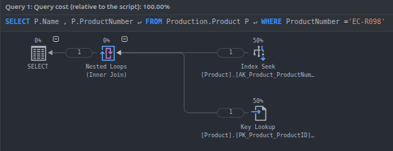
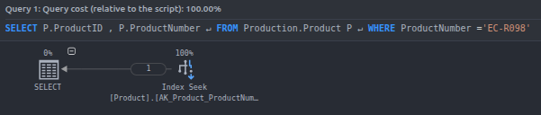

# Ejercicios de optimización

## Ejercicio 0.1

### Índices

|tabla     |columna      |indice                  |tipo        |is_unique |
|----------|-------------|------------------------|------------|----------|
|Product   |Name         |AK_Product_Name         |NONCLUSTERED|1         |
|Product   |ProductNumber|AK_Product_ProductNumber|NONCLUSTERED|1         |
|Product   |rowguid      |AK_Product_rowguid      |NONCLUSTERED|1         |
|Product   |ProductID    |PK_Product_ProductID    |CLUSTERED   |1         |

### Primer query

- El `WHERE` se hace sobre `productNumber`, por lo que podemos utilizar el índice `AK_Product_ProductNumber` para obtener las filas que cumplen `ProductNumber ='EC-R098'` mediante él.
- Luego como el índice no cubre por completo la consulta, ya que en él no se encuentra el atributo `Name`, debe aplicar un `Key lookup` utilizando la clave de la tabla para esa fila `ProductID` que se encuentra en la hoja del mismo índice para acceder a la tabla `Product` y traerse el atributo `Name` correspondiente a esa fila.
- Notar que el plan requiere utilizar el orden dado por el índice `AK_Product_ProductNumber`, ya que tiene el campo `Ordered: True` entre sus propiedades, esto se debe a que mediante el orden lógico de ese índice puede encontrar más fácilmente qué fila se corresponde con un `ProductNumber ='EC-R098'`.
- Para hacer el `Key lookup` también utiliza el órden, pero en este caso no es un órden lógico, sino el físico de las filas de la tabla, por ser un índice *clustered*. Así puede encontrar qué fila es la que tiene el valor de la clave, para obtener el valor del atributo `Name`.
- En este caso ambas entradas del `Inner join` son pequeñas, por lo que se optó por un *Nested loop*.
- Al tratarse de una sola entrada, podríamos podríamos almacenar la de arriba en memoria y hacer un *Hash join*. También al estar ambas ordenadas podríamos utilizar un *Merge join*.
- Esa query es considerada trivial para el optimzador, por lo que no realizó ninguna búsqueda de optimización para el plan de ejecución.

### Segunda query

- En este caso por la misma razón que en el anterior se optó por utilizar el índice `AK_Product_ProductNumber`, pero para esta consulta sí que es un índice completo, ya que en su hoja encontramos también el `ProductID`, al igual que el `ProductNumber` por el que estamos buscando, así que no hace falta ningún `Key lookup` ni nada porque ya tenemos todos los atributos que necesitamos retornar.

## Ejercicio 0.2

tabla             columna             indice                                               tipo          is_unique 
----------------  ------------------  ---------------------------------------------------  ------------  ----------
SalesOrderDetail  rowguid             AK_SalesOrderDetail_rowguid                          NONCLUSTERED  1         
SalesOrderDetail  ProductID           IX_SalesOrderDetail_ProductID                        NONCLUSTERED  0         
SalesOrderDetail  SalesOrderDetailID  PK_SalesOrderDetail_SalesOrderID_SalesOrderDetailID  CLUSTERED     1         
SalesOrderDetail  SalesOrderID        PK_SalesOrderDetail_SalesOrderID_SalesOrderDetailID  CLUSTERED     1         

TABLE_NAME        COLUMN_NAME            IS_NULLABLE  DATA_TYPE       
----------------  ---------------------  -----------  ----------------
SalesOrderDetail  SalesOrderID           NO           int             
SalesOrderDetail  SalesOrderDetailID     NO           int             
SalesOrderDetail  CarrierTrackingNumber  YES          nvarchar        
SalesOrderDetail  OrderQty               NO           smallint        
SalesOrderDetail  ProductID              NO           int             
SalesOrderDetail  SpecialOfferID         NO           int             
SalesOrderDetail  UnitPrice              NO           money           
SalesOrderDetail  UnitPriceDiscount      NO           money           
SalesOrderDetail  LineTotal              NO           numeric         
SalesOrderDetail  rowguid                NO           uniqueidentifier
SalesOrderDetail  ModifiedDate           NO           datetime        

- La relación entre `Product` y `SalesOrderDetail` es 1:N, ya que la clave de `Product` está del lado de `SalesOrderDetail` como *foreign key*, lo que indice que para una fila de `SalesOrderDetail` hay una única en `Product` relacionada.
- Para la segunda query estima que hay una única fila que cumple, mientras que para la primera estima entre 20 y 21.
- Para la primera como tiene 121317 filas en total, que es mucha diferencia respecto a las 21 filas que espera devolver, entonces no conviene hacer un *scan*. Conviene utilizar el *clustered index*, que es el orden físico de las filas y que viene ordenado por su clave que está compuesta por `SalesOrderID` y `SalesOrderDetailID`, entonces las 21 filas con el valor de `SalesOrderId` buscado estarán contiguas en el *índice clustered*.
- Para la segunda query, como el *índice clustered* está ordenado primero por `SalesOrderID` y luego por `SalesOrderDetailID`, entonces todos los valores que coincidan en `SalesOrderDetailID` pero difieran en `SalesOrderID` van a estar separados y no contiguos en el índice, por lo que no puede hacer *seek* ya que no conoce el valor del salesOrderID con el que está como clave, debería hacer un *scan* del *clustered index* de 121317 filas. Como cada fila de `SalesOrderDetail` se relaciona con una sola de `Product`, entonces el índice con `ProductID` va a tener tantas entradas como valores distintos de `SalesOrderDetail` hayan en la tabla `SalesOrderDetail`, mientras que el *clustered* tendrá tantas filas como valores distintos de la tupla (`SalesOrderID`, `SalesOrderDetailID`) haya. Así que ya que es inevitable hacer un *scan*, lo hace por el índice más chico.

## Ejercicio 0.3

Ya antes de ejecutarlas y ver los planes se puede decir que la segunda será más costosa. Notar que no podemos hablar de óptima, ya que son consultas distintas. ¿Por qué? Por como está ordenado el *índice clustered*, primero por `SalesOrderID` y luego por `SalesOrderDetaildID`, vamos a tener para la primer cláusula `WHERE` una sola fila posible y la podemos encontrar directamente con un *seek*, ya que todas las que tengan `SalesOrderID = 43683` estarán contiguas en el *índice clustered*. En cambio para la segunda no podemos hacer lo mismo, ya que las filas que cumplan con la segunda condición del `OR` las debemos buscar por separado y no las podemos obtener todas en el mismo *seek* con el que obtendríamos las de la primer condición.

### Primer plan

Predicción:

- Me imagino un *index seek* sobre `PK_SalesOrderDetail_SalesOrderID_SalesOrderDetailID` para obtener las que cumplan, de forma directa.

Explicación del plan:

- Predicción acertada. Notar como tiene la propiedad `Ordered: True`, ya que para el plan es necesario que esté ordenado. Además al ser *clustered*, ese es el órden físico.
- Según sus estimaciones solo habrá una fila que cumpla, por lo que conviene hacer un *index seek* ya que el índice tiene 121317 filas en total. Además al ser la clave del índice por lo que estamos buscando, el *index seek* es muy eficiente.

### Segundo plan

Predicción:

- Me imagino un *index seek* sobre `PK_SalesOrderDetail_SalesOrderID_SalesOrderDetailID` para obtener las mismas que en la primer query.
- Para las segundas un *index scan* sobre  `IX_SalesOrderDetail_ProductID`, por ser inevitable el *index scan* y ese el índice más chico que me permite recorrerlo para obtener los distintos valores del atributo `SalesOrderDetailID`.
- Con ambos resultados podrías hacer un `concatenate` y pasárselo al `SELECT`.

Explicación del plan:

- Predicción errónea. Era más óptimo hacer un *index scan*.
Explicación del plan:

- Predicción errónea. Era más óptimo hacer un solo *index scan*.
- No existe ningún índice ordenado por `SalesOrderDetailID` como primer criterio, así que no se puede hacer un *seek* para esa condición y hay que recorrer un índice completo. Ese único scan evalúa el `OR` entero como *predicate* en cada fila, usando la lista enlazada de los *leaf nodes*.
- En los *leaf nodes* de `IX_SalesOrderDetail_ProductID`, además de `ProductID`, se encuentra la clave del clustered `(SalesOrderID, SalesOrderDetailID)` (si fuera un heap sería un RID), que se usa como *row locator* para acceder a la fila completa. Como la consulta solo necesita esas dos columnas, el índice **cubre** la consulta y no hace falta un *Key Lookup*.
- Entre los índices que se pueden recorrer (el clustered, este y el de `rowguid`), el optimizador elige este porque es el más angosto: tiene una entrada por fila, igual que los demás, pero cada una ocupa menos bytes, así que hay menos páginas hoja que leer. En un scan el costo está en la cantidad de páginas hoja, no en la profundidad del B-Tree.

>[!IMPORTANT]
> Todos los índices tienen una entrada por fila de la tabla, lo único que puede variar es el tamaño de cada entrada, en base a la cantidad y tamaño de los atributos que utilice.

## Ejercicio 0.4

|tabla        |columna         |indice                                     |tipo        |is_unique |
|-------------|----------------|-------------------------------------------|------------|----------|
|ProductVendor|BusinessEntityID|IX_ProductVendor_BusinessEntityID          |NONCLUSTERED|0         |
|ProductVendor|UnitMeasureCode |IX_ProductVendor_UnitMeasureCode           |NONCLUSTERED|0         |
|ProductVendor|BusinessEntityID|PK_ProductVendor_ProductID_BusinessEntityID|CLUSTERED   |1         |
|ProductVendor|ProductID       |PK_ProductVendor_ProductID_BusinessEntityID|CLUSTERED   |1         |

|tabla     |columna         |indice                    |tipo        |is_unique |
|----------|----------------|--------------------------|------------|----------|
|Vendor    |AccountNumber   |AK_Vendor_AccountNumber   |NONCLUSTERED|1         |
|Vendor    |BusinessEntityID|PK_Vendor_BusinessEntityID|CLUSTERED   |1         |

### Primer query

- Espera leer toda la tabla de `Vendor`.
- De `Vendor` necesita los atributos `Name` y `BusinessEntityID`. Solo `BusinessEntityID` es clave.
- Ningún índice cubre por completo a los atributos `Name` y `BusinessEntityID`, así que hace un *clustered index scan* con el índice `PK_Vendor_BusinessEntityID` para obtener toda la tabla y termina retornando los `Name` y `BusinessEntityID` para cada entrada.
- Para `ProductVendor` también estima leer toda la tabla, por lo que conviene un *scan*.
- Solo le interesan los atributos `BusinessEntityID` de ella, entonces le conviene utilizar el *índice unclustered* `IX_ProductVendor_BusinessEntityID` ya que es el más chico que cubre la consulta en comparación con el *índice clustered* `PK_ProductVendor_ProductID_BusinessEntityID`.
- Como ambos índices `IX_ProductVendor_BusinessEntityID` y `PK_Vendor_BusinessEntityID` vienen ordenados por `BusinessEntityID` que es el atributo por el que se hace el `JOIN`, entonces puede realizar un *merge join* de ambos.

### Segunda query

- Se agrega  una condición `WHERE` sobre un atributo de la tabla `ProductVendor`.
- Estima que 412/460 van a cumplir la condición, por lo que va a convenir hacer un *scan*.
- El índice que usamos en la query anterior (`IX_ProductVendor_BusinessEntityID`) ya no es tan útil porque necesitamos el atributo `StandarPrice` que no está cubierto.
- Conviene directamente recorrer todas las filas desde el *índice clustered* y sobre ellas aplicar la condición del `WHERE` para acabar proyectando solo los atributos `ProductID` y `BusinessEntityID`, como vemos en `Output List`.
- Respecto al *hash join*:
  - La primer entrada es de 104 filas, por lo que es una cantidad reducida que puede entrar en la tabla de hash almacenada en memoria.
  - Al hacer hash puede, una vez creó la tabla de hash en memoria probar con cada fila de las 412 para ver cuáles matchean.
  - Los planes se ejecutan de izquierda  a derecha, si usara *nested loops* tendría que hacer $104*412$ chequeos, además de que los chequeos para la tabla `ProductVendor` son sobre un *clustered index* y no sobre uno *unclustered* sobre el que pudiera hacer *seek*.

### Tercer query

- Se agrega una condición al `WHERE` sobre el atributo `Name` de `Vendor`.
- Como no hay ningún índice que cubra los atributos `Name` y `BusinessEntityID` de `Vendor`, debe hacer un *scan* ya que no puede hacer un *seek* al no tener índice sobre `Name`. Elige hacer un *clustered index scan* y obtener `ProductID` de los que cumplan la condición de `Name LIKE N'F%'`.
- Como el *outer input* del `JOIN` es chico, solo 7 filas y tiene un índice sobre el atributo a joinear en `ProductVendor`, que es `IX_ProductVendor_BusinessEntityID`, por lo que dado el valor de `BusinessEntityID` *outer input* buscar qué fila de `ProductVendor` matchea con ese `BusinessEntityID` se puede realizar con un *seek* de forma directa, no como en [segunda query](#segunda-query-1) donde teníamos que hacer un *clustered index scan*.
- Sobre esas filas que cumplen la condición de *join* y  `Name LIKE N'F%'` resultantes del *join* hace un *Key lookup* con los valores de `ProductID` y de `BusinessEntityID` para traer los de `standarPrince`, pero sobre ellos aplica el predicado del `WHERE StandardPrice > $10`.
- Finalmente los junta con sus datos provenientes del anterior *nested loop* y los retorna.
