# SQL Server Execution Plans (3.ª ed.) — Resumen de mis subrayados

> Autor del libro: Grant Fritchey.
> Basado en los 574 subrayados de las páginas 20 a 241 (capítulos 1 a 8, hasta el inicio de *Columnstore Indexes*).
> Los números `p. N` son páginas del PDF, tal como las muestra el visor. Los subrayados que eran palabras sueltas se completaron con el contexto de la página. Las imágenes son figuras del libro.

---

## Capítulo 1 — Introducción al plan de ejecución

### Qué pasa cuando se envía una consulta (p. 20, 27–31)

SQL es un **lenguaje declarativo**: describe *qué datos* queremos, no *cómo* obtenerlos. De eso se encarga el **Query Optimizer**, que define una estrategia: el **plan de ejecución**, un conjunto de **operadores** que dice qué hizo SQL Server y en qué orden.

El proceso tiene dos fases (Figura 1-1):

- **Compilación** (relational engine):
  1. El **parser** comprueba que la consulta esté bien escrita y genera un *parse tree* con los pasos lógicos.
  2. El **algebrizer** hace el *query binding*: resuelve nombres de objetos, tablas y columnas. Genera el *query processor tree* en binario, que incluye un **hash** de la consulta. Con ese hash se busca si ya hay un plan en la **plan cache**.
  3. El **optimizer** genera el plan y lo guarda en la plan cache.
- **Ejecución**: el **execution engine** ejecuta el plan.

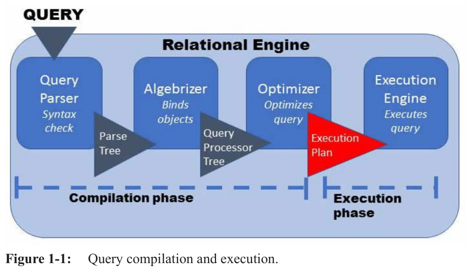

Puntos clave del optimizer:

- Un plan guardado se reutiliza, saltándose la optimización completa. Deja de ser válido si cambió la tabla o si se actualizaron las estadísticas usadas desde que se creó el plan (p. 29).
- Estima un **coste** (tiempo de CPU y de I/O de disco de cada paso) y busca un plan *suficientemente barato* en el menor tiempo razonable. Es un proceso **heurístico**: busca el plan de menor coste en pocas iteraciones, no el óptimo absoluto.
- Usa reglas para transformar el *logical query tree* en un conjunto de operadores, cada uno con una tarea específica.
- Para consultas simples aplica un **trivial plan** en vez de la optimización completa basada en costes.
- **Auto-parametrización**: un valor *hard-coded* se reemplaza por un parámetro, y el plan se guarda en la caché.
- Las sentencias **DML** se optimizan. Las **DDL** pueden no optimizarse.
- **Interleaved execution** (p. 32): el optimizer genera el plan, *pausa* la optimización, ejecuta un subárbol para obtener los row counts reales y optimiza el resto con esos datos.

### Trabajar con el optimizer (p. 32–38)

No debemos intentar dictarle a SQL Server cómo ejecutar una consulta. Lo que sí podemos hacer como DBA es ayudar al optimizer con dos cosas: **mantener estadísticas precisas y actualizadas** y **promover la reutilización de planes**.

**Estadísticas y cardinalidad**

- La principal fuente de las estimaciones son las **estadísticas** de índices y datos. El coste estimado depende sobre todo de las **estimaciones de cardinalidad**: cuántas filas tiene una tabla y cuántas cumplen cada condición de búsqueda o join.
- Las estadísticas describen la distribución de los datos. La **selectividad** (porcentaje de filas que pasan el criterio) se degrada cuanto menor es la unicidad.
- La **cardinalidad de un operador** es su selectividad multiplicada por el número de filas de entrada.
- La actualización automática de estadísticas solo **muestrea** un subconjunto de los datos para reducir el coste. Con el tiempo, las estadísticas reflejan cada vez peor los datos reales.
- Las **tablas temporales** también tienen estadísticas (el mismo tipo de histograma que las permanentes).

**Plan cache**

- La "edad" de un plan = coste estimado de CPU de compilarlo × número de usos. Los planes muy usados y caros de compilar permanecen más tiempo.
- **Cache churn**: ocurre cuando el optimizer genera muchísimos planes de un solo uso, que expulsan constantemente a los planes antiguos de la caché.
- `DBCC FREEPROCCACHE` vacía la caché de **todas** las bases del servidor, lo que en producción puede ser muy costoso. También es posible limpiar solo planes concretos.
- El optimizer guarda el hash en la propiedad **QueryHash**, que identifica consultas con la misma lógica o muy parecida. Después hace una comparación detallada entre el SQL enviado y el texto SQL del plan en caché.
- Un plan se **reutiliza** si coinciden los cuatro factores: **QueryHash, texto SQL, SET options y ID de base de datos**.
- Con **literales hard-coded**, el plan se compila de nuevo cada vez. Para asegurar la reutilización, lo mejor es usar **stored procedures o consultas parametrizadas** ("prepared queries", construidas desde el código de la aplicación).
- Para reducir el impacto de planes de un solo uso existe el ajuste de servidor **Optimize For Ad Hoc Workloads**: esos planes ocupan mucha menos memoria.
- Ciertos eventos o acciones fuerzan la **recompilación** del plan, que puede ser muy cara.

### Cómo obtener planes: estimado vs. real (p. 39–49)

- Para ver planes se necesita el permiso **ShowPlan**.
- El **plan estimado** no ejecuta la consulta. El **plan real** sí, y añade **información de runtime**.
- Solo hay **un plan válido** por consulta. No son "dos planes distintos", como a veces se dice. Los planes en caché no contienen información de runtime (salvo los row counts de los planes interleaved).
- Con el plan estimado, como no hay intención de ejecutar, se omiten dos pasos: guardar el plan en caché (si es nuevo) y enviarlo a ejecución. Con el plan real se hacen los tres. Los valores de runtime se *inyectan* en una copia del plan.
- Pueden verse diferencias entre ambos planes en tres casos:
  - **Paralelismo**: si el coste supera el *cost threshold for parallelism*, se genera una versión paralela. Aun así, el motor decide en ejecución si realmente va en paralelo.
  - **Tablas temporales**: el plan estimado no ejecuta la consulta ni crea la tabla temporal, y de ahí viene el error. En runtime la consulta sí se compila y entonces existe un plan.
  - **Interleaved execution**.
- Existe también el **live execution plan**, que devuelve estadísticas en vivo de las operaciones.
- Cada operador tiene un elemento **lógico** (lo que hace) y uno **físico** (cómo lo implementó el optimizer).

---

## Capítulo 2 — Empezar a leer planes

### Operadores: streaming vs. blocking (p. 61–62)

- Cada operador soporta un método **GetNext**.
- Un operador **streaming** produce salida a la vez que recibe entrada, y pasa cada fila al siguiente operador en cuanto la procesa.
- Los operadores **blocking** deben reunir *todo* el conjunto de entrada y hacer su trabajo sobre el conjunto completo antes de pasar filas.

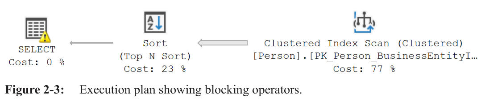

### Qué buscar en un plan (p. 67)

- Un **scan** lee las páginas de un índice o tabla. Suele indicar que se accede a **muchas filas**.
- Un **seek** usa la estructura del índice para encontrar un punto de inicio (y quizá de fin) y recorrer un rango. Suele indicar que se accede a **pocas filas**.
- Señales de alerta: **scans caros que devuelven pocos datos** (índice ausente o mal estructurado) o **seeks que devuelven conjuntos enormes**.

### Información tras el primer operador (p. 72–75)

En las propiedades del operador SELECT:

- **Reason For Early Termination Of Statement Optimization**:
  - *Good Enough Plan Found*: tras al menos una fase de optimización, el coste del mejor plan estaba bajo el umbral para pasar a la siguiente fase.
  - *Timeout*: el optimizer intentó la optimización completa pero no encontró un plan matemáticamente suficiente, y devolvió el de menor coste hallado.
  - *Memory Limit Exceeded*: el plan probablemente no es el óptimo. Sin simplificar la consulta o la estructura es difícil mejorarlo.
- **Parameter List**: muestra los parámetros y sus valores de compilación y de ejecución.
- **Simple parameterization**: solo la aplica el optimizer a consultas simples de **una tabla**. La mejor forma de promover reutilización es parametrizar activamente, usando stored procedures.
- **Parameter sniffing**: el valor del parámetro se compara con las estadísticas de la columna o índice usado.
- **QueryHash**: hash de la consulta, usado para identificar planes con lógica igual o muy similar. **QueryPlanHash**: lo mismo pero para el plan (mismas operaciones, mismo orden).

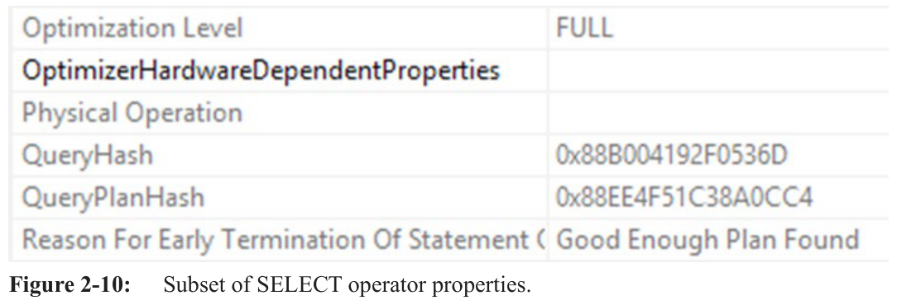

### Otras herramientas (p. 76–78)

- Conviene recopilar **métricas de rendimiento** junto a los planes, sobre todo al afinar consultas en desarrollo.
- `STATISTICS IO` es útil, pero puede **empeorar el tiempo de ejecución** por el coste de enviar la información al cliente. Mostrar resultados en grid o texto también añade mucho overhead.
- Para consultas rápidas pero muy frecuentes, se pueden ejecutar muchas veces (`GO 100`) y mirar el tiempo transcurrido.
- **Extended Events** tienen menor impacto en el rendimiento.

---

## Capítulo 3 — Operadores que leen datos

### Estructura de un índice (p. 80–81)

- Los índices tradicionales usan **páginas de 8 KB** conectadas en un **árbol B+**.
- En un **clustered index**, las páginas hoja guardan las **filas de datos**, ordenadas por la clave del índice. *Es la tabla*, con un árbol B+ encima, y por eso solo puede haber **uno por tabla**.
- Un **nonclustered index** tiene la misma estructura, pero sus hojas contienen solo las columnas clave, más las claves del clustered index, más las columnas añadidas con **INCLUDE**.
- Un índice se puede leer con **scan, seek o lookup**.

### Index Scan (p. 81–86)

Recorre las páginas hoja de principio a fin (o hacia atrás). Ocurre cuando:

- se necesitan leer todas (o casi todas) las filas;
- leer todo sería más rápido que navegar la estructura del índice;
- no hay un índice útil o la consulta está escrita de forma que impide el seek.

El optimizer puede aprovechar el **orden del índice** si un operador posterior necesita datos ordenados, y así evita un Sort. Si no existe un índice que coincida con la columna del predicado, el scan evalúa el **Predicate** fila a fila. Escanear un índice más pequeño que la PK es más rápido y consume menos recursos. Un scan que lee muchas más páginas de las necesarias indica **lecturas lógicas innecesarias**. Entonces conviene ajustar la consulta o crear un índice que permita leer solo las páginas necesarias.

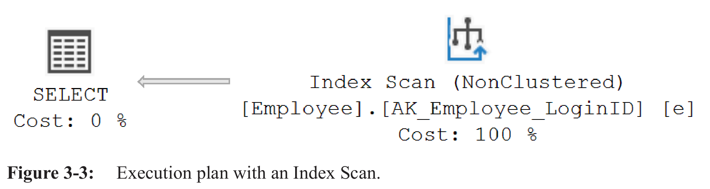

### Index Seek (p. 87–89)

Navega directamente a las páginas con las filas que cumplen el filtro (o al inicio/fin de un rango) y procesa solo lo necesario. Es eficiente para pocas filas de una tabla grande. Ocurre cuando:

1. hay un índice que coincide con una columna del predicado **y cubre la consulta**; o
2. el índice coincide con el predicado, **no cubre**, pero el predicado es **muy selectivo**.

Cuenta las lecturas del recorrido por el árbol B+ más la página hoja. El operador tiene la propiedad **Seek Predicates**. Ojo con las **conversiones de tipo** (convierten un seek en scan) y con los **LIKE** que empiezan por comodín.

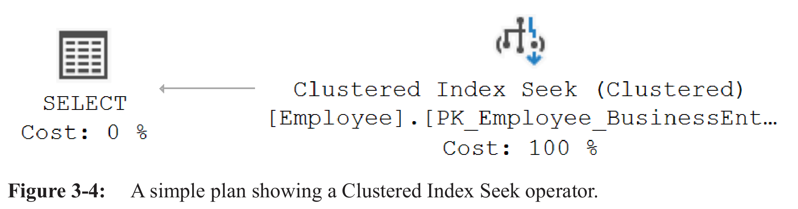

### Key Lookup (p. 91–94)

- Un índice **cubre la consulta** si todas las columnas necesarias están en su nivel hoja.
- Un **Key Lookup** aparece junto a un Index Seek (a veces Scan) cuando el índice **no cubre** la consulta y hay que buscar el resto de columnas en el clustered index. Siempre lo acompaña un **Nested Loops**.
- Puede ser caro si se ejecuta muchas veces. Antes de arreglarlo, conviene verificar que todas las columnas devueltas son realmente necesarias.
- Si lo son, lo mejor es **ampliar un índice existente con INCLUDE** en vez de crear uno nuevo. Nunca es buena idea crear un covering index para cada consulta que use un lookup.

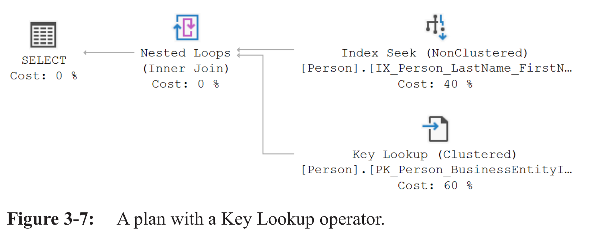

### Heap, Table Scan y RID Lookup (p. 94–97)

- Un **heap** es una tabla sin clustered index: las filas no están ordenadas (solo por orden de llegada). Los nonclustered indexes de un heap guardan el **row identifier (RID)** en vez de la clave del clustered index.
- El **Table Scan** solo ocurre sobre heaps: no hay índices útiles y hay que revisar todas las filas.
- El **RID Lookup** es el equivalente en heaps del Key Lookup. Si devuelve muchas filas, hay que mirar la consulta o considerar un clustered index o un covering index.

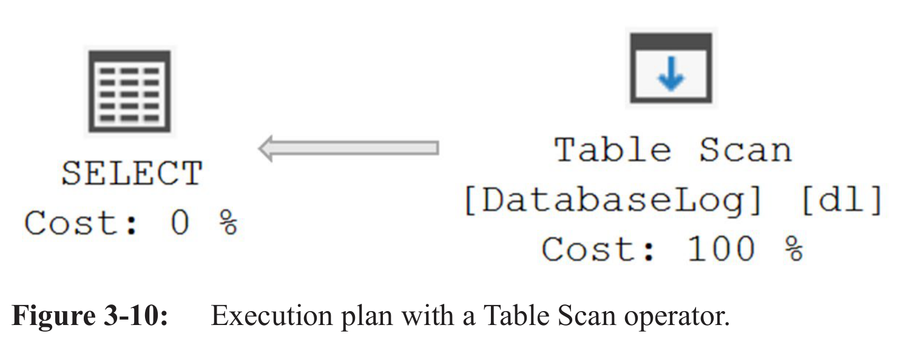

---

## Capítulo 4 — Joins

### Los cuatro algoritmos físicos (p. 99)

| Operador | Cómo funciona |
|---|---|
| **Nested Loops** | Por cada fila del conjunto superior, hace una búsqueda en el otro conjunto. |
| **Hash Match** | Crea una hash table con el conjunto superior y la "sondea" con las filas del segundo. |
| **Merge Join** | Lee ambas entradas a la vez y las fusiona. Requiere que estén **ordenadas** por la(s) columna(s) del join. |
| **Adaptive Join** (SQL Server 2017) | Implementa Nested Loops y Hash Match, y elige el de menor coste **en runtime**, cuando se conoce el número real de filas. |

La elección depende del tamaño y del orden de las entradas. También existen los **Semi Join** (asociados a `EXISTS`/`IN`), los **Anti Semi Join** (`NOT EXISTS`) y **Concatenation/Union**. Antes de analizar un plan complejo, conviene entender a grandes rasgos qué hace el plan (p. 101).

### Nested Loops (p. 102–108)

- Es muy eficiente **si la entrada externa es pequeña y buscar en la interna es barato**, algo que suele lograrse indexando la "tabla interna" por la columna del join.
- Compara **Actual Number of Rows** con **Estimated Number of Rows**. Una gran discrepancia indica estimaciones inexactas del optimizer. Causas posibles:
  - estadísticas ausentes o desactualizadas;
  - un plan reutilizado cuando el volumen o la distribución cambió;
  - distribución muy no uniforme;
  - lógica que impide estimar bien;
  - *parameter sniffing*.
- **Outer References**: valores de la entrada externa que se *empujan* a la interna y así permiten un seek.
- Si no hay valores empujados, el Nested Loops aplica el join **Predicate** sobre las filas de la entrada interna.
- **Rebind**: primera ejecución de la entrada interna o cambio de los valores de Outer References. **Rewind**: los valores no cambian, o no hay Outer References.
- Con **spools** (Index Spool, Table Spool, etc.) el optimizer guarda resultados para no repetir el trabajo cuando ocurre un Rewind.

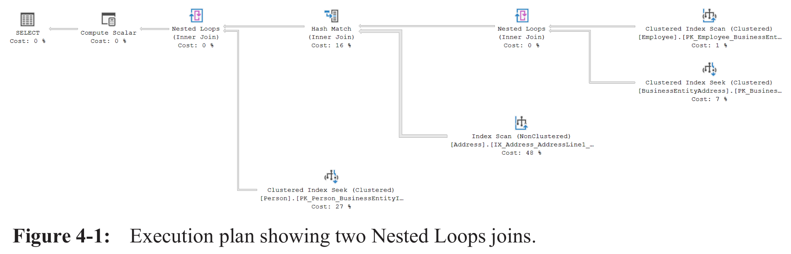

### Hash Match (p. 109–114)

- Guarda en memoria, en una **hash table**, los valores de la entrada *Build*. Luego lee una a una las filas de la entrada *Probe*, calcula su hash y lo compara con la tabla.
- Es **blocking durante la fase Build**.
- El optimizer lo elige sobre todo cuando las entradas **no están ordenadas** por la columna del join. Suele ser la mejor opción con dos entradas grandes sin ordenar, o una pequeña y una grande. Siempre usa como *Build* la entrada que estima más pequeña.
- Los problemas aparecen cuando la entrada Build es **mucho mayor de lo previsto**: excede la **memory grant** y hace *spill* a disco.
- Ver un Hash Match a veces indica:
  - un **índice ausente o inutilizable**;
  - un `WHERE` con un cálculo o conversión que lo hace **no SARGable**.
- Las alternativas son Nested Loops con muchas ejecuciones de la entrada interna, o usar sorts para habilitar un Merge Join.
- **Compute Scalar** (p. 114): el optimizer no lo cuesta del todo. Su valor es `0.0000001 × filas estimadas`, sin importar la complejidad del cálculo. Puede ser un **coste oculto**, sobre todo con funciones escalares definidas por el usuario (UDF).

### Merge Join (p. 115–120)

- Trabaja solo con datos **ordenados** por la columna del join, es **no bloqueante** y es una de las operaciones de join **más eficientes**. Su salida está ordenada.
- La propiedad **Ordered = True** en el scan indica que el optimizer *requiere* el orden. **Ordered = False** no significa que los datos no estén ordenados, solo que el plan no lo exige.
- Si hay que hacer un **Sort** previo, quizá haya que revisar la estrategia de índices (sobre todo con entradas grandes).
- **Many to Many**: el optimizer intenta inferir unicidad en las columnas del join. Si no puede, las filas de la entrada inferior se copian a una **worktable en tempdb**. Suele deberse a restricciones ausentes o a columnas incluidas en expresiones (conversiones implícitas o explícitas).

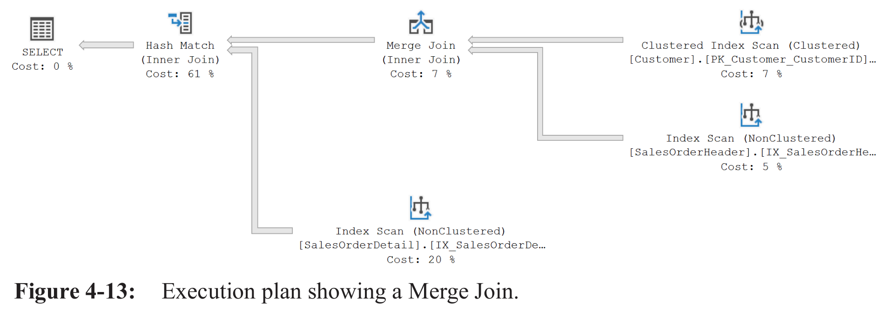

### Adaptive Join (p. 120–122)

Difiere la elección entre Hash Match y Nested Loops hasta el runtime. En la fase *Build* guarda las filas de la entrada superior en una hash table y compara su número con un **umbral** (*Adaptive Threshold Rows*): por encima va Hash Match, por debajo Nested Loops. Resulta útil con **columnstore**, que no tiene estadísticas como un índice rowstore y hace más difícil estimar filas.

### Semi Join, Anti Semi Join y Concatenation (p. 124–127)

- El optimizer usa operadores de join para tareas que no son la palabra clave `JOIN`, como implementar **EXISTS**.
- **Semi Join**: devuelve **una copia** de cada fila de una entrada que tiene *al menos una coincidencia* en la otra. No añade filas de la otra entrada, solo comprueba **existencia**.
- **Anti Semi Join**: devuelve las filas **sin** coincidencia (como `NOT EXISTS`).
- **Concatenation**: tiene dos o más entradas y las procesa de arriba abajo, concatenándolas. Puede tener tantas como haga falta. Usar variables en un `IN` puede dar un plan con Concatenation.

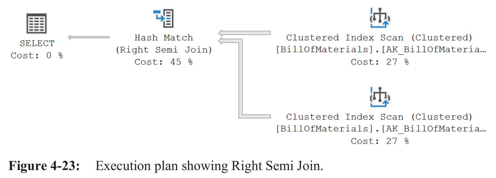

---

## Capítulo 5 — Ordenar y agregar

### Ordenación (p. 129–139)

- Sin `ORDER BY` **no hay orden definido** para los datos devueltos. Si un índice los entrega en el orden requerido y todos los operadores lo preservan, no hace falta nada más. Si no, se añade un **Sort**, que es **blocking**.
- Si `ORDER BY` no especifica dirección, el orden por defecto es ascendente.
- Un **Index Scan** puede recuperar los datos de dos maneras:
  - **Ordered** (sigue la estructura del índice, en orden lógico);
  - por **páginas IAM** (orden "semi-aleatorio", pero con acceso a disco secuencial).
  Con *Ordered = False* el motor puede elegir cualquiera. Con *Ordered = True* usa el método ordenado.
- Ante un Sort, la primera pregunta es **por qué está ahí**. La siguiente: *¿es realmente necesario?* Conviene limitar las filas a ordenar para no incluir filas que nunca se usarán.
- **Top N Sort** y **Distinct Sort** (este último ordena y además elimina duplicados) son variantes del Sort.
- El Sort depende mucho de las **estimaciones de filas** y **necesita memoria**.
- El operador **Filter** examina cada fila y solo pasa las que cumplen el *Predicate*.

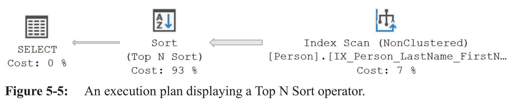

### Agregación (p. 140–151)

Agregar pronto en el plan significa trabajar con **menos datos** el resto del plan. Y es mucho más eficiente agregar en el servidor y enviar pocas filas al cliente que enviar todo y agregar en el cliente.

- **Stream Aggregate**: requiere los datos **ordenados** por las columnas agregadas (propiedad *Ordered = True* en el scan) y calcula la información en **streaming**, mientras la lee.
- **Hash Match (Aggregate)**: crea una hash table temporal en memoria con los resultados de todos los cálculos (conteos, mínimos, máximos, sumas...). Usa normalmente **menos memoria que un Hash Match (Join)**, porque solo guarda la clave de agregación y los resultados.
- **HAVING vs. WHERE**: el optimizer no puede verificar un predicado de `HAVING` sin agregar antes, así que añade un **Filter** *después* de la agregación. En cambio, un filtro en el `WHERE` actúa antes.

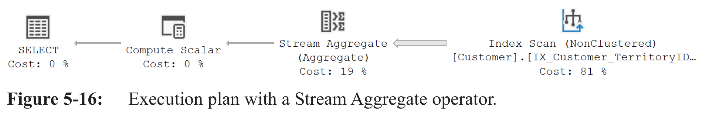

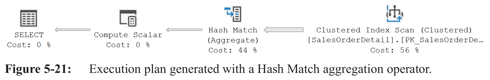

### Spools (p. 148–151)

- Un **Spool** guarda datos en una **worktable temporal** para reutilizarlos varias veces en el plan, en vez de ejecutar de nuevo conjuntos de operadores.
- Siempre hay un clustered index para guardar los datos del spool. Un **Index Spool** añade además un nonclustered index para recuperarlos más fácilmente.
- Hay dos tipos lógicos:
  - **Lazy Spool**: *streaming*, lee una fila, la guarda y la pasa de inmediato.
  - **Eager Spool**: *blocking*. El optimizer suele evitarlo.
- Ejemplo típico: en un Nested Loops cuya entrada interna es **estática** (produce el mismo resultado para cada valor externo), el **Table Spool** evita volver a llamar al Hash Match (en el ejemplo, 13 veces) porque reutiliza la worktable.
- Un spool puede **compartir** datos con otros spools del plan. Entonces, en las propiedades del segundo se ven su *Node ID* y un *Primary Node ID*.
- El **Index Spool** inicializa sus hijos, pasa las filas coincidentes al Stream Aggregate y guarda el resultado en una worktable indexada que devuelve al Nested Loops.

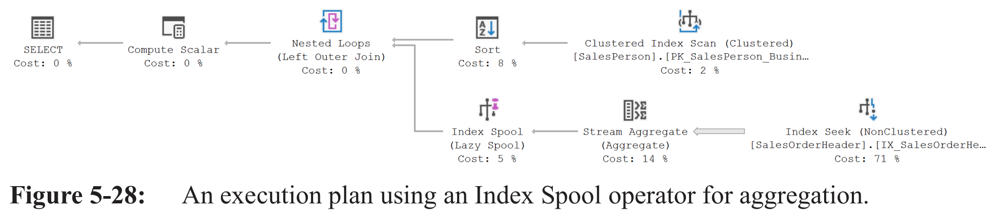

### Funciones de ventana (p. 152–156)

- Las filas se ordenan (por ejemplo, por `CustomerID` y luego por `OrderDate`) para prepararlas para la división en particiones.
- El operador **Segment** divide los datos en segmentos según las columnas de partición definidas en la consulta.
- **Sequence Project (Compute Scalar)** se usa **solo en funciones de ranking** y trabaja sobre un conjunto ordenado con las marcas de segmento añadidas por Segment.
- A diferencia de un Lazy Spool, el **Table Spool** de este caso lee *todas* las filas de un segmento y entonces envía la fila de ese segmento a las operaciones siguientes.

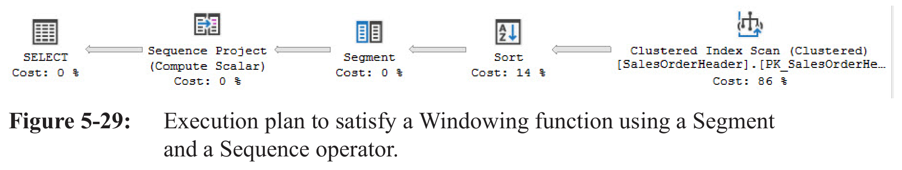

---

## Capítulo 7 (parcial) — Planes de sentencias T-SQL comunes

- **Stored procedures** (p. 189–190): SQL Server primero compila solo el *batch*, luego comprueba la plan cache y, si no hay plan, invoca al compilador. Ahí el optimizer puede hacer *sniffing* del parámetro y generar un plan con las estadísticas de ese valor. Si se ejecuta de nuevo con otro valor, ya habrá un plan reutilizable. Los planes de los procedimientos **no son especiales**. Hay que identificar el plan (o planes) problemático y evaluar posibles arreglos.
- **Startup Expression** (p. 194): con *Startup Expression = False*, los operadores hijos se llaman en cada ejecución. Si hubiera un *Startup Expression Predicate*, solo se llamarían para las filas que cumplan esa condición.
- **CTE** (p. 199): un "conjunto de resultados temporal" que existe solo dentro de una sentencia. Puede ser autorreferencial y referenciarse varias veces en la misma consulta.

---

## Capítulo 8 — Uso de índices

### Selección de índices (p. 221–230)

- **No siempre se resuelve un problema de rendimiento añadiendo un índice.** Puede haber demasiados, así que hay que ser juiciosos (p. 221).
- Un clustered index reemplaza al heap con un índice que guarda *todos* los datos. Un nonclustered guarda solo las claves y un puntero (clave del clustered o RID), más columnas extra con `INCLUDE`.
- El objetivo es crear el **conjunto mínimo de índices** más beneficioso para las consultas **más importantes, caras y frecuentes**.
- **Selectividad de un predicado**: proporción esperada de filas que coinciden. Se calcula como `x / z`, con `z` = total de filas y `x` = valores distintos de la(s) columna(s). Un índice muy selectivo tiene un valor *bajo* (0.01 = 1 % de las filas).
- El índice debe ser selectivo *para los predicados de las consultas a las que debe ayudar*. Si lo es lo bastante, el optimizer lo considera buen candidato.
- **Densidad**: el *density graph* da al optimizer sus estimaciones de valores distintos. Menor densidad significa mayor "unicidad" y mayor selectividad, pero **densidad y selectividad no son lo mismo**.
- Si el optimizer no puede *sniffear* el valor de un parámetro o variable, usa la densidad. En el ejemplo, densidad `0.02439024 × 121 317 filas ≈ 2958.95` filas estimadas. Para algunos predicados usa una **selectividad fija del 30 %**.
- Si conoce el valor (lo sniffeó o está hard-coded), usa el **histograma**. Si el valor no tiene coincidencia exacta, usa el rango de la `RANGE_HI_KEY` que lo contiene y su `AVG_RANGE_ROWS` (`RANGE_ROWS / DISTINCT_RANGE_ROWS`).
- Cuantas más filas se estiman, más *lookups* habrá, hasta un **punto de inflexión** en el que el optimizer prefiere escanear el clustered index.
- Con **variables locales** el optimizer no puede sniffear el valor (salvo que haya recompilación a nivel de sentencia por `OPTION (RECOMPILE)`), así que usa el density graph.
- Un índice que no cubre implica el coste extra de los lookups (pequeño si son pocas filas). Y **todo índice se paga** en INSERT, UPDATE, DELETE y MERGE, porque hay que reordenar, añadir o quitar datos. Hay que sopesar su importancia, frecuencia de ejecución y tiempo real de ejecución.

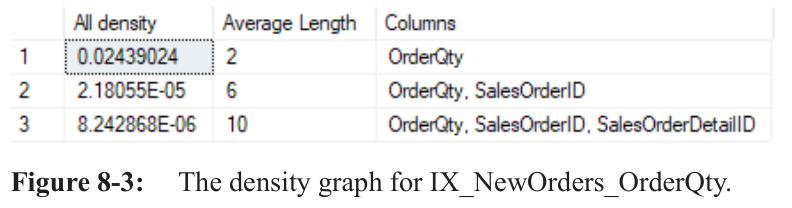

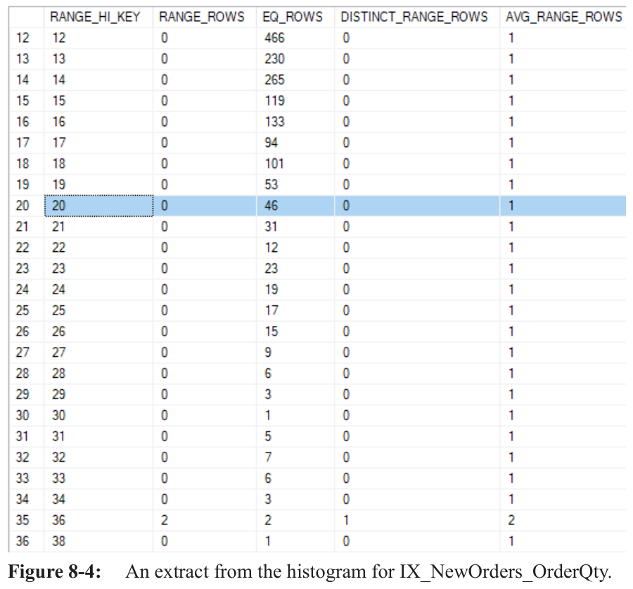

### Qué puede salir mal (p. 231–232)

- Una **discrepancia de tipos** entre parámetro y columna fuerza una **conversión implícita** sobre la columna indexada y **impide el seek**.
- Los predicados complejos son más difíciles de estimar que los simples. También los de desigualdad frente a los de igualdad, y las expresiones con la columna incrustada frente a las que dejan la columna sola. Cuando no se puede sniffear, se usa la estimación fija del 30 %.
- Si el optimizer no puede estimar bien las filas, o reutiliza un plan con estimaciones que ya no son válidas, puede **ignorar índices bien construidos** o usar índices inapropiados.
- Causas habituales:
  - **estadísticas ausentes**;
  - **estadísticas obsoletas** (por debajo del umbral que dispara la actualización automática);
  - **reutilizar un plan en caché subóptimo** (cambió el volumen o la distribución);
  - **distribución de datos sesgada**.

### Parameter sniffing (p. 236–241)

- Con consultas bien parametrizadas y objetos bien escritos (stored procedures, funciones), el optimizer **espía el valor del parámetro** y lo compara con el histograma. Así obtiene estimaciones de cardinalidad precisas en vez de "promedios" basados en la densidad o en estimaciones fijas.
- Si se filtra por la **PRIMARY KEY** o por una clave con distribución uniforme, el sniffing es en gran parte irrelevante.
- El sniffing se vuelve **problemático** cuando se filtra por claves con distribución desigual y se **reutiliza un plan** generado para un valor cuyo número estimado de filas resulta atípico para los siguientes valores.
- Si hay problemas de rendimiento en un stored procedure, conviene mirar las propiedades del **primer operador** y comprobar si los valores de **compilación y ejecución** de los parámetros difieren (p. 238).

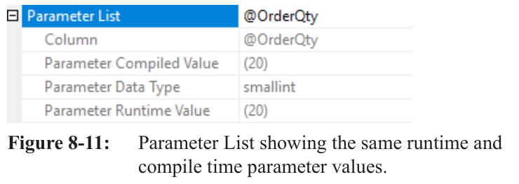

**Opciones cuando la distribución es "irregular"** (p. 240–241):

- `OPTION (RECOMPILE)` al final de la consulta afectada: recompila en cada ejecución y optimiza para el valor concreto. Si un procedimiento tiene tres consultas y solo una sufre el problema, el hint se pone solo en esa. Como contrapartida, genera compilaciones extra.
- `OPTION (OPTIMIZE FOR <valor>)`: especifica el valor con el que el optimizer debe crear el plan (se detalla en el capítulo 10).
- `OPTION (OPTIMIZE FOR (@OrderQty UNKNOWN))`: genera un **plan genérico**, optimizando para un valor desconocido con ayuda del density graph.

---

## Chuleta rápida: señales de alerta al leer un plan

| Si ves... | Piensa en... |
|---|---|
| **Scan** caro que devuelve pocas filas | índice ausente o mal estructurado |
| **Seek** que devuelve muchísimas filas | revisar la consulta o el índice |
| **Key Lookup / RID Lookup** repetido | ¿faltan columnas en `INCLUDE`?, ¿se piden columnas innecesarias? |
| **Hash Match** (join) | índice ausente/inutilizable o predicado no SARGable; riesgo de spill a disco |
| **Sort** grande antes de un Merge Join | replantear la estrategia de índices |
| **Merge Join Many to Many** | restricciones de unicidad ausentes o columnas dentro de expresiones |
| **Compute Scalar** | coste oculto, sobre todo con UDFs escalares |
| **Actual ≠ Estimated rows** | estadísticas ausentes/obsoletas, parameter sniffing, distribución sesgada |
| **Conversión implícita** en columna indexada | tipos de dato distintos: impide el seek |
| **Valor compilado ≠ valor de ejecución** del parámetro | parameter sniffing problemático |
