# Práctica de recuperabilidad

## Definiciones

### Log

### Flush log

### Transacción completa

Terminaron con *COMMIT* o *ABORT*.

### Transacción incompletas/activas

Tienen registro de *START* pero no de *COMMIT* ni *ABORT*.

## Checkpoints

### Checkpoint Quiescente

No se aceptan nuevas transacciones durante el checkpoint.

### Checkpoint No-Quiescente

Aceptan nuevas transacciones.

### Undo/Checkpoint Quiescente

1. Dejamos de aceptar nuevas transacciones.
2. Esperamos a que las [transacciones activas](#transacción-incompletasactivas) se [completen](#transacción-completa).
3. Escribimos <$CKPT$> en el [log](#log) y efectuamos un [*flush*](#flush-log).
4. Aceptamos nuevas transacciones.

>[!IMPORTANT]
> [Checkpoint](#checkpoint) solo puede aparecer en el [log](#log) cuando ya no hay transacciones activas

## Ejercicio 5.1

> Dada la siguiente historia: $$ H = r_1(Z); w_1(U); c_1; w_2(X); w_2(Y); r_3(U); w_3(X); w_2(Z); c_2; r_3(Y); r_4(Z); w_3(Y); c_3; r_4(U); w_4(U); c_4 $$
> Suponer que inicialmente todos los items tienen valor 0 y cada operación WRITE incrementa en 1 el valor anterior. Escribir la secuencia de los registros de log correspondientes a la ejecución exitosa de H, según:

### (a) Undo logging con checkpointing quiescente (incluir un checkpoint en el log)

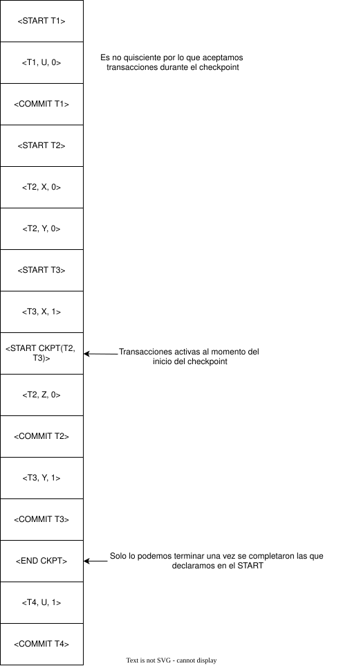

### (b) Redo logging con checkpointing no quiescente (incluir un checkpoint en el log tal que ocurra durante la ejecución de H)

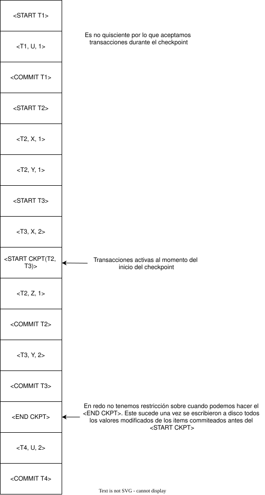

### (c) Undo/Redo logging sin checkpointing

- Undo logging:

|Log                   |
|:--------------------:|
|<$\text{START} ~T_1$> |
|<$T_1, U, 0$>         |
|<$\text{COMMIT} ~T_1$>|
|<$\text{START} ~T_2$> |
|<$T_2, X, 0$>         |
|<$T_2, Y, 0$>         |
|<$\text{START} ~T_3$> |
|<$T_3, X, 1$>         |
|<$T_2, Z, 0$>         |
|<$\text{COMMIT} ~T_2$>|
|<$\text{START} ~T_4$> |
|<$T_3, Y, 1$>         |
|<$\text{COMMIT} ~T_3$>|
|<$T_4, U, 1$>         |
|<$\text{COMMIT} ~T_4$>|

- Redo logging:

|Log                   |
|:--------------------:|
|<$\text{START} ~T_1$> |
|<$T_1, U, 1$>         |
|<$\text{COMMIT} ~T_1$>|
|<$\text{START} ~T_2$> |
|<$T_2, X, 1$>         |
|<$T_2, Y, 1$>         |
|<$\text{START} ~T_3$> |
|<$T_3, X, 2$>         |
|<$T_2, Z, 1$>         |
|<$\text{COMMIT} ~T_2$>|
|<$\text{START} ~T_4$> |
|<$T_3, Y, 2$>         |
|<$\text{COMMIT} ~T_3$>|
|<$T_4, U, 2$>         |
|<$\text{COMMIT} ~T_4$>|

- Undo/redo logging:

|Log                   |
|:--------------------:|
|<$\text{START} ~T_1$> |
|<$T_1, U, 0, 1$>      |
|<$\text{COMMIT} ~T_1$>|
|<$\text{START} ~T_2$> |
|<$T_2, X, 0, 1$>      |
|<$T_2, Y, 0, 1$>      |
|<$\text{START} ~T_3$> |
|<$T_3, X, 1, 2$>      |
|<$T_2, Z, 0, 1$>      |
|<$\text{COMMIT} ~T_2$>|
|<$\text{START} ~T_4$> |
|<$T_3, Y, 1, 2$>      |
|<$\text{COMMIT} ~T_3$>|
|<$T_4, U, 1, 2$>      |
|<$\text{COMMIT} ~T_4$>|

## Ejercicio 5.2

> Dada la siguiente secuencia de registros en el *undo-log*, escritos por el *log manager*, correspondientes a la ejecución de tres transacciones $T_1$, $T_2$ y $T_{12}$, sobre los ítems A, B, C, D, E y R:
> < $START T_1$ >; < $T_1, A, 10$ >; < $START T_2$ >; < $T_2, B, 20$ >; < $START T_{12}$ >;< $T_1, C, 30$ >; < $T_2, D, 40$ >; < COMMIT $T_2$ >; < $T_{12}, R, 12$ >; < $T_1, E, 50$ >;< ABORT $T_{12}$ >< COMMIT $T_1$ >
> Describir las acciones que debería realizar el [*recovery manager*]() (incluyendo los cambios tanto en los ítems en disco como en el log) si ocurre un crash y el último registro de log en disco es

### (a) $<START T_2>$

- Partimos desde $<START T_2>$ hacia atrás marcando completas e incompletas, en este caso $T_1$ y $T_2$ son las únicas transacciones y ambas están incompletas.
- Por cada $T_i$ incompleta con un registro $<T_i, X, a>$ escribimos en $X$ el valor $a$. En este caso escribimos $10$ en $A$.
- Agregamos un $<ABORT T_i>$ por cada $T_i$ incompleta al momento del crash, es decir añadimos $<ABORT T_2>$ y $<ABORT T_1>$.
- El log nos queda $<START T_1>$;$<T_1, A, 10>$;$<START T_2>$;$<ABORT T_1>$;$<ABORT T_2>$ y luego hacemos [flush del log](#flush-log)

### (b) $<COMMIT T_2>$

- Partimos desde el $<COMMIT T_2>$ hacia atrás marcando las incompletas, en este caso $T_{12}$ y $T_1$, mientras que la única completa es $T_2$.
- Por cada $T_i$ incompleta, partiendo desde $<COMMIT T_2>$ hacia el inicio de la que encontremos un registro $<T_i, X, a>$ escribimos $a$ en $X$. En este caso nos quedarían:
  - ¿Escribimos $40$ en $D$? No, porque $T_2$ está completa.
  - ¿Escribimos $30$ en $C$? Sí.
  - ¿Escribimos $20$ en $B$? No, $T_2$ está completa.
  - ¿Escribimos $10$ en $A$? Sí.
- Luego agregamos al log $<ABORT T_i>$ por cada $T_i$ incompleta, en este caso agregaríamos $<ABORT T_1>$ y $<ABORT T_{12}>$.
- Realizamos un flush del log a disco.

### (c) $<T_1, E, 50>$

- Partimos desde $<T_1, E, 50>$ hacia atrás marcando las incompletas ($T_1$ y $T_{12}$ en este caso).
- Por cada incompleta $T_i$ de la que nos encontremos un registro $<T_i, X, a>$ escribimos en $X$ el valor $a$. En este caso escribimos:
  - En $E$ escribimos $50$.
  - En $R$ escribimos $12$.
  - En $C$ escribimos $30$.
  - En $A$ escribimos $10$.
- Por cada incompleta escribimos un abort, en este caso agregamos al log $<ABORT T_1>$ y $<ABORT T_{12}>$.
- Realizamos un flush del log a disco.

### (d) $<COMMIT T_1>$

- No hay incompletas.
- No hace falta que haga el *undo* para ninguno de los registros $<T_i, X, a>$.
- Tampoco que añada un $<ABORT T_i>$.
- No hago flush del log porque no lo modifiqué.

## Ejercicio 5.3

>Dada la siguiente secuencia de registros en el *undo-log* generados por el *log manager* correspondientes a la ejecución de las transacciones $T_1$, $T_2$, $T_3$ y $T_4$: $< START T_1 >; < T_1, A, 8 >; < START T_2 >; < START T_3 >< T_2, B, 16 >;< START T_4 >; < T_4, E, 24 >; < T_2, D, 32 >; < T_4, K, 9 >; < T_4, F, 40 >;< ABORT T_4 >; < COMMIT T_3 >; < T_2, G, 48 >; < COMMIT T_2 >; < T_1, C, 56 >;< COMMIT T_1 >$

### (a) Describir las acciones que debería realizar el recovery manager (incluyendo los cambios tanto en los ítems en disco como en el log) si ocurre un crash y el último registro de log en disco es

#### $<START T_4>$

- Recorremos los registros en reversa desde el $<START T_4>$ marcando las transacciones completas e incompletas.
  - Incompletas: $T_4$, $T_2$, $T_1$, $T_3$.
  - Completas: Ninguna.
- Por cada registros $<T_i, X, a>$ de una $T_i$ incompleta, escribo en $X$ el valor $a$.
  - Escribo en $B$ el valor $16$.
  - Escribo en $A$ el valor $8$.
- Por cada transacción incompleta añado un aborts al log.
  - $<ABORT T_4>;<ABORT T_3>;<ABORT T_2>;<ABORT T_1>$.
- Realizamos flush del log.

#### $<T_1, C, 56>$

- Recorremos los registros en reversa desde el $<T_1, C, 56>$ marcando las transacciones incompletas y completas.
  - Incompletas: $T_1$.
  - Completas: $T_2, T_3$ y $T_4$.
- Recorremos en reversa ahora para aplicar el *undo* en cada registro $<T_i, X, a>$ de $T_i$ incompleta.
  - Escribimos en $C$ el valor $56$.
  - Escribimos en $A$ el valor $8$.
- Por cada incompleta $T_i$ agregamos $<ABORT T_i>$ al log.
  - Agregamos $<ABORT T_1>$.
- Realizamos flush del log.

### (b) Idem ejercicio anterior pero asumiendo redo logging y que el último registro de log en disco es

#### $<COMMIT T_3>$

- Recorremos los registros en reversa desde el $<COMMIT T_3>$ marcándo las completas e incompletas.
  - Incompletas: $T_2$ y $T_1$.
  - Completas: $T_3$ y $T_4$.
  - Con commit: $T_3$.
- Recorro en reversa pero para cada $<T_i, X, a>$ de una $T_i$ con commit escribo en $X$ el valor de $a$.
  - Como $T_3$ no escribió nada, no hago nada.
- Por cada $T_i$ incompleta agrego $<ABORT T_i>$.
  - $<ABORT T_1>;<ABORT T_2>$.
- Realiza flush del log.

#### $<COMMIT T_1>$

- Recorro en reversa desde $<COMMIT T_1>$ marcando las completas con commit y las incompletas.
  - Completas con commit: $T_1$, $T_2$, $T_3$.
  - Incompletas: Ninguna.
- Por cada $<T_i, X, a>$ de una $T_i$ completa con commit escribo en $X$ el valor $a$.
  - Escribo en $A$ el valor $8$.
  - Escribo en $B$ el valor $16$.
  - Escribo en $D$ el valor $32$.
  - Escribo en $G$ el valor $48$.
  - Escribo en $C$ el valor $56$.
- Por cada transacción $T_i$ incompleta agrego un $<ABORT T_i>$.
- Hago flush del log.

## Ejercicio 5.4

> Dada la siguiente secuencia de registros undo/redo-log generados por el *log manager* correspondientes a la ejecución de cuatro transacciones $T_1$, $T_2$, $T_3$ y $T_4$: $< START T_1 >; < T_1, A, 100, 110 >; < START T_2 >; < T_2, B, 200, 210 >;< START T_3 >; < T_1, C, 300, 310 >; < T_3, D, 400, 410 >; < T_2, E, 40, 41 >;< T_3, F, 500, 510 >; < COMMIT T_3 >; < COMMIT T_2 >; < START T_4 >;< T_1, G, 600, 610 >; < T_4, H, 700, 710 >; < COMMIT T_1 >; < COMMIT T_4 >$
> Describa las acciones que debería realizar el *recovery manager* -incluyendo los cambios tanto en los items en disco como en el *log*- si ocurre un *crash* y el último registro de log en disco es:

### (a) $<START T_3>$

- Recorro desde $<START T_3>$ en reversa, marcando las transacciones completas commiteadas y las incompletas.
  - Completas commiteadas: Ninguna.
  - Incompletas: $T_3, T_2, T_1$.
- Por cada $T_i$ completa commiteada con un registro $<T_i, X, a, b>$ escribo $X$ el valor $b$, es decir hago *redo*.
- Por cada $T_i$ incompleta con un registro $<T_i, X, a, b$ escribo en $X$ el valor $a$.
  - Escribo en $B$ el valor $200$.
  - Escribo en $A$ el valor $100$.
- Por cada $T_i$ incompleta agrego $<ABORT T_i>$.
  - Agrego $<ABORT T_3>;<ABORT T_2>;<ABORT T_1>$.
- Hago flush del log a disco.

### (b) $<COMMIT T_3>$

- Por recorro desde $<COMMIT T_3>$ en reversa marcando completas commiteadas e incompletas.
  - Completas commiteadas: $T_3$.
  - Incompletas: $T_1$ y $T_2$.
- Por cada registro $<T_i, X, a, b>$ de una completa commiteada $T_i$ escribo en $X$ el valor $b$, es decir hago *redo* pero desde la primer commiteada hasta la última.
  - En este caso solo tenemos la $T_3$ como commiteadas, entonces hacemos.
    - Escribo en $D$ el valor $410$.
    - Escribo en $F$ el valor $510$.
- Por cada registro $<T_i, X, a, b>$ de una incompleta escribo en $X$ el valor $a$, en orden de última a primera.
  - Escribo en $E$ el valor $40$.
  - Escribo en $C$ el valor $300$.
  - Escribo en $B$ el valor $200$.
  - Escribo en $A$ el valor $100$.
- Por cada $T_i$ incompleta escribo $<ABORT T_i>$.
  - Escribo $<ABORT T_1>;<ABORT T_2>$.
- Flush del log a disco.

### (c) $<T_1, G, 600, 610>$

- Recorro desde $<T_1, G, 600, 610>$ en reversa marcando las completas con commit e incompletas.
  - Completas: $T_3$ y $T_2$.
  - Incompletas: $T_4$ y $T_1$.
- Para cada registro $<T_i, X, a, b>$ de una completa escribo en $X$ el valor $b$. En orden de primeras a últimas.
  - Escribo en $B$ el valor $210$.
  - Escribo en $E$ el valor $41$.
  - Escribo en $D$ el valor $410$.
  - Escribo en $F$ el valor $510$.
- Por cada registro $<T_i, X, a, b>$ de una $T_i$ incompleta en orden de últimas a primeras escribo en $X$ el valor $a$, es decir hago *undo*.
  - Escribo en $G$ el valor $600$.
  - Escribo en $C$ el valor $300$.
  - Escribo en $A$ el valor $100$.
- Por cada incompleta $T_i$ escribo $<ABORT T_i>$ en el log.
  - Escribo $<ABORT T_1>;<ABORT T_4>$.
- Hago flush del log.

### (d) $<COMMIT T_4>$

- Recorro desde $<COMMIT T_4>$ hacia atrás marcando completas con commit e incompletas.
  - Completas: $T_4, T_1, T_2, T_3$.
  - Incompletas: Ninguna.
- Por cada completa con commit aplico *redo*, es decir por cada registro $<T_i, X, a, b>$ de la transacción, escribo en $X$ el valor $b$. En orden de primeras a últimas.
  - Escribo en $A$ el valor $110$.
  - Escribo en $C$ el valor $310$.
  - Escribo en $G$ el valor $610$.
  - Escribo en $B$ el valor $210$.
  - Escribo en $E$ el valor $41$.
  - Escribo en $D$ el valor $410$.
  - Escribo en $F$ el valor $510$.
  - Escribo en $H$ el valor $710$.
- No hay incompletas.
- Hago flush del log a disco.

## Ejercicio 5.5

>Dada la siguiente secuencia de registros de undo-log: $<START T_1>;<T_1, A, 60>;<COMMIT T_1>;<START T_2>;<T_2, A, 10>;<START T_3>;<T_3, B, 20>;<T_2, C, 30>;<START T_4>;<T_3, D, 40>;<T_4, F, 70>;<COMMIT T_3>;<T_2, E, 50>;<COMMIT T_2>;<T_4, B, 80 >;< COMMIT T_4 >$ Suponer que se inicia *checkpoint no-quiescente* inmediatamente después de que cada uno de los siguientes registros de *log* han sido escritos en el *pool de buffers de memoria*:
>
> - $<T_1, A, 60>$.
> - $<T_2, A, 10>$.
> - $<T_3, B, 20>$.
> - $<T_3, D, 40>$.
> - $<T_2, E, 50>$.
>
> Para cada uno indicar:

- (a) Cuándo el registro $<END CKPT>$ es escrito
- (b) Para cada punto donde fuera posible que ocurriera un crash, hasta dónde se debería examinar el log para hallar todas las posibles transacciones incompletas

- $<T_1, A, 60>$.
  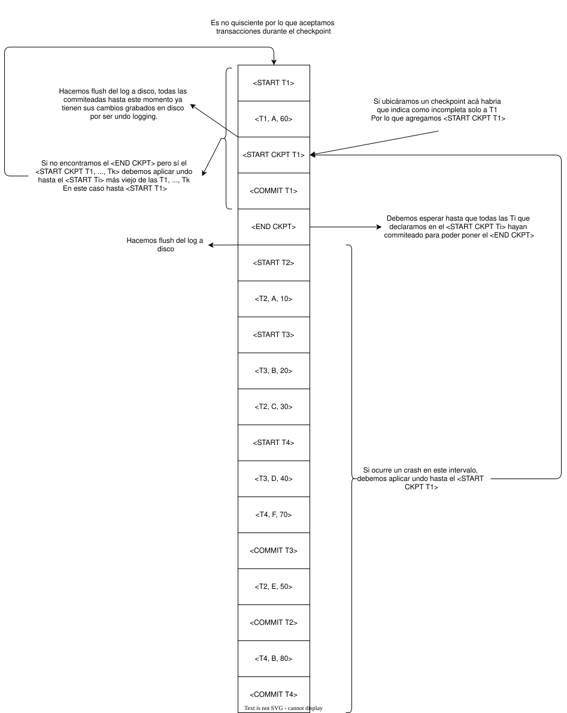
- $<T_2, A, 10>$.
  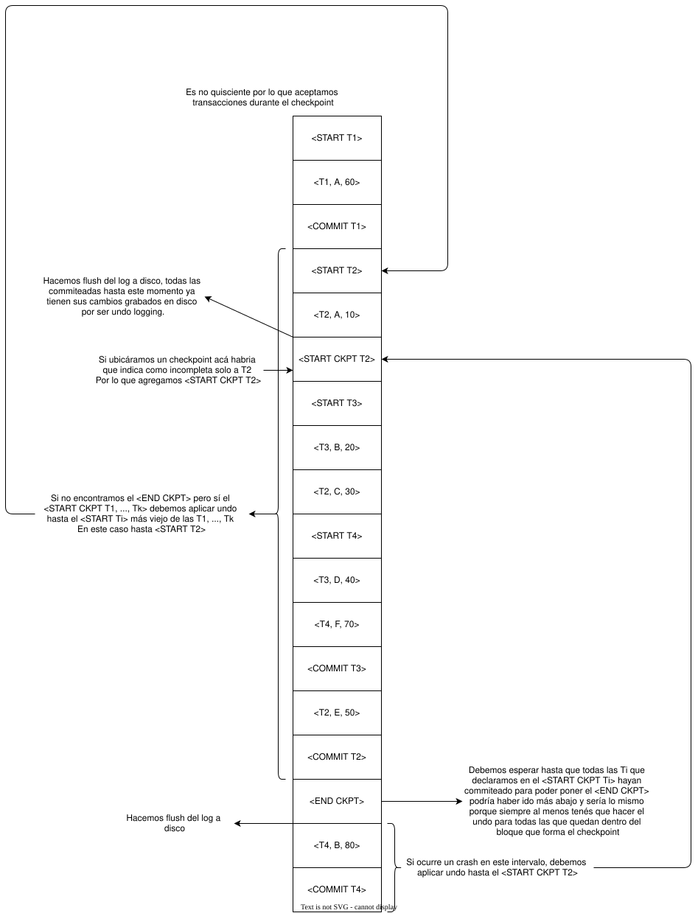
- $<T_3, B, 20>$.
  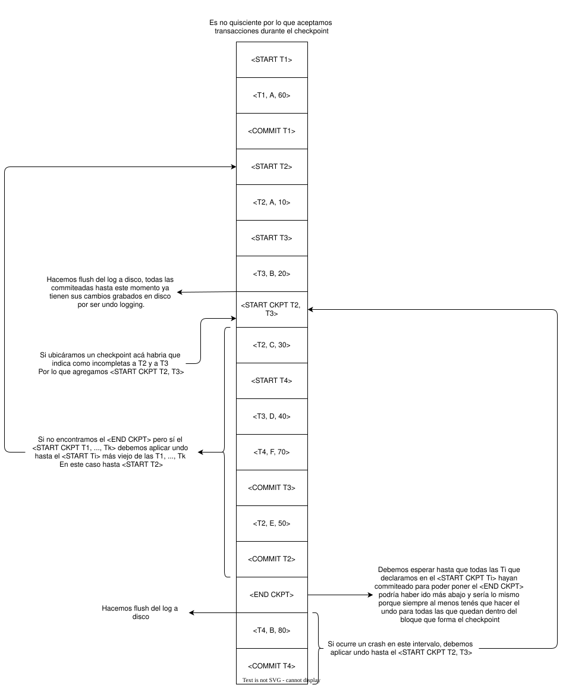
- $<T_3, D, 40>$.
  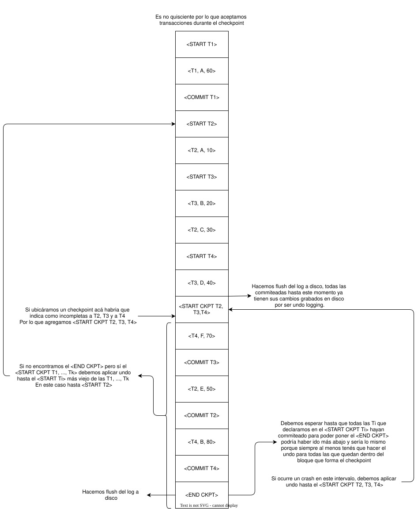
- $<T_2, E, 50>$.
  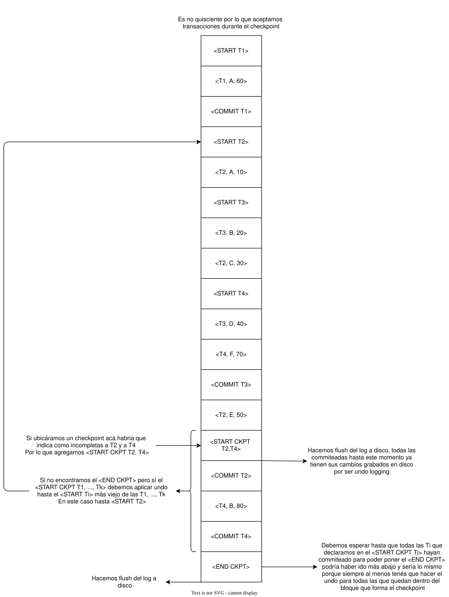

## Ejercicio 5.6

>Dados los mismos datos del ejercicio anterior pero ahora asumiendo *redo logging* indicar para cada punto de 1) a 5):

- (a) En qué punto el registro $< END CKPT >$ podría ser escrito.
- (b) Para cada punto donde fuera posible que ocurriera un crash, hasta dónde se debería examinar el log para hallar todas las posibles transacciones completas. Considere los dos casos posibles
  - i. que el registro $< END CKPT >$ fué escrito antes del crash.
  - ii. que el registro $< END CKPT >$ no fué escrito antes del crash.

- $<T_1, A, 60>$.
  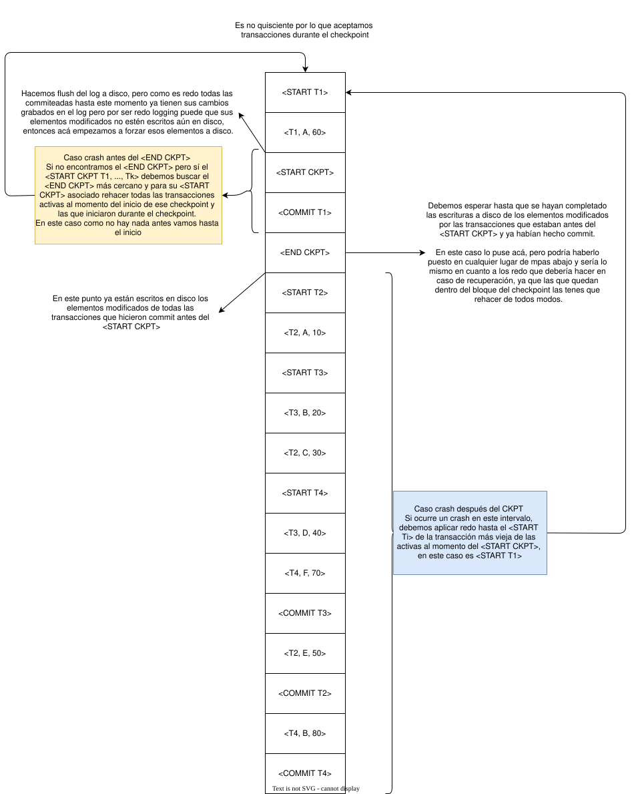
- $<T_2, A, 10>$.
  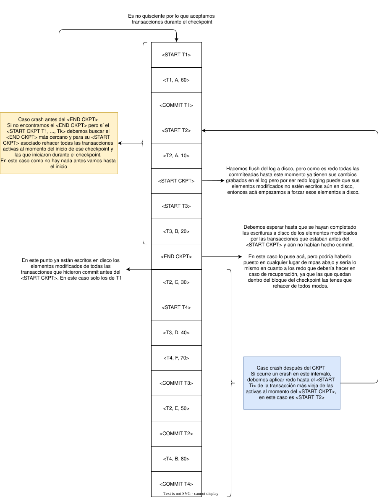
- $<T_3, B, 20>$.
  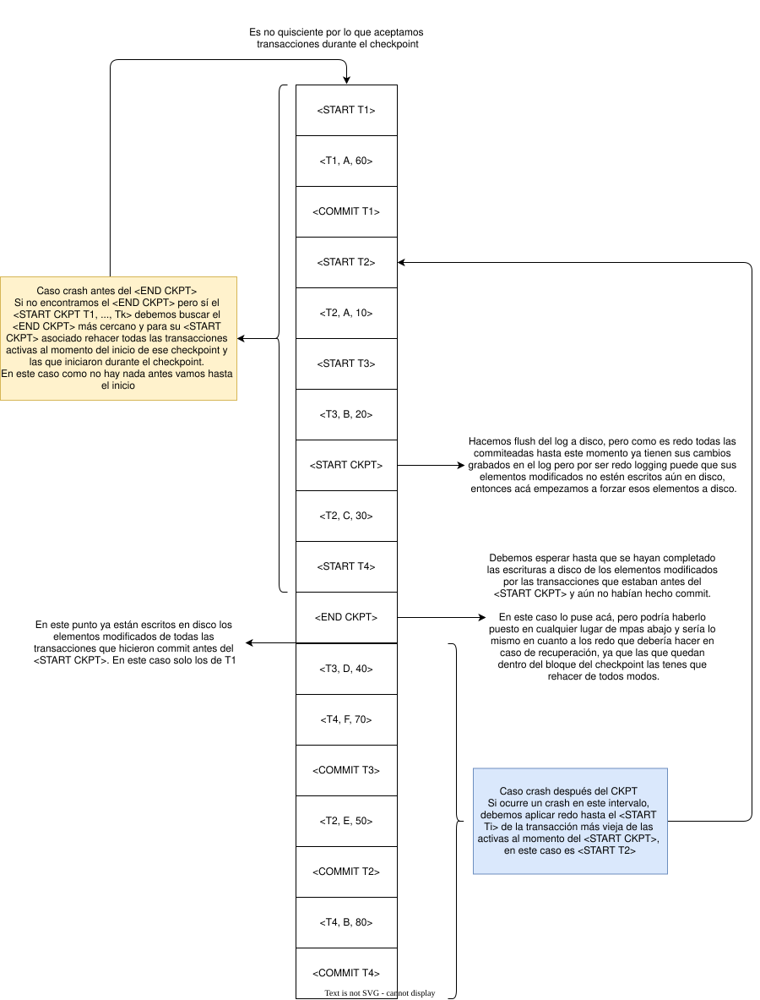
- $<T_3, D, 40>$.
  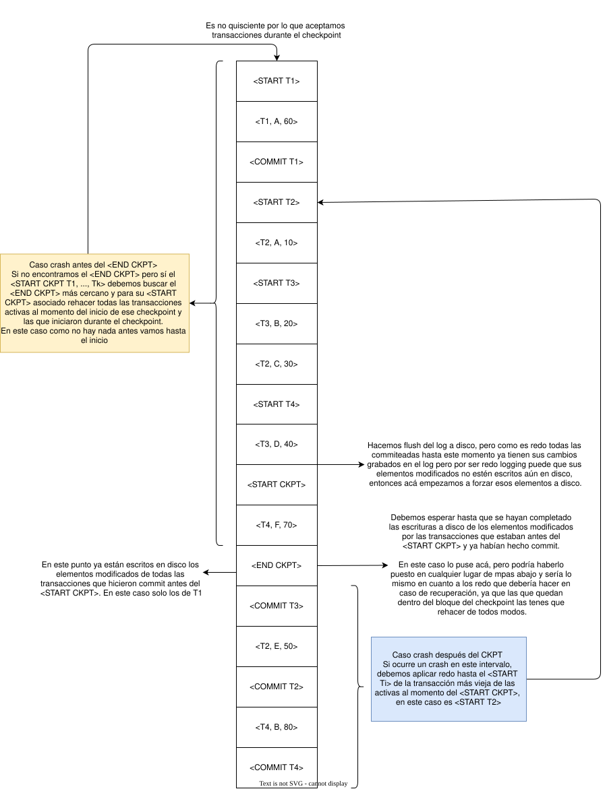
- $<T_2, E, 50>$.
  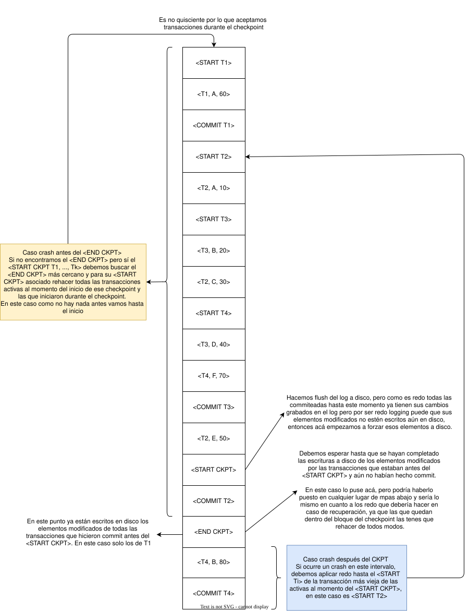

## Ejercicio 5.7

> Se tiene el siguiente log de un planificador que utiliza estrategia REDO Logging con checkpoints no-quiescente. Asumiendo que hay un crash luego del paso 27 marcar con verdadero o falso.

Asumiendo que hay un crash luego del paso 27 marcar con verdadero o falso:

- Se tienen que rehacer $T_2$, $T_4$, $T_5$ y $T_6$, ya que se garantiza que aquellas transacciones que commitearon antes del Start Ckpt estan en disco.
  - Falso, como el $<END CKPT>$ de ese $<START CKPT (T_2, T_4)>$ solo tiene como transacciones commiteadas previas a $T_1$ y $T_3$ abortó, por lo que no se debe rehacer. Por lo que solo se tienen que hacer $T_2, T_4$ y $T_6$ porque hicieron commit.

- Se rehacen solamente las transacciones que comenzaron luego del Start Ckpt. Todo lo anterior ya se encuentra en disco
  - Falso: Las transacciones anteriores que estaban activas al momento del $<START CKPT>$, es decir $T_2$ y $T_4$ también se deberían rehacer.

- Despues del paso 27 todas las transacciones commitearon, con lo cual solo hay que hacer flush del log en disco.
  - Si se refiere al proceso de recuperación... Falso: $T_5$ nunca commitea, así que hay que agrega un abort.
  - Si se refiere a lo que nos falta agregarle al log... Verdadero: Ya no hay transacciones incompletas sin su abort correspondiente en el log.

- Se rehacen desde el Start Ckpt todas las transacciones incompletas y ademas se rehacen $T_5$ y $T_6$
  - Falso: Las transacciones incompletas se deben rehacer desde su $<START T_i>$ ya que los cambios previos al $<START CKPT>$ no fueron escritos en disco porque no estaban commiteadas al momento del $<START CKPT>$.

Asumiendo que hay un crash luego del paso 20 marcar
con verdadero o falso:

- Se tienen que rehacer $T_1$, $T_2$, $T_3$ y $T_4$.
  - Luego del paso 20, es decir que tenemos el $<START CKPT>$ pero no el $<END CKPT>$ asociado a él.
  - Entonces debemos ir hasta el $<END CKPT>$ previo y para el $<START CKPT T_1, ..., T_n>$ asociado rehacer desde $<START T_i>$ cada una de las $T_i \in T_1, \dots, T_n$ transacciones incompletas previas.
  - En este caso como no hay un checkpoint previo, debemos rehacer $T_1, T_2, T_3, T_4, T_5$ y $T_6$ porque las que iniciaron después de ese $<START CKPT>$ también debemos rehacerlas.
- Se tienen que rehacer unicamente $T_1$.
  - Verdadero porque es la única con commit.

## Ejercicio 5.8

> Dada la siguiente secuencia de registros *undo/redo-log* con *nonquiescent checkpointing* generados por el *log manager* correspondientes a la ejecución de las transacciones $T_1$ a $T_5$:
> $< START T_1 >;< T_1, A, 26, 33 >;< START T_2 >;< START T_3 >;< T_2, C, 51, 34 >;< T_3, E, 21, 35 >;< T_1, B, 25, 24 >;< T_1, A, 33, 20 >;< T_2, D, 18, 36 >;< COMMIT T_1 >;< START T_4 >;< T_4, F, 19, 37 >;< T_2, D, 36, 4 >;< START CKPT (T_2, T_3, T_4)>< T_2, C, 34, 10>;< T_4, F, 37, 41 >;< START T_5 >;< T_3, E, 35, 52 >;< T_5, G, 27, 43 >;< COMMIT T_2 >;< END CKPT >;< T_5, G, 43, 28 >;< T_4, H, 26, 23 >;< COMMIT T_5 >;< COMMIT T_4 >$
>Asuma que las entradas en el log son de la forma $< transaccion, item, valor anterior, valor nuevo >$. Para los siguientes posibles escenarios de fallas:

### (a) El sistema crashea justo antes de que la línea 23 sea escrita en el disco

- Todas las transacciones que commitearon antes del $<START CKPT (T_2, T_3, T_4)>$ son $T_1$ y como hay $<END CKPT>$ entonces se escribieron sus modificaciones en el disco.
- Tenemos que deshacer $T_5$ que inició durante el checkpoint y quedó incompleta al momento del crash.
- Tenemos que rehacer todas las que estaban activas al momento del $<START CKPT (T_2, T_3, T_4)>$ que hayan hecho commit. Es decir $T_2$.
- Para las que no hicieron commit $T_3, T_4, T_5$ hacemos undo deshaciendo las modificaciones de sus registros y agregando un abort en el log.

|A  |B  |C  |D  |E  |F  |G  |H  |
|:-:|:-:|:-:|:-:|:-:|:-:|:-:|:-:|
|20 |24 |10 |4  |21 |19 |27 |26 |

### (b) Idem anterior pero para la línea 24

Lo mismo.

### (c) Idem anterior pero para la línea 25

- Ahora $T_5$ también es completada, por lo que debo aplicarle redo.

|A  |B  |C  |D  |E  |F  |G  |H  |
|:-:|:-:|:-:|:-:|:-:|:-:|:-:|:-:|
|20 |24 |10 |4  |21 |19 |28 |26 |

### (d) El sistema crashea inmediatamente después de que la línea 25 fuera escrita en el disco

- Tengo que hacer redo de $T_4$ y de $T_5$ también.

|A  |B  |C  |D  |E  |F  |G  |H  |
|:-:|:-:|:-:|:-:|:-:|:-:|:-:|:-:|
|20 |24 |10 |4  |21 |41 |28 |23 |
