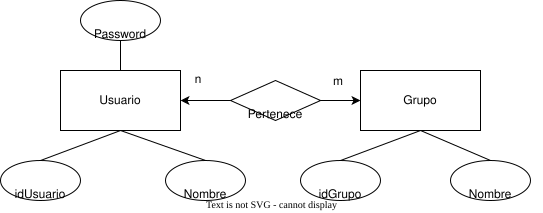
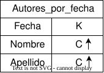
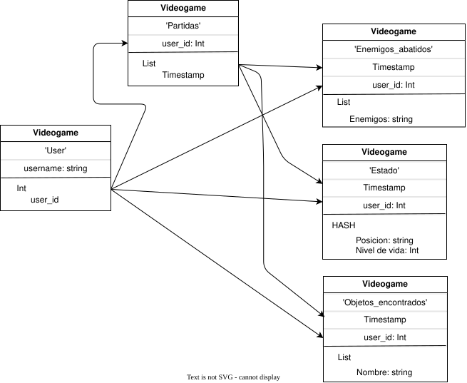
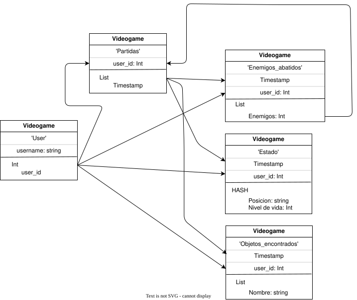
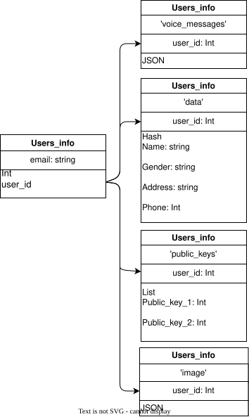

# Práctica NoSQL

## Modelado

### Ejercicio 2.1

En este modelo cada grupo tiene una lista con las claves (idUsuario) de sus miembros y cada usuario tiene una lista con las claves (idGrupo) a los que pertenece.



En este modelo cada grupo guarda una lista con las claves (idUsuario) de sus miembros y cada usuario tiene un documento incrustado con la información del grupo al que pertenece.


En este modelo cada usuario tiene un documento incrustado con la información de su grupo, pero no nos permite dado un grupo obtener sus miembros.


### Ejercicio 2.2

```JSON
{
    "titulo": "MongoDB: The Definitive Guide",
    "autor": [ "Kristina Chodorow", "Mike Dirolf" ],
    "fecha_pub": ISODate("2010-09-24"),
    "paginas": 216,
    "idioma": "English",
    "editorial": {
        "nombre": "O’Reilly Media",
        "fundada": 1980,
        "ubicacion": "CA"
    }
}

{
    "titulo": "50 Tips and Tricks for MongoDB Developer",
    "autor": "Kristina Chodorow",
    "fecha_pub": ISODate("2011-05-06"),
    "paginas": 68,
    "idioma": "English",
    "editorial": {
        "nombre": "O’Reilly Media",
        "fundada": 1980,
        "ubicacion": "CA"
    }
}
```

a) Nos piden modificarla para que no se repitan los datos de las editoriales.

Aclaración: Decidí continuar con la notación utilizada en el enunciado, aunque no coincida con la del *JSONSchema* del apunte.

Solución propuesta:

- Asignamos un id único a cada libro.
- Agregamos el documento `editoriales`, con toda su información en un solo lugar. Además tiene una lista con las referencias a los ids de los libros publicados por ella.
- Para no perder la posibilidad de dado un libro saber a qué editorial pertenece y sus datos debemos incorporar una referencia en ellos a su editorial, en este caso utilizo un id para cada editorial y los libros lo conservan como propiedad.
- Como utilizo ids para los libros y para las editoriales les pongo un prefijo con la primer letra de cada entidad para evitar que coincidan los ids de libros con los de editoriales.

> Consulta: ¿Es necesario esto último?

```JSON
{
    "idLibro": 'L1',
    "titulo": "MongoDB: The Definitive Guide",
    "autor": [ "Kristina Chodorow", "Mike Dirolf" ],
    "fecha_pub": ISODate("2010-09-24"),
    "paginas": 216,
    "idioma": "English",
    "editorial": 'E1'
}

{
    "idLibro": 'L2',
    "titulo": "50 Tips and Tricks for MongoDB Developer",
    "autor": "Kristina Chodorow",
    "fecha_pub": ISODate("2011-05-06"),
    "paginas": 68,
    "idioma": "English",
    "editorial": 'E1'
}

{
    "idEditorial": 'E1',
    "nombre": "O’Reilly Media",
    "fundada": 1980,
    "ubicacion": "CA",
    "publicaciones" : ['L1', 'L2']
}
```

*¿En qué contextos es mejor la representación inicial dada sobre la resuelta en el item anterior?*

**<ins>Ventajas:</ins>**

- **Rapidez y disponibilidad para una consulta específica:** Si cada vez que se accede a un libro se quiere tener rápidamente la información de su editorial, entonces conviene la representación inicial ya que con una sola consulta obtenemos todos los datos que necesitamos.

**<ins>Desventajas:</ins>**

- **Modificación:** Esa representación introduce redundancia lo cual dificulta la mantenibilidad de la información, ya que por cada nuevo campo o modificación de uno de la editorial deberíamos modificar todos los libros de ella.
- **Búsqueda por editorial:** Dada una editorial no podemos saber todos los libros que fueron publicados por ella rápidamente, ya que deberíamos buscar uno por uno.
- **Posible ruptura de integridad referencial:** Las editoriales no existen por sí mismas como entidad, sino que las obtenemos a partir de los libros. Esto nos impide chequear que la información de la editorial de libro corresponda con una válida en nuestra base de datos.
- **Posible inconsistencia**: Dos editoriales que quisieran referirse a la misma pero que difieran en un campo están permitidas. e.g.:

```JSON
{
    ...
    "editorial"{
        "nombre": "O'Reilly Media",
        "fundada": 1980,
    }
}
{
    ...
    "editorial"{
        "nombre": "O'Reilly Media",
        "fundada": 1920,
    }
}
```

### Ejercicio 2.3

Utilizamos el algoritmo de *Chebotko*.

<ins>**Recordar** Una tabla por cada consulta</ins>.

Consulta: Buscar todos los artículos que citan a un artículo dado. Se debe devolver fecha y título de los artículos citados.

**MR1:** Información que nos interesaría obtener en la consulta.
    - Fecha del citado.
    - Título del citado.

**MR2:** ¿Queremos buscar por igualdad de atributos? Sí, por aquellos que citen al artículo recibido. Entonces agregamos ese atributo sobre el que haremos la igualdad como *partition key (K)*. En este caso para ver si citan a mi artículo necesito ver si mí título aparece entre las referencias de ese otro artículo, así que agrego título del citado como *partition key (K)*.

**MR3:** ¿Queremos hacer una consulta filtrando por una desigualdad? No.

**MR4:** ¿Nos importa un orden en específico? No.

**MR5:** ¿Nos alcanza con título del citado para identificar unívocamente al citador? No, porque un título puede ser citado por muchos artículos distintos, entonces necesitamos el título del citador. Lo agregamos como *cluster key (C)*, eligiendo un orden cualquiera.

**¿Hay columnas estáticas?:** Si alguna columna es dependiente funcionalmente de *partition key (K)*, entonces la agregamos como *static column (S)*. En este caso "Título del citado" es *partition key (K)* y dado un título solo puede haber sido publicado en una fecha, entonces "Fecha del citado" es *static column (S)*.


Consulta: Buscar todos los autores que escribieron en una fecha dada.

**MR1:** ¿Qué información nos interesa obtener en la consulta?
    - Nombre (Nombre del autor).
    - Apellido (Apellido del autor).
    - Título (Título de la obra).
    - Fecha (Fecha de escritura).
    - Afiliación (esta se podría omitir).

**MR2:** ¿Es una consulta por igualdad sobre un atributo? Sí, sobre la fecha. Entonces ponemos fecha como *partition key (K)*.

**MR3:** ¿Es una consulta sobre una desigualdad? No.

**MR4:** ¿Nos piden un orden específico? No.

**MR5:** ¿Alcanza con fecha para identificar unívocamente a los distintos autores? No porque en una misma fecha muchos autores pudieron haber escrito, incluso un mismo autor pudo haber escrito dos o más libros en una misma fecha, para eso necesitamos Nombre, Apellido y Título $\therefore$ Los agregamos como *cluster key (C)* con un orden cualquiera.

**¿Hay algún atributo que sea dependendiente funcionalmente de la *partition key (K)*?:** Sí,
    - Dado un Nombre y Apellido solo puede haber una Afiliación.
    - Dado un título, este puede tener solo una fecha de escritura.
    $\therefore$ Agregamos Afiliación y Fecha como *static columns (S)*.


- Si no te interesaba saber qué libro escribió y solo el nombre del autor entonces quedaría así.



### Ejercicio 2.4

El modelo lo hice pensando que es un juego donde los enemigos están fijados por la máquina y no es multijugador con otros usuarios.



En el caso de ser multijugador sería:



### Ejercicio 2.5

- *"Las propiedades de tamaño pequeño son accedidas generalmente en conjunto"* $\therefore$ Hago que nombre, género, dirección y teléfono se encuentren como valores en el mismo diccionario. Elijo `Hash`, pero también podría haber elegido `List`.
- *"Las propiedades de tamaño grande son leídas cuando un usuario busca su información"* Imagino que se refiere a que solo se las lee cuando se busca esa información (clave, mensajes de voz o imagen) específicamente, así que los puedo tener en diccionarios separados.
- *"Al actualizar los datos de las claves públicas son siempre actualizadas al mismo tiempo"*, entonces conviene que esté en el mismo diccionario ambas. Elijo un tipo `List` porque son 2 y tanto para la última como para la primera tenga $\mathcal{O}(1)$.
- *"Tanto la imagen como el mensaje de voz pueden ser actualizados en forma independiente de las otras cosas"* $\therefore$ Los pongo en diccionarios individuales. Para la imagen utilicé un tipo `JSON` que debería contener datos comúnes como tamaño, formato, path, etc. En cambio para los mensajes de voz, al ser varios quería utilizar `List` pero no sabía qué tipo poner a cada uno, entonces utilicé un `JSON` que también debería contener información estándar.

