# Práctica NoSQL

## Conceptuales

- Describa brevemente limitaciones de las base de datos relacionales y con qué características las base de datos *NoSQL* mitigan este problema.
  - Las limitaciones de las bases de datos relacionales son:
    - Velocidad insuficiente.
    - Alto costo.
    - Esquemas estrictos, poca flexibilidad.
    - Garantizar ACID.
    - Suelen escalar más verticalmente.
  - ¿Con qué características mitigan estos problemas las bases *NoSQL*?:
    - Cambiar *consistencia estricta/fuerte* (lecturas siempre retornan el valor más reciente del item leído) por ***consistencia eventual*** (operaciones de lectura ven, conforme pasa el tiempo, las escrituras. Solo en estado de equilibrio se devuelve el último valor escrito).
    - Cambiando el esquema de datos, pasando de relaciones a esquemas más flexibles.
    - Son más escalables horizontalmente, lo que suele ser menos costoso que verticalmente.
    - Son más laxas con las propiedades ACID.

- Describa los cuatro tipos de base de datos *NoSQL*.
  - *Document based*: Es <ins>no-relacional</ins> y almacena los datos como documentos estructurados (JSON, BSON, XML, etc).
  - *Column-family/wide column*:
  - *Key-value*: Bases de datos no relacionales que almacenan la información en diccionario clave-valor. 
  - *Graph databases*: Bases de datos no relacionales donde la información se almacena en una estructura de grafo. Facilitan descubrir relaciones complejas entre los datos que con otros tipos de bases de datos serían más difíciles.

- ¿Qué es un espacio de nombres o *bucket* en una base de datos *Key-Value*?.
  - En las bases *key-value* no hay columnas, por lo que no hay forma de saber la semántica que tiene un valor sino hacemos que recaiga esa responsabilidad sobre la clave.
  - Esto genera la posibilidad de conflictos entre claves, que si las múltiples aplicaciones que comparten una base de datos y justo pueden coincidir en la clave si quieren hacer la misma tarea, ya que se busca que los nombres de las claves no sean ambiguos. Entonces al enviar la misma clave a la base de datos, esta no puede saber con qué diccionario responder a cada una, ya que ambas lo llaman igual. Para eso están los *namespaces*, que permiten distinguir claves aunque se llamen igual y evitar estos conflictos.

- ¿De ejemplos de uso de TTL (time to live) en una base *Key-Value*?.
    - Si solo queremos que la información persista por un periodo de tiempo predeterminado y no queremos tener que tomarnos el trabajo de borrarla de forma manual, podemos asignarle ese tiempo de vida.
    - Sirve para almacenar datos temporales mientras procesamos otra cosa.

- Compare *Key-Value* con *Document Database*, de ventajas y desventajas de una u otra.
    - *Key-value* es más óptima cuando priorizamos alta disponibilidad a corto plazo por sobre tamaño y persistencia. Si tenemos una alta y constante demanda de la información conviene poder accederla rápidamente que guardarla de forma estructurada.
    - *Key-value* tiene una estructura más simple que las bases de datos *document based*. Dada la clave obtenemos un menor volumen de información y más rápido que en *document based* donde podemos agrupar mayor cantidad de información en una sola consulta.
    - Las *Key-value* son altamente particionables, mientras que en las *document based* se prioriza obtener más información de una.
    - Las *document based* tienen esquemas más flexibles, mientras que las *key-value*, dado un diccionario la estructura del valor que guarda la definimos con él.

- Discuta ventajas y desventajas de que una *Document Database* sea *schemaless*.
  - Permite un esquema de datos más flexible, podemos modificar un documento sin tener que modificar todos los demás o llenando con nulls los valores en los otros.
  - No exige que todos los documentos sigan una misma estructura, como sí sucede en las tablas del modelo relacional.
  - No validación del esquema del documento, aunque algunas sí que lo ofrecen.
  - Se puede almacenar los datos en el mismo formato en que se los necesita recibir, evitando tener que pasar por una capa de traducción extra previa, como sería realizar operaciones de SQL.
  - Entre sus desventajas se encuentra la replicación de la información, dificultad para mantener la consistencia de los datos.

- ¿En qué casos puede ser conveniente desnormalizar?.
  - Si se prioriza *alta disponibilidad* por sobre *consistencia*.
  - Si no nos importa pagar el costo extra por replicación de la información.
  - Si queremos obtener más información en una sola consulta.

- Compare las *Column Family Databases* con otros tipos de bases de datos *NoSQL*.
    - Facilita almacenar grandes volúmenes de información conjunta para obtener los datos en una única consulta.

- ¿A que se denomina *consistencia eventual*?.
  - Operaciones de lectura ven, conforme pasa el tiempo, las escrituras. Solo en estado de equilibrio se devuelve el último valor escrito.

- Explique el *teorema CAP*:
  - No se puede tener *C*, *A* y *P* en simultáneo, a lo sumo podés tener 2 <ins>en cualquier sistema de datos compartidos</ins>.
  - **C**: *Consistencia*, que todos vean los mismos datos al mismo tiempo.
  - **A**: *Availability/Disponibilidad*, que todo request recibido por un nodo fuera de estado de falla debe ser respondido.
  - **P**: *Partition tolerance*, que el *cluster* puede sobrevivir a roturas de comunicación que lo dividan con partes incomunicadas entre sí.
  - La **P** la querés porque los sistemas siempre pueden fallar.
- Explique el *teorema CAP*:
  - No se puede tener *C*, *A* y *P* en simultáneo, a lo sumo podés tener 2 <ins>en cualquier sistema de datos compartidos</ins>.
  - **C**: *Consistencia*, que todos vean los mismos datos al mismo tiempo.
  - **A**: *Availability/Disponibilidad*, que todo request recibido por un nodo fuera de estado de falla debe ser respondido.
  - **P**: *Partition tolerance*, que el *cluster* puede sobrevivir a roturas de comunicación que lo dividan con partes incomunicadas entre sí.
  - La **P** la querés porque los sistemas siempre pueden fallar.

## Modelado

### Ejercicio 2.1

En este modelo cada grupo tiene una lista con las claves (idUsuario) de sus miembros y cada usuario tiene una lista con las claves (idGrupo) a los que pertenece.


> **Si sólo se permiten que las interrelaciones N:M pasen a DID con doble referenciación, ¿Cómo puedo proponer 3 distintas que sean válidas? RTA: En las diapositivas solo se ve el caso de la doble referenciación, pero no es una restricción obligatoria, es decir, también podés aplicar incrustación. Lo importante es que el modelo cumpla lo que te piden.**

En este modelo cada grupo guarda una lista con las claves (idUsuario) de sus miembros y cada usuario tiene un documento incrustado con la información del grupo al que pertenece.


En este modelo cada usuario tiene un documento incrustado con la información de su grupo, pero no nos permite dado un grupo obtener sus miembros.


### Ejercicio 2.2

```JSON
{
    "titulo": "MongoDB: The Definitive Guide",
    "autor": [ "Kristina Chodorow", "Mike Dirolf" ],
    "fecha_pub": ISODate("2010-09-24"),
    "paginas": 216,
    "idioma": "English",
    "editorial": {
        "nombre": "O’Reilly Media",
        "fundada": 1980,
        "ubicacion": "CA"
    }
}

{
    "titulo": "50 Tips and Tricks for MongoDB Developer",
    "autor": "Kristina Chodorow",
    "fecha_pub": ISODate("2011-05-06"),
    "paginas": 68,
    "idioma": "English",
    "editorial": {
        "nombre": "O’Reilly Media",
        "fundada": 1980,
        "ubicacion": "CA"
    }
}
```

a) Nos piden modificarla para que no se repitan los datos de las editoriales.

Aclaración: Decidí continuar con la notación utilizada en el enunciado, aunque no coincida con la del *JSONSchema* del apunte.

Solución propuesta:

- Asignamos un id único a cada libro.
- Agregamos el documento `editoriales`, con toda su información en un solo lugar. Además tiene una lista con las referencias a los ids de los libros publicados por ella.
- Para no perder la posibilidad de dado un libro saber a qué editorial pertenece y sus datos debemos incorporar una referencia en ellos a su editorial, en este caso utilizo un id para cada editorial y los libros lo conservan como propiedad.
- Como utilizo ids para los libros y para las editoriales les pongo un prefijo con la primer letra de cada entidad para evitar que coincidan los ids de libros con los de editoriales.

> Consulta: ¿Es necesario esto último? No, no es necesario. Si bien estás guardando una lista de ids que son números, la semántica de esos números la aporta el nombre de la propiedad en el **JSONSchema**.

```JSON
{
    "idLibro": 'L1',
    "titulo": "MongoDB: The Definitive Guide",
    "autor": [ "Kristina Chodorow", "Mike Dirolf" ],
    "fecha_pub": ISODate("2010-09-24"),
    "paginas": 216,
    "idioma": "English",
    "editorial": 'E1' //No hace falta, con poner el id alcanza
}

{
    "idLibro": 'L2',
    "titulo": "50 Tips and Tricks for MongoDB Developer",
    "autor": "Kristina Chodorow",
    "fecha_pub": ISODate("2011-05-06"),
    "paginas": 68,
    "idioma": "English",
    "editorial": 'E1'//No hace falta, con poner el id alcanza
}

{
    "idEditorial": 'E1',
    "nombre": "O’Reilly Media",
    "fundada": 1980,
    "ubicacion": "CA",
    "publicaciones" : ['L1', 'L2'] //No hace falta, con poner la lista con los ids alcanza
}
```

*¿En qué contextos es mejor la representación inicial dada sobre la resuelta en el item anterior?*

**<ins>Ventajas:</ins>**

- **Rapidez y disponibilidad para una consulta específica:** Si cada vez que se accede a un libro se quiere tener rápidamente la información de su editorial, entonces conviene la representación inicial ya que con una sola consulta obtenemos todos los datos que necesitamos.

**<ins>Desventajas:</ins>**

- **Modificación:** Esa representación introduce redundancia lo cual dificulta la mantenibilidad de la información, ya que por cada nuevo campo o modificación de uno de la editorial deberíamos modificar todos los libros de ella.
- **Búsqueda por editorial:** Dada una editorial no podemos saber todos los libros que fueron publicados por ella rápidamente, ya que deberíamos buscar uno por uno.
- **Posible ruptura de integridad referencial:** Las editoriales no existen por sí mismas como entidad, sino que las obtenemos a partir de los libros. Esto nos impide chequear que la información de la editorial de libro corresponda con una válida en nuestra base de datos.
- **Posible inconsistencia**: Dos editoriales que quisieran referirse a la misma pero que difieran en un campo están permitidas. e.g.:

```JSON
{
    ...
    "editorial"{
        "nombre": "O'Reilly Media",
        "fundada": 1980,
    }
}
{
    ...
    "editorial"{
        "nombre": "O'Reilly Media",
        "fundada": 1920,
    }
}
```

### Ejercicio 2.3

Utilizamos el algoritmo de *Chebotko*.

<ins>**Recordar** Una tabla por cada consulta</ins>.

Consulta: Buscar todos los artículos que citan a un artículo dado. Se debe devolver fecha y título de los artículos citados.

**MR1:** Información que nos interesaría obtener en la consulta.
    - Fecha del citado.
    - Título del citado.

**MR2:** ¿Queremos buscar por igualdad de atributos? Sí, por aquellos que citen al artículo recibido. Entonces agregamos ese atributo sobre el que haremos la igualdad como *partition key (K)*. En este caso para ver si citan a mi artículo necesito ver si mí título aparece entre las referencias de ese otro artículo, así que agrego título del citado como *partition key (K)*.

**MR3:** ¿Queremos hacer una consulta filtrando por una desigualdad? No.

**MR4:** ¿Nos importa un orden en específico? No.

**MR5:** ¿Nos alcanza con título del citado para identificar unívocamente al citador? No, porque un título puede ser citado por muchos artículos distintos, entonces necesitamos el título del citador. Lo agregamos como *cluster key (C)*, eligiendo un orden cualquiera.

**¿Hay columnas estáticas?:** Si alguna columna es dependiente funcionalmente de *partition key (K)*, entonces la agregamos como *static column (S)*. En este caso "Título del citado" es *partition key (K)* y dado un título solo puede haber sido publicado en una fecha, entonces "Fecha del citado" es *static column (S)*.


Consulta: Buscar todos los autores que escribieron en una fecha dada.

**MR1:** ¿Qué información nos interesa obtener en la consulta?
    - Nombre (Nombre del autor).
    - Apellido (Apellido del autor).
    - Título (Título de la obra).
    - Fecha (Fecha de escritura).
    - Afiliación (esta se podría omitir).

**MR2:** ¿Es una consulta por igualdad sobre un atributo? Sí, sobre la fecha. Entonces ponemos fecha como *partition key (K)*.

**MR3:** ¿Es una consulta sobre una desigualdad? No.

**MR4:** ¿Nos piden un orden específico? No.

**MR5:** ¿Alcanza con fecha para identificar unívocamente a los distintos autores? No porque en una misma fecha muchos autores pudieron haber escrito, incluso un mismo autor pudo haber escrito dos o más libros en una misma fecha, para eso necesitamos Nombre, Apellido y Título $\therefore$ Los agregamos como *cluster key (C)* con un orden cualquiera.

**¿Hay algún atributo que sea dependendiente funcionalmente de la *partition key (K)*?:** Sí,
    - Dado un Nombre y Apellido solo puede haber una Afiliación.
    - Dado un título, este puede tener solo una fecha de escritura.
    $\therefore$ Agregamos Afiliación y Fecha como *static columns (S)*.


- Si no te interesaba saber qué libro escribió y solo el nombre del autor entonces quedaría así.


> Columna es *static column (S)* ←→ Es determinado por la *partition key (K)*.

### Ejercicio 2.4

El modelo lo hice pensando que es un juego donde los enemigos están fijados por la máquina y no es multijugador con otros usuarios.


En el caso de ser multijugador sería:


### Ejercicio 2.5

- *"Las propiedades de tamaño pequeño son accedidas generalmente en conjunto"* $\therefore$ Hago que nombre, género, dirección y teléfono se encuentren como valores en el mismo diccionario. Elijo `Hash`, pero también podría haber elegido `List`.
- *"Las propiedades de tamaño grande son leídas cuando un usuario busca su información"* Imagino que se refiere a que solo se las lee cuando se busca esa información (clave, mensajes de voz o imagen) específicamente, así que los puedo tener en diccionarios separados.
- *"Al actualizar los datos de las claves públicas son siempre actualizadas al mismo tiempo"*, entonces conviene que esté en el mismo diccionario ambas. ~~Elijo un tipo `List` porque son 2 y tanto para la última como para la primera tenga $\mathcal{O}(1)$~~ Usar un hash parece más apropiado ya que la cantidad es fija (solo dos claves y no nos dicen que puede variar la cantidad de claves en el tiempo).
- *"Tanto la imagen como el mensaje de voz pueden ser actualizados en forma independiente de las otras cosas"* $\therefore$ Los pongo en diccionarios individuales. Para la imagen utilicé un tipo `JSON` que debería contener datos comúnes como tamaño, formato, path, etc. En cambio para los mensajes de voz, al ser varios quería utilizar `List` pero no sabía qué tipo poner a cada uno, entonces utilicé un `JSON` que también debería contener información estándar.

> Si no sé que tipo de los primitivos es más apropiado ¿Pongo un JSON con algunas propiedades que me parezcan acertadas?.


### Ejercicio 2.6

#### Base de datos *key-value*

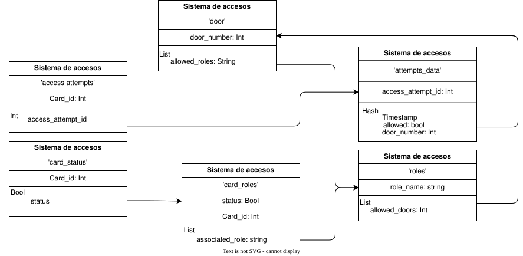

> **Corrección del diseño**: (**Validar**) Me dijeron que conviene tener un único camino de entrada a un diccionario, incluso aunque existieran varios, como en este caso que tanto de `'door'` como de `'card_roles'` podés acceder a `'roles'`, conviene solo poner un camino en el diagrama. Esto se debe a que querés evitar inconsistencias, por ejemplo en este caso podrías tener una puerta que tenga roles a los que les permite pasar por ella pero que ella no esté entre las puertas permitidas para ese rol. Respecto a la flecha de `'attempts_data'` hacia `'door'` no es necesaria porque solo te permitiría saber qué roles tenían permitido pasar por esa puerta, pero eso ya lo podés saber con el camino de `'card_status'` → `'card_roles'` → `'roles'`.

> **Duda:** ¿Qué me garantiza que haya consistencia entre la lista de roles permitidos de `'door'` y la de puertas permitidas de `'roles'`? ¿Y que `door_number` del diccionario `attempts_data` sea sobre una puerta de `'door'`?¿Y qué el valor de `allowed` sea coherente con el rol de la tarjeta y la puerta por la que se intentó pasar? RTA: Nada te lo garantiza y tampoco te importa porque en NoSQL no tenes consistencia fuerte sino eventual.

<ins>***Idea del diseño:***</ins>

- Tenemos un diccionario *card_status* que dado el identificador de una tarjeta nos dice si está activa o no.
- Un diccionario *card_roles* que dado el estado de una tarjeta y su identificador da una lista de los roles asociados a ella.
- El diccionario *roles* que dado el nombre del rol retorna una lista con las puertas a las que puede acceder.
- Un diccionario *access_attempts* que dado un identificador retorna el identificador del intento de acceso para acceder al diccionario con la información específica.
- El diccionario con los intentos de accesos *attempts_data* que contiene la información detallada del intento, como en qué momento fue (*timestamp*), en qué puerta (*door_number*) y si fue concedido o no (*allowed*).
- Finalmente está el diccionario con las puertas, el cual usa como clave el número identificador de la puerta y retorna una lista con los roles que pueden accederla.

> ¿Cuando usar hash y cuando list?: **RTA:** Si es una cantidad que puede variar de elementos del mismo tipo entonces usás list. Si es una cantidad fija, de distinto tipo, como un struct de C, usás hash.

> **Duda** ¿Se pueden anidar, tipo en la caja del valor poner List Hash role: string, id: Int o esos ya es un indicador de que hay algo del diseño que va mal? ¿En qué casos usaría un JSON?

#### Base de datos *document-based*

> Generalmente te van a dar un DER y sobre ese generás tu DID.

**DER:** Sobre este vamos a partir para realizar el **DID**.
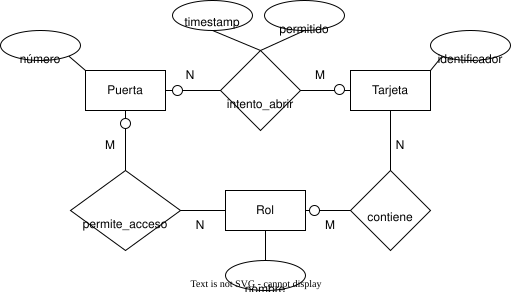

Una variante sería en vez de tener el atributo `permitido` que sería un *bool* que indica si el acceso fue permitido o no, tener 2 relaciones **M:N** una para `Intentos fallidos` y otra para `Intentos exitosos`, cada una con el atributo `timestamp` como atributo identificatorio.

**DID:**

*<ins>¿Qué información debería pasar a la *base de documentos* una vez que una persona con una tarjeta se retira y se saca su información de la base *key-value*?:</ins>*

- Puertas por las que pasó, junto con el timestamp.
- Puertas por las que intentó pasar, con su timestamp.
- El rol que tenía.

*<ins>Decisiones de diseño:</ins>*

- Como son todas relaciones M:N, debemos aplicar referenciación en ambos sentidos, pero eso no nos alcanza para lo que necesitamos, ya que en `puerta` sólo tendríamos el `identificador` de cada `tarjeta` que haya intentado acceder, sin saber cuándo ni si fue concedido o denegado el acceso.
- Como la cantidad de intentos de accesos a puertas puede llegar a ser enormemente grande a lo largo del tiempo, queremos tenerla en un documento aparte. Creamos un documento auxiliar llamado `accesos`.
- Como es más probable que dado un acceso se quiera saber también sobre qué puerta fue realizado o intentado, añado una referencia a `puerta` en el documento auxiliar.
- Utilizamos los atributos de la interrelación M:N (`timestamp` y `permitido`) en el documento.
- Nos interesa saber el rol que tiene una tarjeta al momento de consultar por ella pero como es una **M:N** tendremos una lista con las referencias de los `Rol` en `Tarjeta` y en `Rol` una lista con cada `identificador` de tarjeta con ese `Rol`.
- Con argumento similar, al consultar por una puerta nos interesa saber en la misma consulta cuáles roles tienen permitido su acceso, y por ser **M:N** entonces tendremos una lista con referencias a cada `Rol` que tiene permitido acceso, análogamente en cada `Rol` tendremos una lista con el número de cada `Puerta` por la que nos permite pasar.

> **Las interrelaciones M:N <ins>SIEMPRE</ins> se pasan a DID con doble referenciación.** (¿Sin excepción?) **RTA:** No necesariamente, en las diapositivas quedó expresado así, pero eso no significa que no sean válidas las incrustaciones o incrustación y referenciación.

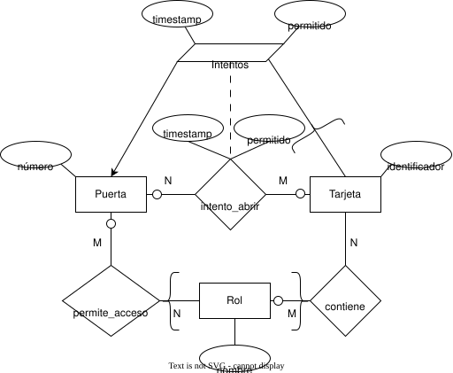

*<ins>¿Perdemos información al modelar los documentos?</ins>*

- Por el **documento auxiliar** seguimos teniendo los intentos exitosos y fallidos de ingresar por las puertas junto con el identificador de la tarjeta y el timestamp, por lo que podemos saber quién intentó ingresar por qué puerta, en qué momento y con qué resultado.
- Por la incrustación de los roles con permiso de pasar por cada puerta en las puertas, seguimos sabiendo qué roles pueden ingresar por cada una.
- Por la incrustación de los roles en la tarjeta sabemos qué roles tiene cada tarjeta.

> *¿Está bien lo de replicar los atributos?* Sí, en tu **DID** no vas a tener la relación que surge del M:N. Podés llevarte atributos de las entidades involucradas cuando hacés un documento auxiliar o agregar unos nuevos que consideres necesarios, incluso esos podrían ser claves.

- En el caso en que las tarjetas puedan ir cambiando de rol y que estos no estén fijados para cada tarjeta, entonces me interesaría saber qué rol tuvo una tarjeta en un intervalo de tiempo. Para eso podría añadir otro documento auxiliar que se desprenda de la interrelación `contiene` con atributos <ins>nombre del rol</ins>, <ins>identificador de la tarjeta</ins>, <ins>timestamp retiro de la tarjeta</ins> y <ins>timestamp devolución de la tarjeta</ins>.

> La consigna se refería a que se quiere pasar la misma información que se tenía en la base key value a una de documentos una vez se desactiva la tarjeta, entonces ¿no nos interesaría también saber quién la tenía y con qué rol? en el enunciado no se habla de asociar personas a las tarjetas, como que le da igual ese dato y solo quiere llevar registro de qué tarjeta quiso pasar por tal puerta y si tenía permiso o no. Quizás asociar personar a tarjetas sería una extensión del enunciado posible, habría que añadir una entidad persona, una interrelación con tarjeta que podría ser M:N y de ella sacar un documento auxiliar para guardar esa información.

### Ejercicio 2.7

#### Item *Document based*

<ins>**Consideraciones de diseño:**</ins>

- *"Cuando se consulta una reserva se necesita conocer el detalle de la habitación reservada, los datos del cliente que hizo la reserva y, eventualmente, la lista de pasajeros"*:
    - Como solo *eventualmente* (y no inmediatamente) necesito la lista de pasajeros, que también son clientes, entonces puedo tener una lista de referencias a ellos.
    -   Como necesito conocer el detalle de la habitación reservada al momento de la consulta de la `reserva`, entonces hago una incrustación de esta en la `reserva`. Lo mismo para los datos del `cliente` que hizo la reserva, entonces la incrusto en el documento de `reserva`.
- *"El precio de la habitación puede cambiar con el tiempo, por lo que se necesita saber a qué precio se reservó la habitación en su momento"*:
    - Entonces no puedo incrustar el `precio` de la `habitación` en el documento de `reserva`, por lo que solo incrusto el `número` y la `categoría`.
    - Creamos un **documento auxiliar** para los precios por reserva.
        - Le incrustamos el atributo `precio` de la entidad `habitación`.
        - ~~Le ponemos como clave el `idReserva` para indicar que se van a diferenciar por ese valor, ya que solo puede tener un precio, y no varios, la habitación en una reserva específica.~~ Ponemos en ese documento auxiliar una referencia a la `reserva`, por lo que tendrá entre sus propiedades el `idReserva`. Así al utilizarlo y querer saber con qué precio se hizo una reserva en particular, podemos acceder al documento que tenga su `idReserva`.
        > Consultar sobre el siguiente razonamiento:
        - Como puede que los precios varien mucho y ese documento auxiliar crezca mucho, entonces:
            - No me conviene incrustarlo, además que a cada reserva le importa solo su precio.
            - Si hago que `reserva` referencie al documento auxiliar, entonces voy a tener dos campos con la misma información, ya que el documento auxiliar lo pensé para que utilice `idReserva` como clave.
            > ¿Puedo agregar en un documento auxiliar un atributo que no esté en ninguna de las entidades con las que se lo relaciona? Sí, incluso puede ser clave.
            - Entonces propongo que el documento auxiliar sea el que referencie a `reserva`, así incorpora su `idReserva`, que será utilizado como clave en él y evitamos que quede repetido. Para eso cada vez que se quisiera saber con qué precio se hizo una reserva se debe buscar en el documento auxiliar la entrada con el `idReserva`.
    - **A la relación `Se aloja` aplicamos las referencia en ambos lados por ser M:N**.

> En el ejemplo del apunte de mediciones termina eliminando `mediciones` ¿es porque es debil o hay otra razón?. Solo las débiles y generalmente las eliminamos porque si ya la incrustaste no te hace falta.

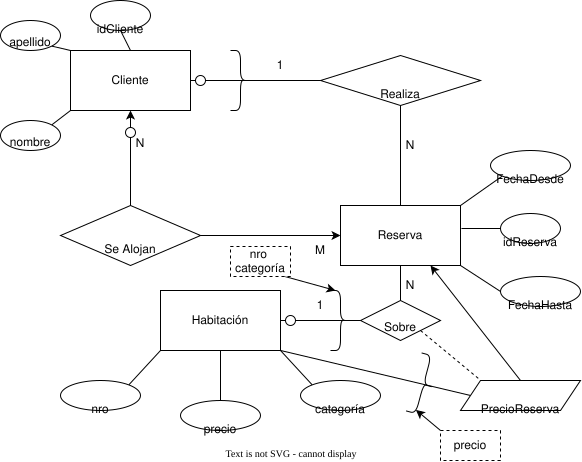

**corregir: no hace falta el documento auxiliar, incrustando también el precio ya te aseguras para cada reserva tener el precio de esa habitación en ese momento, ya que al crear la reserva te traes su precio en ese momento por la incrustación y si en un futuro lo cambias, ese no va a cambiar en las reservas que ya se hicieron a menos que lo hagas vos manualmente como programador.**

<ins>**JSONSchema** asociado</ins>

**Al hacer los JSONSchema te vas a dar cuenta de si te está faltando información que sí tenías en el DER. Chequear que con los JSONSchemas tenga representada la información de cada cosa del DER, es decir de sus otras interrelaciones también**.

Realizamos uno para cada documento:

- Para **Cliente**:

    ```JSON
    "Cliente": {
        "type": "object",
        "properties": {
            "idCliente": {"type": "integer"},
            "apellido": {"type": "string"},
            "nombre": {"type": "string"},
            "seAlojan": {"type": "array", "items": {"type": "integer"}}
        },
        "additionalProperties": {"value": "false"}, //Lo pongo por seguridad,
        "required": ["idCliente"] //Pongo la clave en required
    }
    ```

- Para **Habitación**:

    ```JSON
    "Habitación": {
        "type": "object",
        "properties": {
            "nro": {"type": "integer"},
            "precio": {"type": "number", "minimum": 0},
            "categoria": {"type": "string"}
        },
    "additionalProperties": {"value": "false"}, //Lo pongo por seguridad,
    "required": ["nro"] //Pongo la clave en required
    }
    ```

- Para **Reserva**:

    ```JSON
    "Reserva": {
        "type": "object",
        "properties": {
            "FechaDesde": {"type": "string", "format": "date-time"},
            "idReserva": {"type": "integer"},
            "FechaHasta": {"type": "string", "format": "date-time"},
            "seAlojan": {"type": "array", "items":{"type": "integer"}},
            "Habitacion": {"type": "object",
                "properties": {
                    "nro": {"type": "integer"},
                    "categoria": {"type": "string"}
                },
                "additionalProperties": {"value": "false"},
                "required": ["nro"]
                },
            "Cliente": {"type": "object", 
                "properties": {
                    "idCliente": {"type": "integer"},
                    "nombre": {"type": "string"},
                    "apellido": {"type": "string"}
                },
                "additionalProperties": {"value": "false"},
                "required": ["idCliente"]
            }
        },
    "additionalProperties": {"value": "false"}, //Lo pongo por seguridad,
    "required": ["idReserva"] //Pongo la clave en required
    }
    ```

- Para **PrecioReserva, *documento auxiliar***:

```JSON
   "PrecioReserva": {
        "type": "object",
        "properties": {
            "precio": {"type": "number", "minimum": 0},
            "idReserva": {"type": "integer"}
        },
        "additionalProperties": {"value": "false"},
        "required": ["idReserva"]
   } 
```

#### Item *column family*

*"Se pide que realice el diseño (utilizando el diagrama *Chebotko*) para una base de datos *Column-Family* tal que responda la siguiente consulta: 'Los datos de las habitaciones que para una fecha dada comienzan una reserva en esa fecha ordenadas por precio descendente'"*

**MR1:** ¿Qué información nos interesa retornar con la consulta?
    - nro (Habitación).
    - precio (Habitación).
    - categoría (Habitación).
    - FechaDesde (Reserva), este es opcional.
    - FechaHasta (Reserva).

**MR2:** ¿Es una consulta por igualdad de atributos? No, entonces agrego dummy como *partition key (K)*.

**MR3:** ¿Es una consulta por desigualdad de atributos? Sí, las que tengan FechaDesde mayores a una fecha dada. $\therefore$ Agrego FechaDesde como *cluster key (C↓)*, con orden descendente.

**MR4:** ¿Importa el orden? Sí, queremos orden descendente por precio, entonces añado orden como *cluster key (C↑)*.

**MR5:** ¿Alcanza con la *partition key (K)* para identificar unívocamente estos datos del item **MR1**? No, entonces agrego nro (me permite identificar unívocamente precio, categoría y a sí mismo), idReserva (me permite identificar unívocamente FechaDesde y FechaHasta) como *cluster key (C)*, con un orden cualquiera.

**¿Alguno de los atributos de MR1 tiene como clave de su entidad a la *partition key (K)*?** No, por lo tanto no hay ninguna *static column (S)*.

Finalmente nos queda la siguiente tabla:

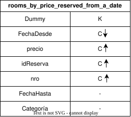

#### Item *key-value*

"Diseñe una base clave-valor para poder consultar si *hay alguna habitación de una categoría dada reservada en una fecha*. Es decir se debe saber las habitaciones de una categoría y si esa habitación esta reservada en una fecha dada."

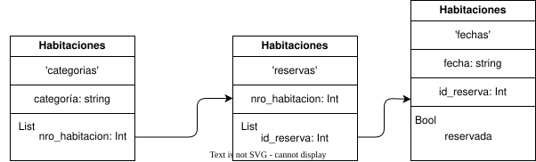

> **Consultar**: Me hace ruido tener un diccionario con fecha y id_reserva como claves y que me retorne un bool. Eso me hace tener que poner agregar $n$ elementos para cada reserva de esa habitación de $n$ días.

**Corregir: Cuando tenés una flecha en un diagrama key value, esa flecha representa que con lo que está en el origen de esa flecha es la clave total y no parcial del otro diccionario. Acá deberías Una vez entras en la reservas, chequear una por una si es de la fecha dada. Que algo sea parte del input de la consulta no significa que deba serlo en tu base key-value.**

### Ejercicio 2.8

**DER enunciado**:

[DER del enunciado](./images/ej2.8.der.drawio.svg)


#### Item *document based*

**Revisar no perder info del DER: En este caso de los blogs en el artículo**. Rehacer todos los ejercicios chequeando eso. Acá te está faltando info del DER en los JSONs, por ejemplo incrustar las jerarquías, etc.

<ins>**Consideraciones de diseño:**</ins>

- *"Se quiere particionar las actividades por Fecha para cada usuario, es decir, acceder en una única consulta para un usuario y fecha a todas las actividades correspondientes"*:
  - Como me dice *en una única consulta para un usuario y fecha*, me sirve una incrustación ya que debería filtrar por fecha o usuario, dependiendo de cuál incruste.
  - Una referenciación me impide poderlo responder en una sola consulta.
  - Propongo crear un documento auxiliar que se desprenda de la interrelación `Realiza` y que contenga como claves `idUsuario` y `Fecha` provenientes de las entidades `Usuario` y `Actividad`.
  - Respecto a los demás atributos:
    - Podría agregar como atributo unicamente el `ID` de la `Actividad` y para acceder a los datos de la actividad como `Hora` tener que recurrir a la relación `Actividad`.
    - O bien podría agregar `ID` y `Hora` como atributos del documento auxiliar.
- *"Para el caso de los artículos se quiere mostrar todas las actividades sobre él cada vez que se accede al mismo independientemente de la fecha"*:
  - Como se quiere saber todas las actividades sobre el artículo cada vez que se accede al mismo, entonces debo aplicar una *incrustación* de `actividad` en `artículo`.
  - Si independientemente de la fecha se refiere a que no le interesa la fecha de la actividad, entonces:
    -  Si tampoco le interesa la hora, solo hago una referenciación de `Actividad` en `Artículo`.
    -  Si le interesa la hora, hago una incrustación de ella con el `ID` en `Artículo`.
  - Si se refiere a que quiere tener todas las actividades, sin importar de qué fecha sean (creo que esto es a lo que se refiere), entonces hago una incrustación de `Actividad` en `Artículo`.

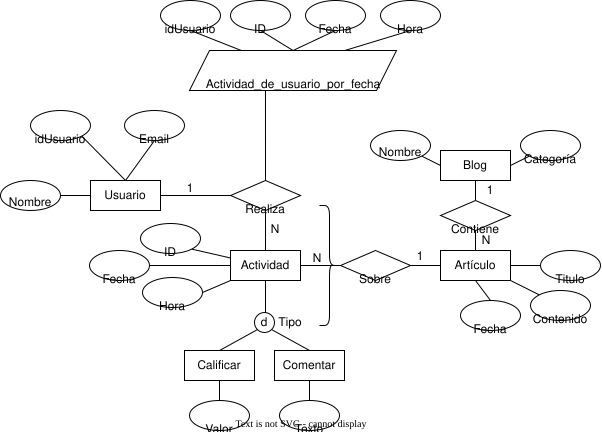

**JSONSchema:**

- Para `Usuario`:

```JSON
"Usuario":{
    "type": "object",
    "properties": {
        "idUsuario": {
            "type": "integer",
        },
        "email": {
            "type": "string",
            "format": "email"
        },
        "nombre": {
            "type": "string"
        }
    },
    "additionalProperties": {"value": False}, 
    "required": ["idUsuario"]
}
```

- Para `Actividad`:

```JSON
"Actividad":{
    "type": "object",
    "properties": {
        "ID": {
            "type": "integer",
        },
        "fecha": {
            "type": "string",
            "format": "date-time"
        },
        "hora": {
            "type": "string",
            "format": "date-time"
        }
    },
    "additionalProperties": {"value": False}, 
    "required": ["ID"]
}
```

- Para `Blog`:

```JSON
"Blog":{
    "type": "object",
    "properties": {
        "nombre": {
            "type": "string",
        },
        "categoria": {
            "type": "string"
        }
    },
    "additionalProperties": {"value": False}, 
    "required": ["nombre"]
}
```

- Para `Artículo`, donde incrustamos `Actividad`:

```JSON
"Artículo":{
    "type": "object",
    "properties": {
        "titulo": {
            "type": "string",
        },
        "contenido": {
            "type": "string"
        },
        "fecha": {
            "type": "string",
            "format": "date-time"
        },
        "actividad": {
            "type": "array",
            "items": {
                "type": "object",
                "properties": {
                    "ID": {
                    "type": "integer",
                },
                "fecha": {
                    "type": "string",
                    "format": "date-time"
                },
                "hora": {
                    "type": "string",
                    "format": "date-time"
                }
            },
            "additionalProperties": {"value": False}, 
            "required": ["ID"]
            }
        }
    },
    "additionalProperties": {"value": False}, 
    "required": ["nombre"]
}
```

- Para `Calificar`:

```JSON
"Calificar":{
    "type": "object",
    "properties": {
        "valor": {"type": "integer", "minimum": 0, "maximum": 10}
    },
    "additionalProperties": {"valor": False}
}
```

- Para `Comentar`:

```JSON
"Comentar":{
    "type": "object",
    "properties": {
        "texto": {"type": "string"}
    },
    "additionalProperties": {"valor": False}
}
```

- Para el documento auxiliar `Actividad_de_usuario_por_fecha`:

```JSON
"Actividad_de_usuario_por_fecha": {
    "type": "object",
    "properties": {
        "idUsuario": {"type": "integer"},
        "ID": {"type": "integer"},
        "Fecha": {"type": "string", "format": "date-time"},
        "Hora": {"type": "string", "format": "date-time"}
    },
    "additionalProperties": {"value": False},
    "required": ["idUsuario", "ID"]
}
```

#### Item *column-family*

*"Se pide diseño para base de datos column-family tal que responda las siguientes consultas"*:

  - *1) "Todos los artículos (título y contenido) de un Blog dado para una Fecha dada".*

  - *2) "Todos los comentarios de un usuario en un rango de fechas".*

*<ins>Seguimos los pasos de Chebotko:</ins>*

<ins>Una tabla por cada consulta.</ins>

**Para consulta 1):**

**MR1:** ¿Qué información me interesa retornar con la respuesta? `Título` y `Contenido`.

**MR2:** ¿Es una búsqueda por igualdad y, en ese caso, sobre qué atributos? Sí, es busqueda por igualdad sobre `Fecha` del artículo y sobre `Nombre` del blog. $\therefore$ Los agrego como *partition key (K)*.

**MR3:** ¿Es una búsqueda por desigualdad, y en dicho caso, sobre qué atributos? No.

**MR4:** ¿Nos piden un orden específico? No.

**MR5:** ¿Nos alcanza con los atributos *partition key (K)* para determinar univocamente todos los demás atributos? No, necesito `Título` para determinar univocamente `Contenido` así que lo agrego como *cluster key (C)* con un orden cualquiera.

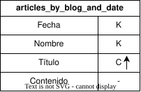

**Para consulta 2):**

**MR1:** ¿Qué información nos piden retornar? `Texto` de comentarios.

**MR2:** ¿Es una búsqueda por igualdad sobre un atributo? Sí, sobre `idUsuario`, entonces lo agrego como *partition key (K)*.

**MR3:** ¿Es una búsqueda por desigualdad sobre un atributo? También, sobre `Fecha` de actividad, entonces la agrego como *cluster key (C)*. No me aclaran un orden entonces elijo descendente *(C↓)*.

**MR4:** ¿Nos piden un orden? No.

**MR5:** ¿Nos alcanza con los atributos que tenemos para tener una clave que identifique univocamente? No, tenemos que agregar `ID` de la actividad para determinar univocamente el `Texto`. Entonces lo agregamos como *cluster key (C)* con un orden cualquiera.

**¿Algún atributo depende de una *partition key (K)*?, de ser así lo marco como *static column (S)***. No.

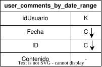

### Ejercicio 2.9

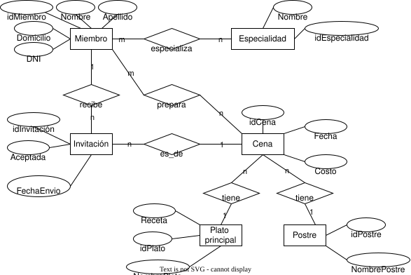

#### Item *document based*

- *"La impresión de invitaciones es una de las tareas más frecuentes. En las mismas se imprime toda la info de la cena incluyendo los nombres de platos/postres."*
  - Hago una incrustación de `NombrePlato` y `NombrePostre` en `Cena`, así en una sola consulta se puede obtener todo lo necesario para las invitaciones.
- *"Ocasionalmente se consultan miembros de alguna especialidad, pero no es algo que se haga muy seguido".*
  - Como solo se los consulta ocasionalmente, puedo referenciarlos en `Especialidad` y que solo cuando se los necesite se pueda acceder a ellos, en vez de obtenerlos con cada consulta.
- *"Es frecuente consultar las fechas en las cuales un miembro organizó cenas".*
  - Se me ocurren dos opciones:
    - Incrustar un arreglo de los atributos `Fecha` de la entidad `Cena` en `Miembro`.
    - Crear un documento auxiliar `Cenas_de_miembro` con `idMiembro`, `idCena` como claves y `Fecha` como atributo (en caso de que un miembro solo pueda realizar una cena en una fecha entonces podría sacar `idCena` y dejar `Fecha` con `idMiembro` como claves).
  - Como no se me indica que la cantidad de cenas organizadas por un miembro quede enormemente, entonces puedo usar la incrustación.

> Consultar: ¿Conviene una u otra? ¿Hay info en el enunciado que no estoy viendo?.

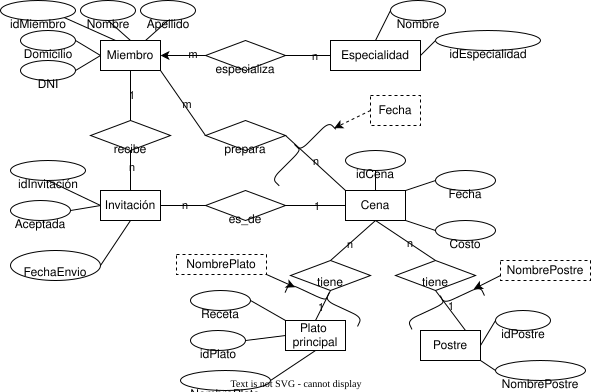

**JSONSchema**:

- Para `Miembro`:

```JSON
"Miembro":{
    "type": "object",
    "properties": {
        "idMiembro":{"type": "integer"},
        "domicilio":{"type": "string"},
        "DNI":{"type": "integer"},
        "Nombre":{"type": "string"},
        "Apellido":{"type": "string"},
        "fecha_cenas": {"type": "array", "items": {"type": "string", "format": "date-time"}} 
    },
    "additionalProperties": {"value": False},
    "required": ["idMiembro"]
}
```

- Para `Especialidad`:

```JSON
"Especialidad":{
    "type": "object",
    "properties": {
        "idEspecialidad":{"type": "integer"},
        "nombre":{"type": "string"},
        "miembros": {"type": "array", 
            "items": {"type": "integer"}
        }
    },
    "additionalProperties": {"value": False},
    "required": ["idEspecialidad"]
}
```

- Para `Cena`:

```JSON
"Cena":{
    "type": "object",
    "properties": {
        "idCena":{"type": "integer"},
        "fecha":{"type": "string", "format": "date-time"},
        "costo":{"type": "integer", "minimum": 0},
        "NombrePostre":{"type": "string"},
        "NombrePlato":{"type": "string"}
    },
    "additionalProperties": {"value": False},
    "required": ["idCena"]
}
```

#### Item *column-family*

**Recordar: Chebotko, una tabla por consulta.**

- *1) "Nombres y apellidos de los miembros invitados a una cena"*.

**MR1:** ¿Qué información queremos retornar con la consulta? `Nombre` y `Apellido` del `Miembro`.

**MR2:** ¿Filtramos por igualdad sobre algún/os atributo/s?, de ser así, lo/s agregamos como *partition key (K)* Sí, por `idCena`.

**MR3:** ¿Filtramos por desigualdad sobre algún/os atributo/s?, de ser así, lo/s agregamos como *cluster key (C)* con orden conveniente. No.

**MR4:** ¿Nos piden algún orden?, de ser así, agregamos dicho/s atributo/s como *cluster key (C)* con el orden. No.

**MR5:** ¿Alcanza con lo que tenemos para identificar unívocamente a todos los atributos?, sino agregamos lo necesario como *cluster key (C)* con un orden cualquiera. Debemos agregar `idMiembro` ya que podemos tener varios con el mismo `Nombre` y `Apellido`.

**Algún atributo es de una entidad que tenga como clave a la *partition key (K)*, de ser así ese es una *static column(S)***. No.

<ins>*Diagrama de *Chebotko**</ins>

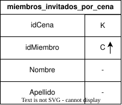

- *2) "Todas las cenas preparadas por un miembro dado desde el año 2015, ordenadas por costo de menor a mayor"*.

<ins>*Diagrama de *Chebotko**</ins>

**MR1:** ¿Qué información queremos retornar con la consulta? `idCena` y `Costo` del `Fecha`.

**MR2:** ¿Filtramos por igualdad sobre algún/os atributo/s?, de ser así, lo/s agregamos como *partition key (K)* Sí, por `idMiembro`.

**MR3:** ¿Filtramos por desigualdad sobre algún/os atributo/s?, de ser así, lo/s agregamos como *cluster key (C)* con orden conveniente. Sí, sobre `Fecha` de `Cena`, el orden depende de si lleva mucho tiempo activo el club o no, en dicho caso nos conviene orden descendente. En cambio si inició más cerca del 2015 que de la actualidad, nos conviene ascendente. Como no aclaran elijo uno cualquiera.

**MR4:** ¿Nos piden algún orden?, de ser así, agregamos dicho/s atributo/s como *cluster key (C)* con el orden. Sí, por `Costo` en orden ascendente.

**MR5:** ¿Alcanza con lo que tenemos para identificar unívocamente a todos los atributos?, sino agregamos lo necesario como *cluster key (C)* con un orden cualquiera. Debemos agregar `idCena` ya que podemos tener varias cenas en una misma fecha y con un mismo costo.

**Algún atributo es de una entidad que tenga como clave a la *partition key (K)*, de ser así ese es una *static column(S)***. No.

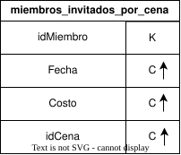

#### Item *key-value*

*"Realizar el diseño para una base de datos Key-Value que permita guardar y consultar la información de miembros (según DER). La aplicación que usaría la base de datos ingresa con el DNI del miembro y una password. Inmediatamente ve sus datos y su especialidad. Luego tiene dos opciones: consultar sus invitaciones o las cenas que preparó".*

<ins>**Consideraciones del diseño:**</ins>

- *"La aplicación que usaría la base de datos ingresa con el DNI del miembro y una password."*:
  - Esto me indica que necesito un diccionario que dado `password` y `DNI` me retorne el `idMiembro`.
- *"Inmediatamente ve sus datos y su especialidad."*:
  - Entonces con el `idMiembro` debo poder acceder a un diccionario, pongamosle la constante `user_data`, que me retorna un hash con sus datos (`Nombre`, `Apellido`, `Domicilio`, `DNI`), y a otro, pongamosle como constante `especialidad` que me retorne el `idEspecialidad`, luego con eso podría acceder a otro para obtener el `Nombre` de la especialidad.
- *"Luego tiene dos opciones: consultar sus invitaciones o las cenas que preparó".*:
  - Puedo tener un diccionario para cada una, al cual acceda mediante `idMiembro`:
    - El primero que me retorne una lista de `idInvitación` con los que pueda acceder a otro con la información propia de la invitación como `FechaEnvio`, `Aceptada`.
    - El segundo que me retorne una lista de `idCena` con los que pueda acceder a otro diccionario con la información propia de la cena como `Fecha`, `Costo`.

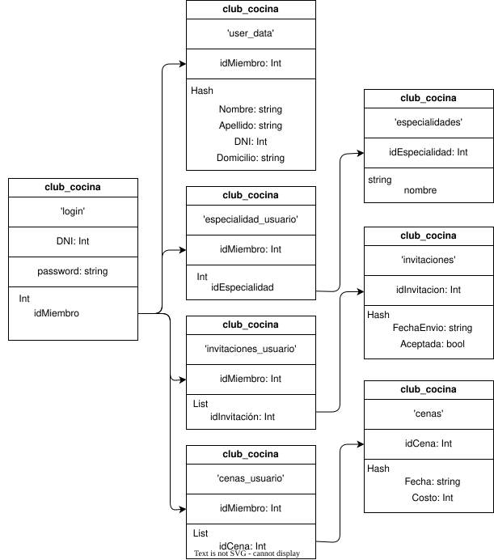

### Ejercicio 2.10

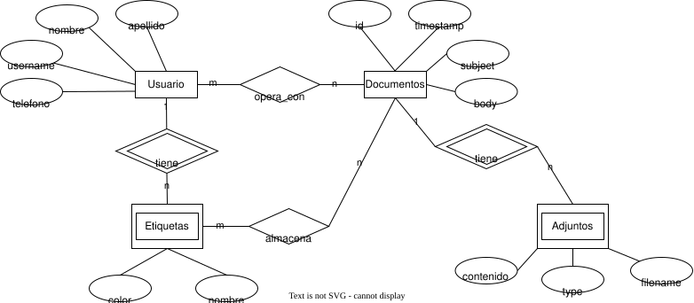

#### Item a) *document based*

- *"Cuando el usuario entra al sistema debe poder ver rápidamente una lista de los documentos con los que opera (subject, fecha y etiquetas asignadas a ellos por él) ordenados por fecha"*.
  - Incrusto la etiquetas asignadas a los `Documentos` por el `Usuario`.
  - Incrusto los `Documentos` en `Usuario` para que pueda acceder rápidamente a ellos.
  - **Ojo, si incrusto todo, la doble incrustación contiene información redudante, por ejemplo tendríamos en nombre y apellido repetidos en el JSONSchema del usuario**.
ˆ- *"Al acceder a un documento es importante contar con todos los adjuntos disponibles"*.
  - Incrustamos los `Adjuntos` en `Documentos` y eliminamos `Adjuntos`.
-ˆ *"Al visualizar un documento debe poder verse los nombres de los usuarios que operan con él"*.
  - Incrustamos en `Documentos` los atributos `nombre`, y `apellido` del `Usuario`.

> **Consultar: No me cierra la doble incrustación**.

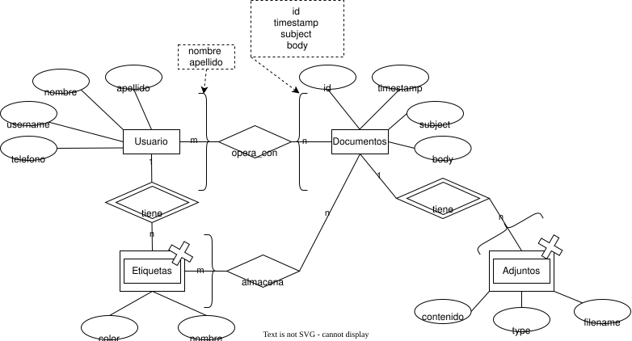

**<ins>JSONSchema de los tengan al menos un nivel de anidamiento:</ins>**

- Para `Documentos`:

```JSON
"Documentos":{
    "type": "object",
    "properties": {
        "id": {
            "type": "integer"
        },
        "timestamp": {
            "type": "string",
            "format": "date-time"
        },
        "subject": {
            "type": "string"
        },
        "body": {
            "type": "string"
        },
        "adjuntos": {
            "type": "array", 
            "items": {
                "type": "object",
                "properties": {
                    "type":      {"type": "string"},
                    "filename":  {"type": "string"},
                    "contenido": {"type": "string"}
                },
                "additionalProperties": {"value": False},
                "required": ["id"]
            }
        },
        "etiquetas": {
            "type": "object",
            "properties": {
                "nombre": {"type": "string"},
                "color": {"type": "string"}
            }
        },
        "usuario": {
            "type": "object",
            "properties": {
                "nombre": {"type": "string"},
                "apellido": {"type": "string"}
            }
        }
    }
}
```

- Para `Usuario`:

```JSON
"Usuario": {
    "type": "object",
    "properties": {
        "nombre": {"type": "string"},
        "apellido": {"type": "string"},
        "telefono": {"type": "integer"},
        "username": {"type": "string"},
        "documentos": {
            "type": "array",
            "items": {
                "type": "object", 
                "properties": {
                    "id": {"type": "integer"},
                    "timestamp": {"type": "string", "format": "date-time"},
                    "subject": {"type": "string"},
                    "body": {"type": "string"}
                },
                "additionalProperties": {"value": False},
                "required": ["id"],
            }
        }
    },
    "additionalProperties": {"value": False},
    "required": ["username"]
}
```

#### Item b) *column family*

- *1) "Todos los documentos de un usuario ordenados ascendentemente por timestamp"*.

<ins> **Diagrama Chebotko:** </ins>

**MR1:** ¿Qué información me interesa retornar con la consulta? La información de los documentos del usuario, por lo tanto `id`, `timestamp`, `subject`, `body`.

> **DUDA:** ¿También la de las entidades débiles asociadas?.

**MR2:** ¿Filtramos por igualdad en algún/os atributo/s? (de ser así ese/esos atributo/s son *partition key (K)*). Sí, por igualdad en el `username`.

**MR3:** ¿Filtramos por desigualdad en algún atributo? (de ser así lo incorporamos como *cluster key (C)* con un orden que nos convenga). No.

**MR4:** ¿Nos piden algún orden? Sí, ascendente por `timestamp`, entonces lo incorporamos como *cluster key (C)* con dicho orden.

**MR5:** ¿Nos alcanza con lo que tenemos para tener una clave de la tabla resultante? (de no ser así, añadimos los atributos necesarios como *cluster key (C)* con cualquier orden). Sí.

**¿Algún/os atributo/s depende totalmente de la *partition key (K)*? (de ser así, los marcamos como *static columns (S)**).

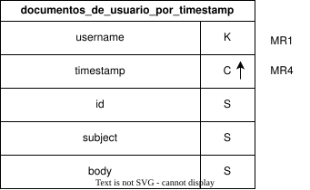

- *1) "Los nombres, apellidos y teléfonos de los usuarios que operan documentos generados en una fecha dada."*


**MR1:** ¿Qué información me interesa retornar con la consulta? La información de los documentos del usuario, por lo tanto `nombre`, `apellido` y `telefono`.

**MR2:** ¿Filtramos por igualdad en algún/os atributo/s? (de ser así ese/esos atributo/s son *partition key (K)*). Sí, por igualdad en el atributo `timestamp` del documento.

**MR3:** ¿Filtramos por desigualdad en algún atributo? (de ser así lo incorporamos como *cluster key (C)* con un orden que nos convenga). No.

**MR4:** ¿Nos piden algún orden? (de ser así lo incorporamos como *cluster key (C)* con dicho orden). No.

**MR5:** ¿Nos alcanza con lo que tenemos para tener una clave de la tabla resultante? (de no ser así, añadimos los atributos necesarios como *cluster key (C)* con cualquier orden). No, podemos tener varios documentos con un mismo `timestamp`, por lo que añadimos `id` del documento como *cluster key (C)*. También podemos tener varios usuarios que coincidan en `nombre`, `apellido` y `teléfono`.

**¿Algún/os atributo/s depende totalmente de la *partition key (K)*? (de ser así, los marcamos como *static columns (S)**).

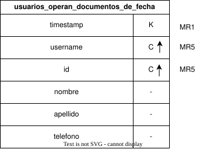

#### Item c) *key value*

- *"Realice un diseño Key-Value que permita guardar usuarios y documentos con sus etiquetas. Para los adjuntos sólo se necesita guardar el filename y el type. Considerar el username como inmutable."*

<ins>**Consideraciones del diseño:**</ins>

> **Consultar este último**.

- Dado el `username` y una `password` podemos obtener el `user_id` en el diccionario `login`.
- Con `user_id` y el `nombre_etiqueta` que introduzca el usuario podemos acceder a los `id` de los documentos bajo esa etiqueta del ese usuario.
- Con el `id` de los documentos y el `user_id` del usuario podemos obtener los demás datos del documento en el diccionario `documentos_usuario`, como subject, body y timestamp.
- Con el `id` del documento podemos acceder al diccionario `documentos_adjuntos` para obtener los `filename` de dichos documentos adjuntos, de los cuales solo nos interesa el `type`.
- Con el `filename` del documento adjunto y el `id` del documento que lo contiene adjunto podemos obtener el `type` del adjunto en el diccionario `tipos_de_adjuntos`.

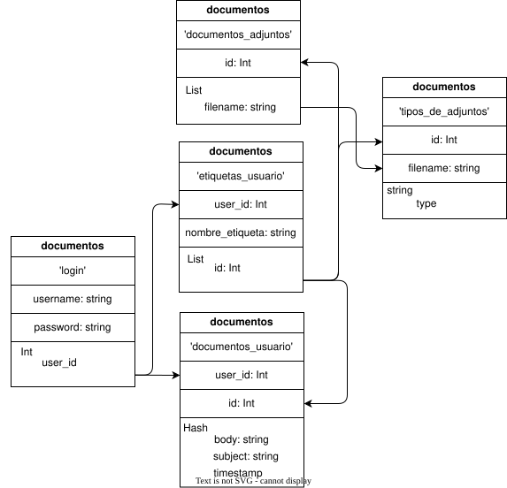